<div align="center">

# 🏛️ SÖL Wellness Sanctuary — Sports Center Management System (SCMS)

[](https://github.com/Agile4Life/SWP391/actions/workflows/pipeline.yml)


**Nền tảng quản trị trung tâm thể thao & chăm sóc sức khỏe (SWP391 Monorepo)**  
*Gói hội viên · Khóa học định kỳ · PT 1:1 & đặt sân · Check-in QR động · Bảo lưu có giấy tờ · Cửa hàng · Báo cáo doanh thu*

<br />

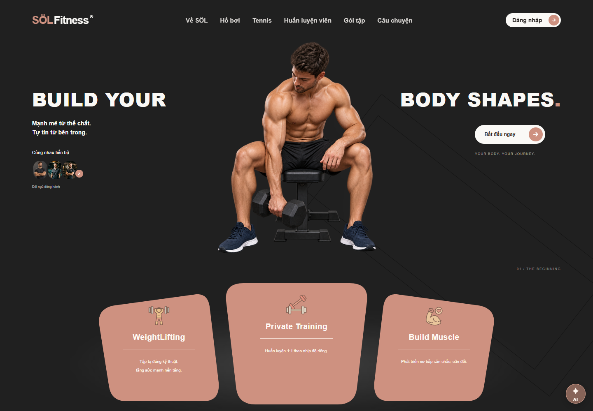

</div>

---

## ✨ Giới thiệu

**SCMS** là hệ thống vận hành trung tâm thể hình & wellness: cổng thông tin nhiều vai trò (**React + Vite + TypeScript**), **Spring Boot 3 REST API (Java 21)** và cơ sở dữ liệu **PostgreSQL** theo hướng **Hibernate Code-First** kèm **trigger PostgreSQL** bảo vệ các ràng buộc nghiệp vụ (sức chứa, trùng lịch).

| Chủ đề | Ở đâu |
| :--- | :--- |
| Một workflow GitHub Actions cho cả CI, Render/Vercel và VPS | [Pipeline](#-cicd--một-workflow-hai-đường-deploy), [CICD_SETUP.md](docs/CICD_SETUP.md) |
| Chạy web + API bằng Docker Compose trên VPS | [DOCKER_COMPOSE.md](docs/DOCKER_COMPOSE.md), [VPS_CICD_SETUP.md](docs/VPS_CICD_SETUP.md) |
| Cơ sở dữ liệu Supabase PostgreSQL (profile `supabase`, JDBC qua TLS) | [SUPABASE_SETUP.md](docs/SUPABASE_SETUP.md) |
| Quy tắc nghiệp vụ gói tập, khóa học, bảo lưu, điểm danh | [Business rules](docs/specs/2026-11-10-membership-and-attendance-business-rules.md), [Thiết kế quyền lợi gói](docs/superpowers/specs/2026-11-09-membership-benefits-design.md) |
| Hợp đồng API (OpenAPI) | [docs/api-contracts](docs/api-contracts) |

---

## 🎯 Tính năng chính

### Theo vai trò

| Vai trò | Việc chính |
| :--- | :--- |
| **Hội viên** | Mua, gia hạn, nâng cấp gói; đăng ký khóa học; đặt PT 1:1 và sân; thẻ hội viên với QR đổi mỗi 60 giây; xin bảo lưu kèm giấy tờ y tế; xem lịch tuần/tháng; chỉ số sức khỏe & tiến độ; mua sản phẩm |
| **Lễ tân** | POS và xác nhận thanh toán; duyệt hồ sơ định danh (KYC) và bảo lưu; cổng quét QR; đánh dấu có mặt buổi PT; đơn hàng và hỗ trợ |
| **Huấn luyện viên** | Lịch dạy, điểm danh lớp, đánh giá thể trạng lần đầu, giáo án, theo dõi học viên được phân công |
| **Quản lý trung tâm** | Tạo khóa học (lặp theo tuần hoặc tháng), danh mục gói/phòng/bộ môn, báo cáo doanh thu, duyệt đơn nội bộ, nhật ký kiểm toán |
| **Quản trị hệ thống** | Tài khoản và phân quyền |

### Gói hội viên

| | Silver | Gold | Platinum | Trial 3 ngày |
| :--- | :---: | :---: | :---: | :---: |
| Giá 1 tháng / 3 tháng | 199k / 549k | 299k / 799k | 599k / 1.599k | 0đ |
| Khóa học miễn phí (1 tháng / 3 tháng) | 1 / 3 | 2 / 6 | 4 / 12 | 0 |
| PT 1:1 mỗi 30 ngày | 0 | 3 | 6 | 1 |
| Đặt sân mỗi 30 ngày | 1 | 2 | 3 | 0 |
| Giảm giá PT thêm, học phí, shop | – | 10% | 20% | – |
| Phòng VIP | – | – | ✔ | – |
| Đánh giá thể trạng | lần đầu | + 1 lần mỗi chu kỳ | + Body Fat, Muscle Mass | như Gold |
| Bảo lưu (chỉ gói 3 tháng, Platinum 1 tháng) | 7 ngày | 15 ngày | 30 ngày (1 tháng: 7) | – |

Điểm cần nhớ:

- **Chu kỳ quyền lợi** là 30 ngày tính từ ngày bắt đầu gói; nâng cấp tiếp tục chu kỳ cũ, ngày bảo lưu không bị tính vào chu kỳ. Lượt không cộng dồn.
- **Khóa học** chỉ có dạng định kỳ (lặp theo tuần hoặc tháng), phải kết thúc trước ngày hết hạn gói, vắng không hoàn tiền hay dạy bù. Vắng quá 50% số buổi thì bị khóa đăng ký khóa mới 30 ngày.
- **Điểm danh:** quét cổng đúng khung giờ tự ghi có mặt buổi khóa và buổi PT; ai vào sớm rồi ở lại vẫn được tính; lượt vào quên checkout tự đóng sau 8 giờ.
- **Bảo lưu:** tối thiểu 3 ngày, nộp trước 24 giờ kèm giấy tờ y tế, mỗi gói một lần; lịch trong kỳ bảo lưu được giải phóng.
- **Định danh:** hồ sơ CCCD/hộ chiếu cần lễ tân duyệt trước khi mua gói đầu tiên; số giấy tờ lưu dạng mã hóa.

---

## 🖥️ Các màn hình chính

### 1. Trang chủ & Cổng đăng nhập (`/` & `/login`)

**Quy chuẩn thiết kế:** [DESIGN.md](DESIGN.md). Phần công khai dùng SÖL Fitness charcoal–salmon, bố cục full width và animation xuất hiện từng component khi cuộn dọc.

| Trang chủ (`/`) | Đăng nhập đa vai trò (`/login`) |
| :---: | :---: |
|  | 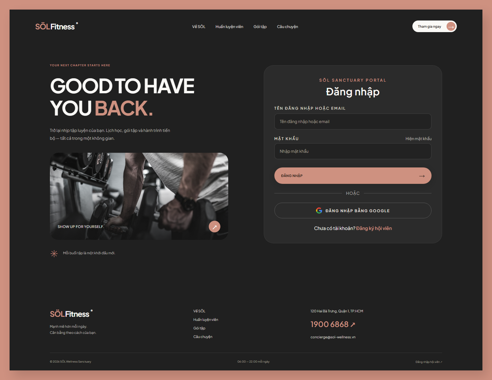 |

### 2. Hội viên — Member Portal (`/member/*`)

<p align="center">
  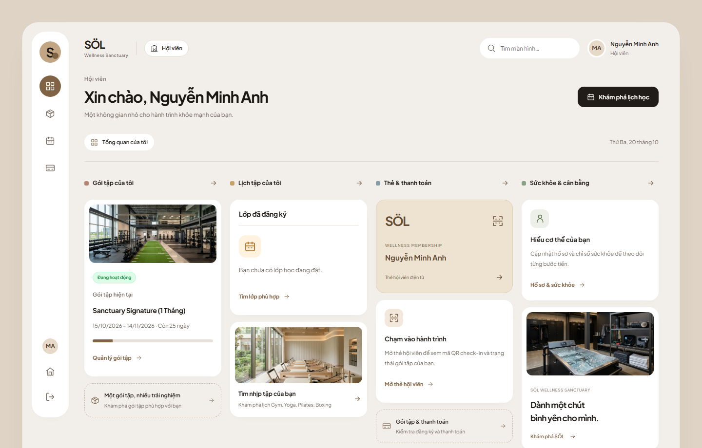
</p>

| 💳 Gói tập & thanh toán (`/member/packages`) | 📅 Lớp học & lịch của tôi (`/member/classes`) |
| :---: | :---: |
| 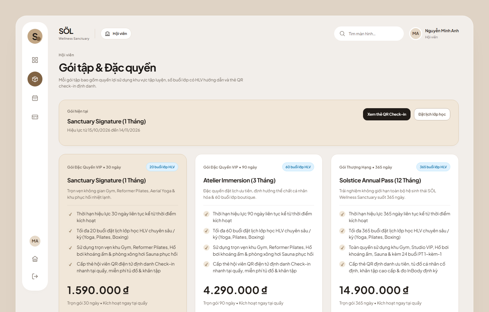 | 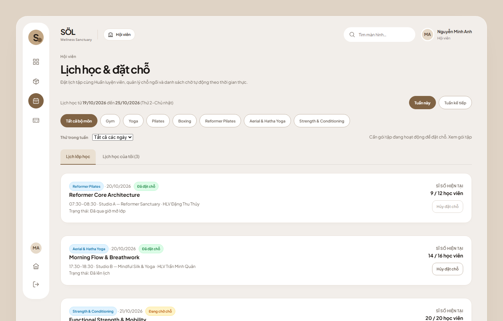 |

| 🪪 Thẻ hội viên & QR (`/member/card`) | 🧬 Hồ sơ & chỉ số sức khỏe (`/member/profile`) |
| :---: | :---: |
| 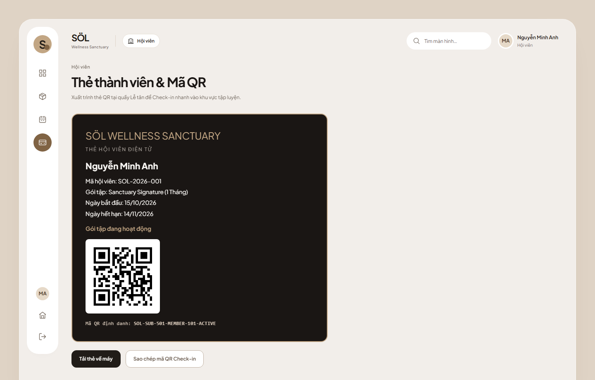 | 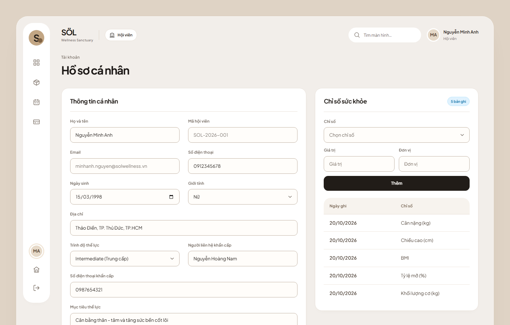 |

### 3. Lễ tân — Front Desk & POS (`/staff/*`)

| 🧾 Quầy POS & cấp gói (`/staff/reception`) | 🔍 Cổng quét QR (`/staff/check-in`) |
| :---: | :---: |
| 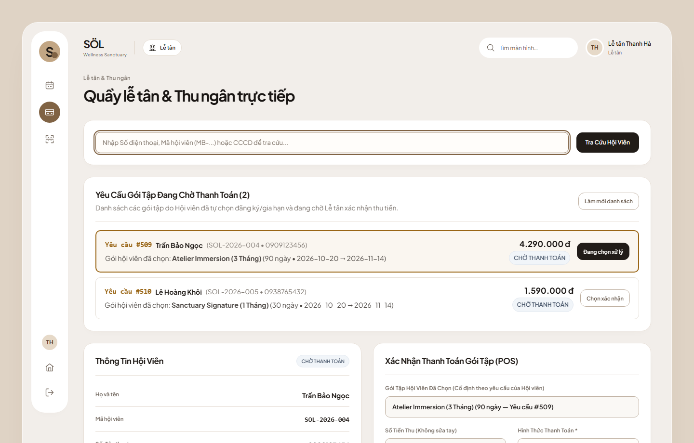 | 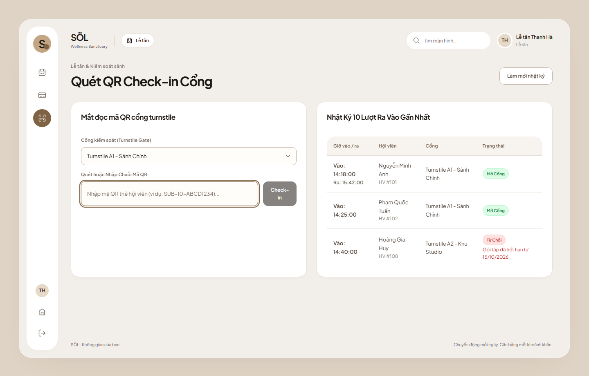 |

<p align="center">
  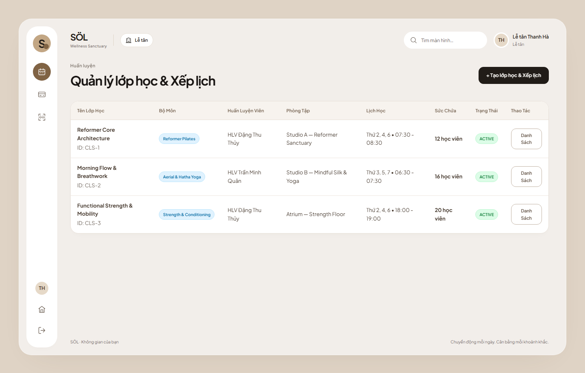
</p>

### 4. Huấn luyện viên (`/staff/attendance`)

<p align="center">
  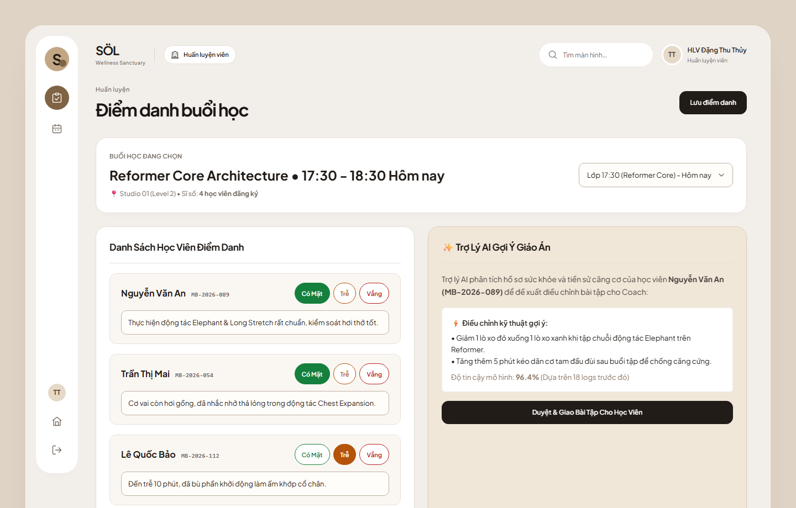
</p>

### 5. Quản lý trung tâm (`/manager/*`)

<p align="center">
  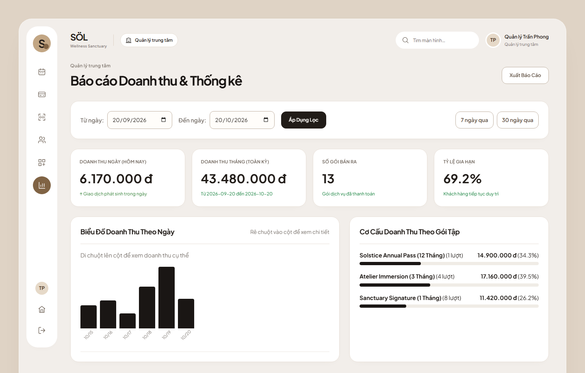
</p>

| 🗂️ Danh mục vận hành (`/manager/catalogs`) | 🔐 Tài khoản & phân quyền (`/manager/users`) |
| :---: | :---: |
| 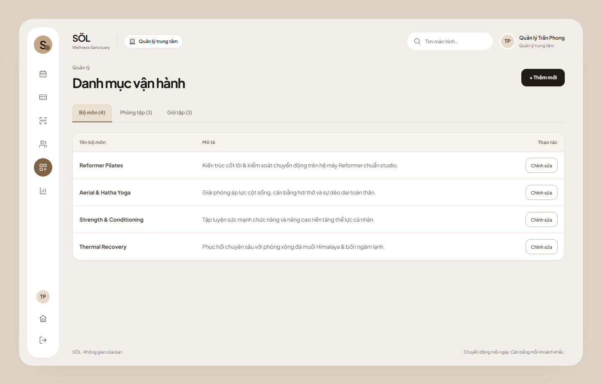 | 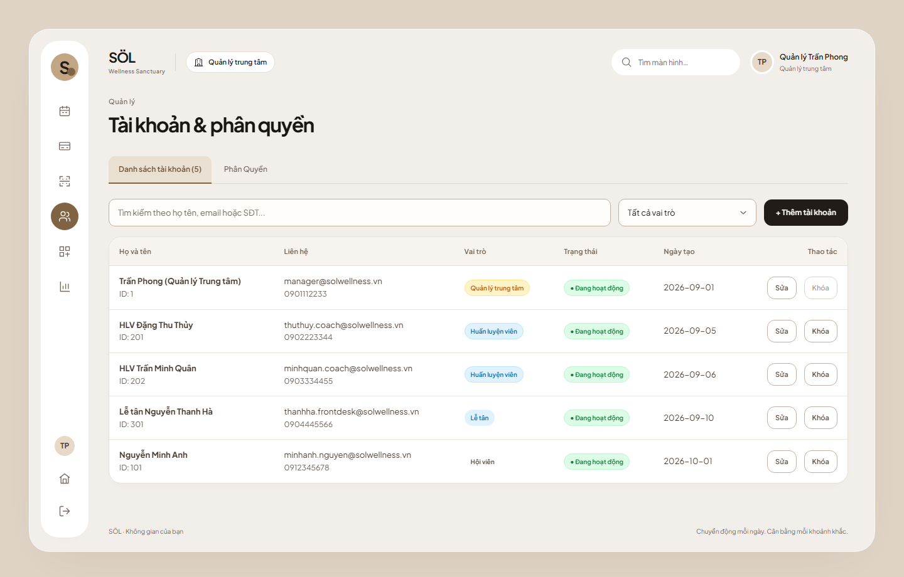 |

---

## 🏗️ Kiến trúc

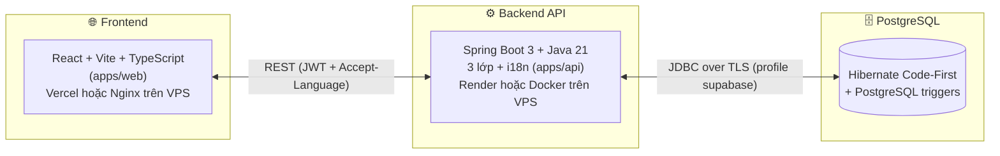

| Vòng đời tài khoản (`users.status`) | Vòng đời gói hội viên (`membership_subscriptions.status`) |
| :---: | :---: |
|  |  |

> [!IMPORTANT]
> **Bất biến kiến trúc dữ liệu:**
> - **Code-First:** bảng, cột, khóa định nghĩa bằng JPA Entity (`ddl-auto: update`). File SQL trong `db/` chỉ là tài liệu lịch sử, không dùng để triển khai.
> - **Trigger bắt buộc:** sức chứa lớp và chống trùng lịch nạp tự động qua `PostgreSqlTriggerProvider`.
> - **Chính sách database:** `DatabasePolicyTest`, `DatabaseProfilesTest` và `scripts/test-database-config.ps1` chỉ cho phép profile `supabase` (PostgreSQL).
> - **Đa ngôn ngữ:** `vi` (mặc định) và `en` qua `Accept-Language`; mọi thông báo mới phải có cả `messages_vi` và `messages_en`.
> - **Phân quyền ở backend:** ẩn menu ở frontend không phải là authorization.

---

## 🔄 CI/CD — một workflow, hai đường deploy

Toàn bộ kiểm tra và deploy nằm trong **một workflow** [`pipeline.yml`](.github/workflows/pipeline.yml), nên mở một lần chạy trong tab **Actions** là thấy cả hai đường deploy trên cùng một đồ thị:

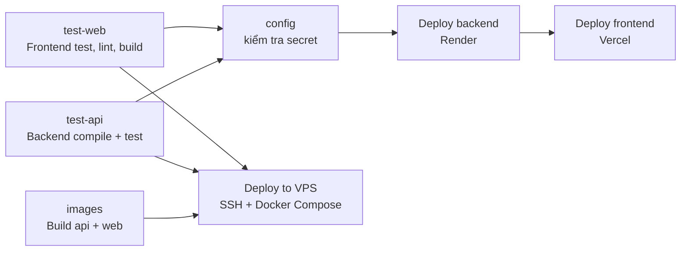

- **PR và `develop`:** chỉ chạy test và build image Docker, không deploy.
- **`main`:** thêm hai đường deploy. Render rồi Vercel (có health check và rollback); VPS qua SSH (`git merge --ff-only`, `docker compose up --wait`, health check, tự quay về commit cũ nếu lỗi). Thiếu secret của đường nào thì đường đó tự bỏ qua.
- **Run workflow** trong tab Actions để chạy lại commit mới nhất hoặc một commit chỉ định.
- Cấu hình secrets: [CICD_SETUP.md](docs/CICD_SETUP.md) (Render, Vercel), [DOCKER_COMPOSE.md](docs/DOCKER_COMPOSE.md) (VPS).

---

## 📂 Cấu trúc thư mục

```text
SWP391/
├── apps/
│   ├── api/        Spring Boot 3 REST API (Java 21, Maven, JPA/Hibernate, Security, i18n)
│   └── web/        React + Vite + TypeScript Web Portal (UI theo feature)
├── db/             Tài liệu cấu trúc dữ liệu lịch sử (chỉ tham chiếu)
├── docs/           Master guide, plans, specs, API contracts, diagrams, QA
├── scripts/        Chạy local (run-local, stop-local, init-db) và kiểm tra database
├── compose.yml     Docker Compose cho VPS (web + API)
└── .github/        workflows/pipeline.yml: CI + CD Render/Vercel + CD VPS
```

---

## 🚀 Chạy local

### Cách 1: một lệnh (Windows)
1. Chạy `npm start` (hoặc bấm đúp [`scripts/run-local.bat`](scripts/run-local.bat)).
2. Bộ chạy kiểm tra môi trường và cấu hình Supabase rồi khởi chạy **Web + API**; Hibernate tự tạo/cập nhật bảng và nạp trigger.
3. Dừng bằng `npm run stop`.

Chi tiết: [docs/LOCAL_DEV_GUIDE.md](docs/LOCAL_DEV_GUIDE.md).

### Cách 2: thủ công
1. Cài **Java 21+**, **Node.js 22**, chuẩn bị thông tin **Supabase PostgreSQL**.
2. Sao chép `.env.example` thành `.env` và điền theo [hướng dẫn Supabase](docs/SUPABASE_SETUP.md).
3. Backend:
   ```powershell
   cd apps/api
   .\mvnw.cmd spring-boot:run
   ```
4. Frontend:
   ```powershell
   cd apps/web
   npm install
   npm run dev
   ```

| Điểm truy cập | Địa chỉ |
| :--- | :--- |
| Web Portal | `http://localhost:5173` |
| API healthcheck | `http://localhost:8080/api/v1/health` |
| Swagger UI | `http://localhost:8080/swagger-ui/index.html` |

### Kiểm tra trước khi mở PR

```bash
npm --prefix apps/web test && npm --prefix apps/web run lint && npm --prefix apps/web run build
cd apps/api && ./mvnw test
```

Hai lệnh này giống các job `test-web` và `test-api` trong Pipeline.

---

## 📚 Tài liệu nhanh

| Tài liệu | Mô tả |
| :--- | :--- |
| [📘 PROJECT_MASTER_GUIDE.md](docs/PROJECT_MASTER_GUIDE.md) | Đặc tả nghiệp vụ tổng thể, vai trò và quy trình cốt lõi |
| [🧾 Business rules](docs/specs/2026-11-10-membership-and-attendance-business-rules.md) | Gói tập, khóa học, điểm danh, bảo lưu và QR cổng |
| [🎁 Quyền lợi gói](docs/superpowers/specs/2026-11-09-membership-benefits-design.md) | Thiết kế và trạng thái triển khai quyền lợi theo hạng |
| [🏛️ backend-architecture.md](docs/rules/backend-architecture.md) | Kiến trúc 3 lớp, SOLID, IoC, JPA |
| [☁️ SUPABASE_SETUP.md](docs/SUPABASE_SETUP.md) | JDBC TLS, RLS và schema test biệt lập |
| [🔄 CICD_SETUP.md](docs/CICD_SETUP.md) | Thiết lập Pipeline: Render, Vercel |
| [🐳 DOCKER_COMPOSE.md](docs/DOCKER_COMPOSE.md) | Chạy web + API bằng Docker Compose và deploy VPS |
| [📋 AGILE_SCRUM_JIRA_PLAN.md](docs/plans/AGILE_SCRUM_JIRA_PLAN.md) | Backlog, phân công màn hình, tiêu chí nghiệm thu |
| [🤖 AGENTS.md](AGENTS.md) | Quy tắc bắt buộc cho contributor và AI coding agent |

---

## 🤝 Quy ước làm việc

Xem [CONTRIBUTING.md](CONTRIBUTING.md) và [bản đồ cấu trúc repo](docs/architecture/REPOSITORY_STRUCTURE.md). Graphify là output local, không commit.

- Đọc [AGENTS.md](AGENTS.md), [backend-architecture.md](docs/rules/backend-architecture.md) và [AGILE_SCRUM_JIRA_PLAN.md](docs/plans/AGILE_SCRUM_JIRA_PLAN.md) trước khi nhận ticket; mỗi PR xử lý một Jira ticket, nhánh đặt theo `SCMS-123/short-description`.
- Đổi API thì cập nhật OpenAPI trong `docs/api-contracts/` cùng PR.
- Mọi thay đổi schema đi qua **JPA Entity**; trigger cập nhật qua `PostgreSqlTriggerProvider`.
- Thông báo hoặc mã lỗi mới ở backend phải có cả `messages_vi.properties` và `messages_en.properties`.
- Giao diện đọc [DESIGN.md](DESIGN.md) trước khi sửa.
- **Tuyệt đối không** commit `.env`, mật khẩu, JWT secret, API token hay dữ liệu nhạy cảm.

---

<div align="center">
  <sub>© 2026 <b>Agile4Life — SWP391 Team</b>. Built with ❤️ using Spring Boot 3, React and PostgreSQL.</sub>
</div>
