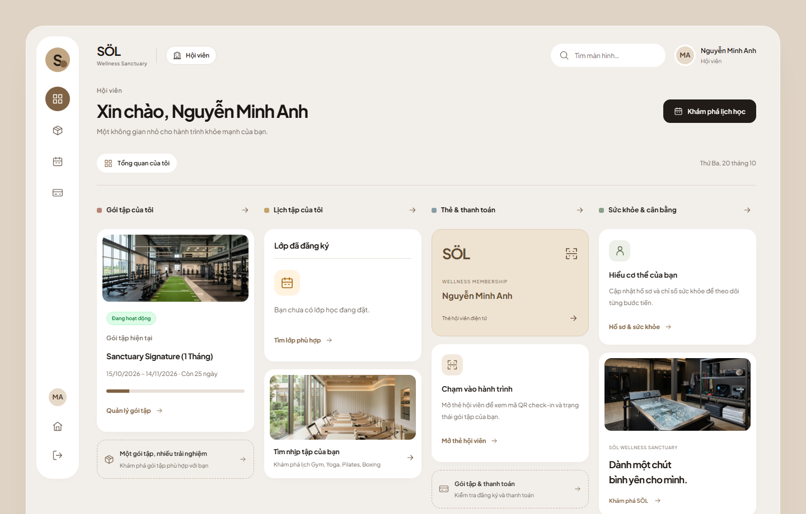
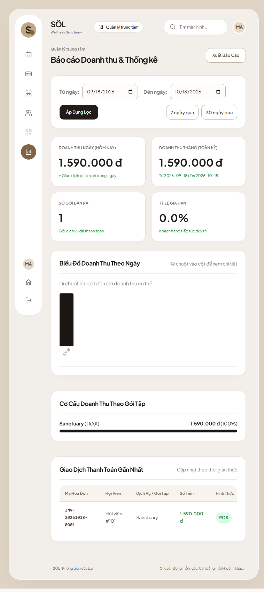
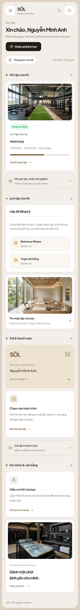
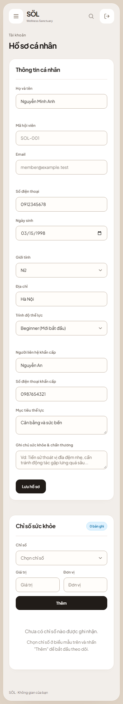
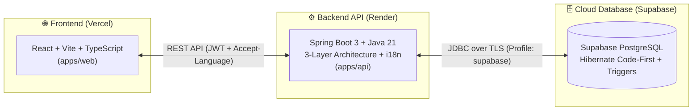

<div align="center">

# 🏛️ SÖL Wellness Sanctuary — Sports Center Management System (SCMS)

[](https://github.com/Agile4Life/SWP391/actions/workflows/cd.yml)
[](https://github.com/Agile4Life/SWP391/actions/workflows/ci.yml)


**Nền tảng quản trị trung tâm thể thao & chăm sóc sức khỏe toàn diện (SWP391 Monorepo)**  
*Đặt lịch lớp học · Quản lý gói hội viên · Check-in QR · Theo dõi chỉ số cơ thể · Báo cáo doanh thu thời gian thực*

<br />


</div>

---

## ✨ Giới thiệu tổng quan

**Sports Center Management System (SCMS)** là hệ thống quản lý vận hành trung tâm thể hình & wellness hiện đại, kết hợp cổng thông tin hội viên (**React + Vite + TypeScript**) với **Spring Boot 3 REST API (Java 21)** và cơ sở dữ liệu đám mây **Supabase PostgreSQL** theo kiến trúc **Hibernate Code-First** cùng hệ thống **PostgreSQL Trigger** kiểm soát toàn vẹn nghiệp vụ.

- **CI/CD Tự động hóa:** Xem [Hướng dẫn GitHub Actions → Vercel + Render](docs/CICD_SETUP.md) để cấu hình Secrets và theo dõi toàn bộ luồng kiểm thử (CI) lẫn triển khai Production (CD) trong tab **Actions**.
- **Cơ sở dữ liệu đám mây:** Sử dụng duy nhất profile `supabase` (**Supabase PostgreSQL** qua TLS), tự động ánh xạ schema từ JPA Entity và nạp trigger nghiệp vụ khi khởi chạy. Xem chi tiết tại [Hướng dẫn Supabase](docs/SUPABASE_SETUP.md).

---

## 🖼️ Giao diện hệ thống (UI Showcase)

### 1. Cổng thông tin Hội viên (Member Portal — Desktop)
Không gian trực quan giúp hội viên theo dõi gói tập đang hoạt động, lịch học 7 ngày, thẻ hội viên điện tử QR và chỉ số sức khỏe cá nhân:

<p align="center">
  
</p>

### 2. Báo cáo Doanh thu & Thống kê Quản lý (Manager Analytics)
Bảng điều khiển dành cho Quản lý trung tâm với thống kê doanh thu theo ngày/tháng, tỷ lệ gia hạn, biểu đồ trực quan và lịch sử hóa đơn POS thời gian thực:

<p align="center">
  
</p>

### 3. Trải nghiệm Đa thiết bị (Responsive Mobile Views)

| Trang tổng quan Hội viên (Mobile) | Hồ sơ cá nhân & Chỉ số sức khỏe (Mobile) |
| :---: | :---: |
|  |  |

### 4. Không gian Tập luyện & Dịch vụ tại SÖL Wellness Sanctuary

| Reformer Pilates Studio | Aerial Silk & Yoga Studio | Thermal & Cold Plunge Recovery |
| :---: | :---: | :---: |
|  |  |  |

---

## 🏗️ Kiến trúc hệ thống & Luồng trạng thái



### Sơ đồ trạng thái nghiệp vụ cốt lõi

| Vòng đời Tài khoản Người dùng (`users.status`) | Vòng đời Gói Hội viên (`membership_subscriptions.status`) |
| :---: | :---: |
|  |  |

> [!IMPORTANT]
> **Bất biến nghiệp vụ & Kiến trúc dữ liệu:**
> - **Code-First & ORM Polymorphism:** Toàn bộ bảng, cột, khóa và quan hệ được định nghĩa qua JPA Entity (`ddl-auto: update`). Các file SQL trong `db/` chỉ là tài liệu lịch sử, không dùng để triển khai.
> - **Database Triggers bắt buộc:** Kiểm tra sức chứa lớp học (`capacity`) và chống trùng lịch (`schedule overlap`) được nạp tự động qua `PostgreSqlTriggerProvider`.
> - **Chính sách CI nghiêm ngặt:** `DatabasePolicyTest`, `DatabaseProfilesTest` và `scripts/test-database-config.ps1` đảm bảo hệ thống chỉ dùng `Supabase PostgreSQL`.
> - **Đa ngôn ngữ (i18n):** Hỗ trợ `vi` (mặc định) và `en` qua header `Accept-Language`.

---

## 📂 Cấu trúc thư mục (Monorepo)

```text
SWP391/
├── apps/
│   ├── api/        Spring Boot 3 REST API (Java 21, Maven, JPA/Hibernate, Security, i18n)
│   └── web/        React + Vite + TypeScript Web Portal (Feature-sliced UI)
├── db/             Tài liệu cấu trúc & lịch sử dữ liệu (chỉ tham chiếu, không dùng bootstrap DB)
├── docs/           Tài liệu dự án (Master Guide, Plans, Diagrams, Rules, API Contracts, QA)
├── scripts/        Script tự động hóa khởi chạy local & CD (run-local, stop-local, deploy-render)
└── .github/        GitHub Actions workflows cho CI (ci.yml) và CD (cd.yml)
```

---

## 🚀 Hướng dẫn khởi động Local

### Cách 1: 1-Click (Khuyên dùng trên Windows)
1. Chạy `npm start` (hoặc bấm đúp vào [`scripts/run-local.bat`](scripts/run-local.bat) / chạy `.\scripts\run-local.ps1`).
2. Bộ chạy tự động kiểm tra môi trường và cấu hình Supabase, sau đó khởi chạy đồng thời **Web + API**. Hibernate tự động tạo/cập nhật bảng và cài đặt PostgreSQL trigger khi API khởi động.
3. Để dừng toàn bộ hệ thống: chạy `npm run stop` (hoặc bấm đúp [`scripts/stop-local.bat`](scripts/stop-local.bat)).

📖 Xem chi tiết tại [docs/LOCAL_DEV_GUIDE.md](docs/LOCAL_DEV_GUIDE.md).

### Cách 2: Khởi động thủ công
1. Cài đặt **Java 21+**, **Maven 3.9+**, **Node.js 20+** và chuẩn bị thông tin kết nối **Supabase PostgreSQL**.
2. Sao chép `.env.example` thành `.env` và điền thông số kết nối theo [Hướng dẫn Supabase](docs/SUPABASE_SETUP.md).
3. Khởi chạy Backend API:
   ```powershell
   cd apps/api
   .\mvnw.cmd spring-boot:run
   ```
4. Khởi chạy Frontend Web:
   ```powershell
   cd apps/web
   npm install
   npm run dev
   ```

🔗 **Điểm truy cập Local:**
- **Web Portal:** `http://localhost:5173`
- **API Healthcheck:** `http://localhost:8080/api/v1/health`
- **Swagger UI (OpenAPI):** `http://localhost:8080/swagger-ui/index.html`

---

## 📚 Tài liệu tham khảo nhanh

| Tài liệu | Mô tả |
| :--- | :--- |
| [📘 PROJECT_MASTER_GUIDE.md](docs/PROJECT_MASTER_GUIDE.md) | Đặc tả nghiệp vụ tổng thể, phân quyền vai trò và quy trình cốt lõi |
| [🏛️ backend-architecture.md](docs/rules/backend-architecture.md) | Quy chuẩn kiến trúc 3 lớp, SOLID, IoC, JPA và Supabase PostgreSQL |
| [☁️ SUPABASE_SETUP.md](docs/SUPABASE_SETUP.md) | Hướng dẫn cấu hình JDBC TLS, RLS và schema test biệt lập trên Supabase |
| [🔄 CICD_SETUP.md](docs/CICD_SETUP.md) | Hướng dẫn thiết lập GitHub Actions CI/CD tự động lên Vercel & Render |
| [📋 AGILE_SCRUM_JIRA_PLAN.md](docs/plans/AGILE_SCRUM_JIRA_PLAN.md) | Backlog tính năng, phân công màn hình và tiêu chí nghiệm thu (AC) |
| [🤖 AGENTS.md](AGENTS.md) | Quy tắc bắt buộc dành cho contributor và AI coding agent |

---

## 🤝 Quy ước làm việc (Contribution Guidelines)

- Đọc kỹ [AGENTS.md](AGENTS.md), [docs/rules/backend-architecture.md](docs/rules/backend-architecture.md) và [docs/plans/AGILE_SCRUM_JIRA_PLAN.md](docs/plans/AGILE_SCRUM_JIRA_PLAN.md) trước khi nhận ticket.
- Mỗi Pull Request xử lý một Jira ticket với nhánh đặt tên theo mẫu `SCMS-123/short-description`.
- Định nghĩa mọi thay đổi schema qua **JPA Entity** và cập nhật trigger PostgreSQL qua `PostgreSqlTriggerProvider`.
- Bổ sung đồng thời cả `messages_vi.properties` và `messages_en.properties` cho mọi thông báo hoặc mã lỗi mới ở Backend.
- **Tuyệt đối không** commit `.env`, mật khẩu, JWT secret, API token hoặc dữ liệu nhạy cảm.

---

<div align="center">
  <sub>© 2026 <b>Agile4Life — SWP391 Team</b>. Built with ❤️ using Spring Boot 3, React, and Supabase PostgreSQL.</sub>
</div>
