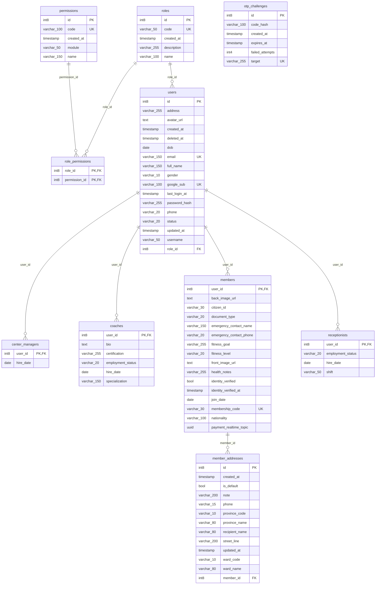
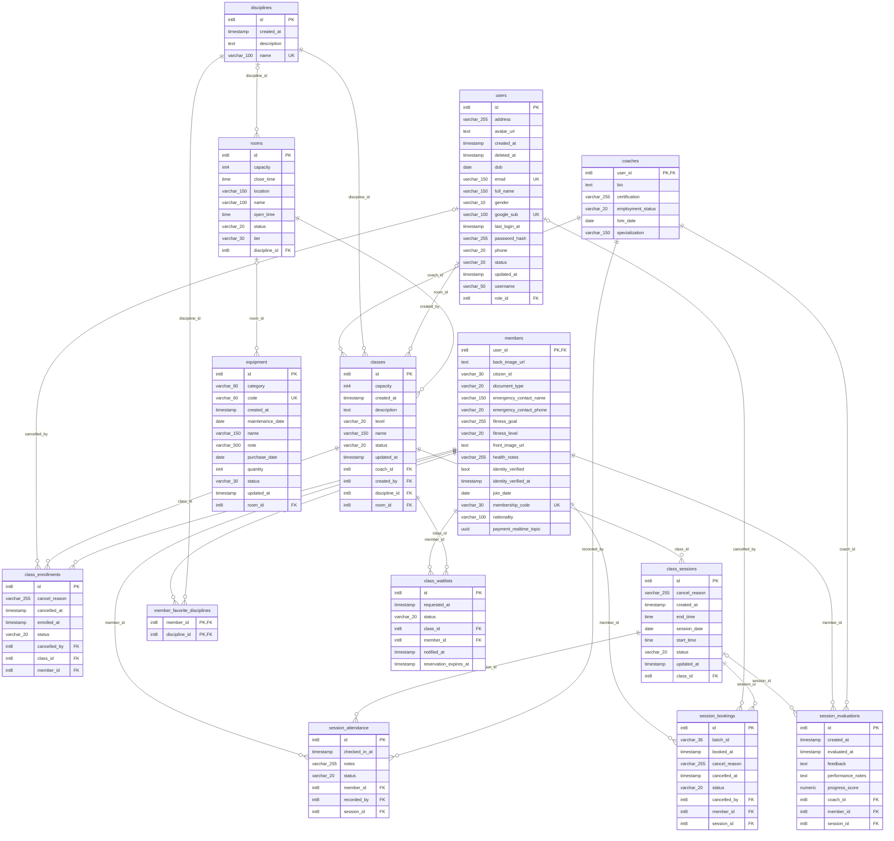
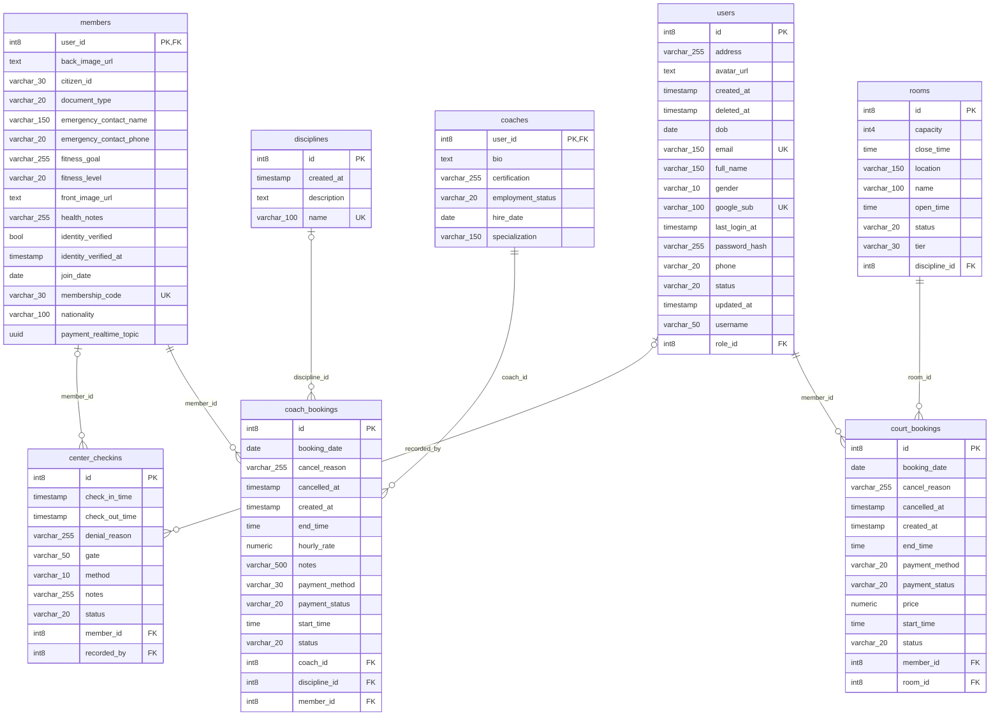
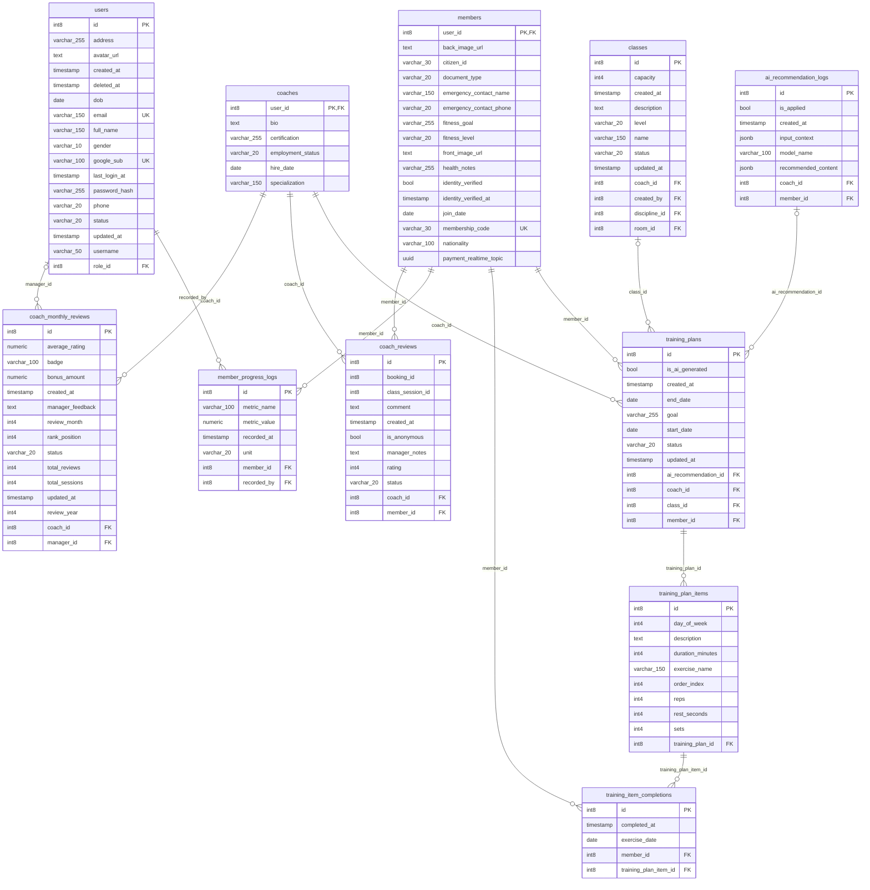
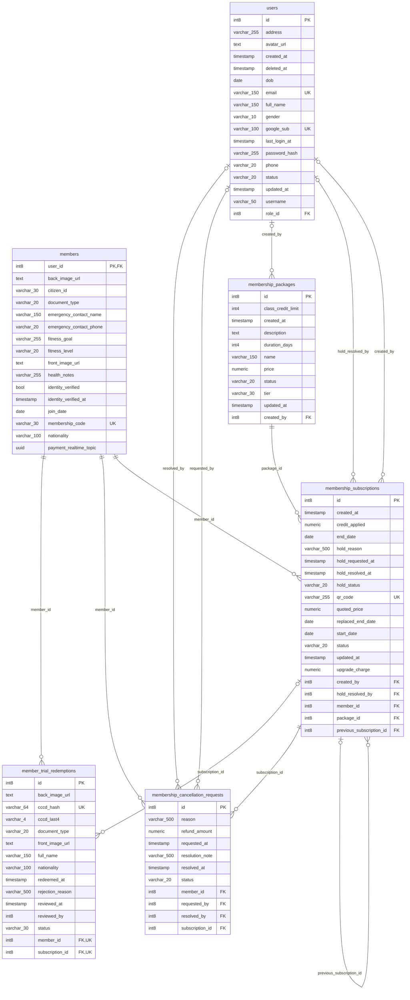
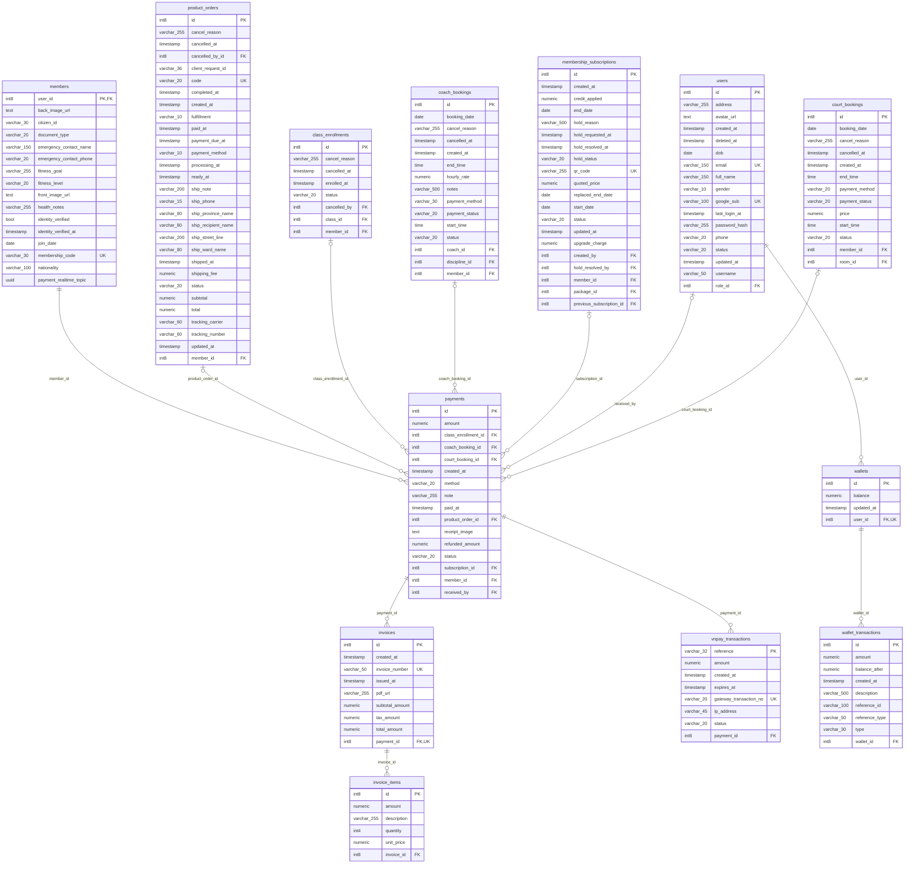
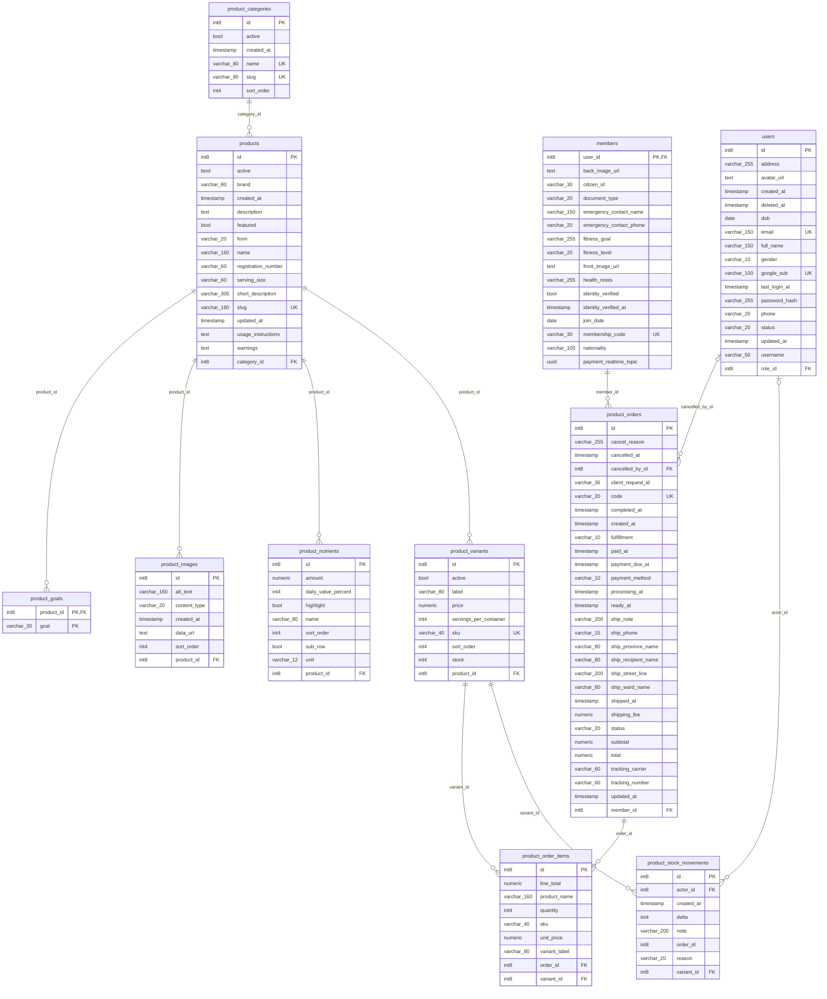
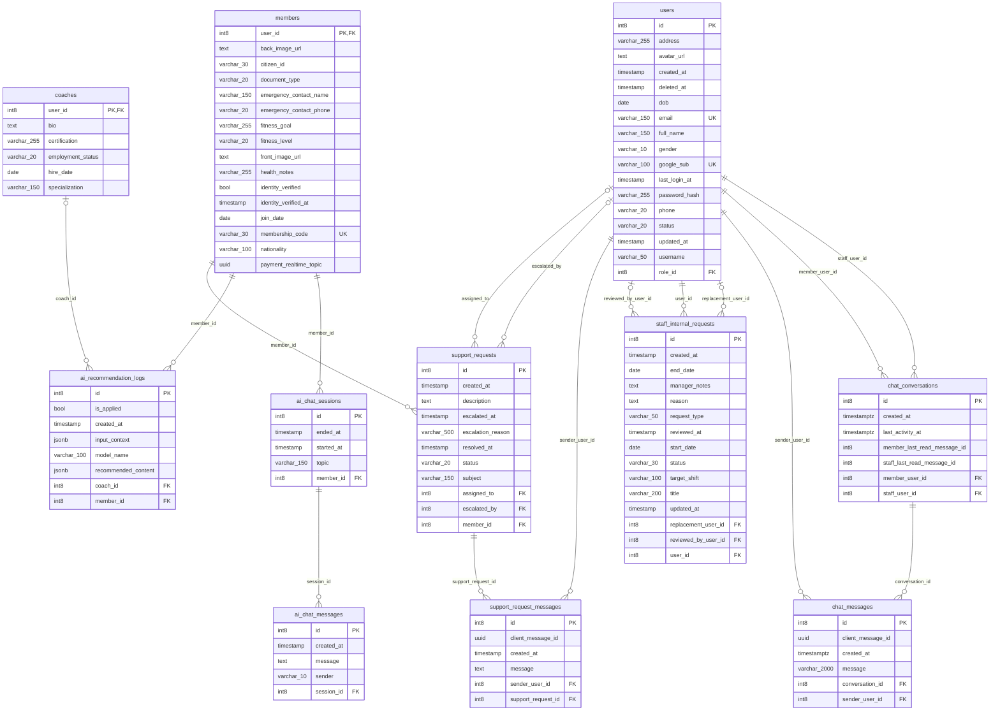
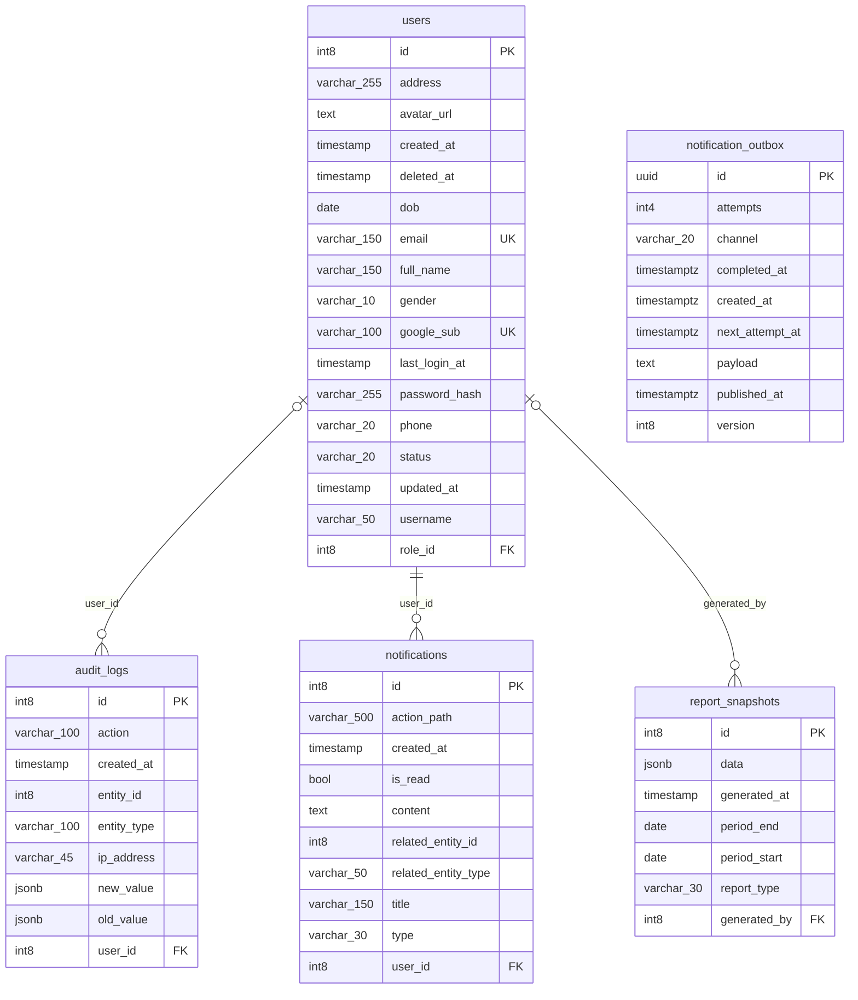

<USER_REQUEST>
# ERD – database `agile4life`

Sinh tự động từ `information_schema` / `pg_constraint` của container `1Panel-postgresql-SFES` (postgres 18.6), ngày 2026-11-08.

- Số bảng: **61** 
- Số khóa ngoại: **105** 
- Schema: `public`

## Mục lục

1. Người dùng & phân quyền
2. Lớp học & lịch tập
3. Đặt lịch
4. Huấn luyện viên & tiến độ
5. Gói thành viên
6. Thanh toán & ví
7. Sản phẩm & đơn hàng
8. Chat, AI, hỗ trợ
9. Thông báo & hệ thống

## 1. Sơ đồ quan hệ (Mermaid)

Chỉ vẽ quan hệ (FK) để sơ đồ gọn; chi tiết cột ở phần 3. Quy ước: `A ||--o{ B` = một A có nhiều B (cột FK nằm ở B).

```mermaid
erDiagram
   ai_chat_sessions ||--o{ ai_chat_messages : "session_id"
   members ||--o{ ai_chat_sessions : "member_id"
   members ||--o{ ai_recommendation_logs : "member_id"
   coaches |o--o{ ai_recommendation_logs : "coach_id"
   users |o--o{ audit_logs : "user_id"
   members |o--o{ center_checkins : "member_id"
   users |o--o{ center_checkins : "recorded_by"
   users ||--o{ center_managers : "user_id"
   users ||--o{ chat_conversations : "staff_user_id"
   users ||--o{ chat_conversations : "member_user_id"
   users ||--o{ chat_messages : "sender_user_id"
   chat_conversations ||--o{ chat_messages : "conversation_id"
   users |o--o{ class_enrollments : "cancelled_by"
   classes ||--o{ class_enrollments : "class_id"
   members ||--o{ class_enrollments : "member_id"
   classes ||--o{ class_sessions : "class_id"
   coaches ||--o{ classes : "coach_id"
   disciplines ||--o{ classes : "discipline_id"
   users |o--o{ classes : "created_by"
   rooms ||--o{ classes : "room_id"
   disciplines |o--o{ coach_bookings : "discipline_id"
   coaches ||--o{ coach_bookings : "coach_id"
   members ||--o{ coach_bookings : "member_id"
   coaches ||--o{ coach_monthly_reviews : "coach_id"
   users |o--o{ coach_monthly_reviews : "manager_id"
   coaches ||--o{ coach_reviews : "coach_id"
   members ||--o{ coach_reviews : "member_id"
   users ||--o{ coaches : "user_id"
   rooms ||--o{ court_bookings : "room_id"
   users ||--o{ court_bookings : "member_id"
   rooms |o--o{ equipment : "room_id"
   invoices ||--o{ invoice_items : "invoice_id"
   payments ||--o{ invoices : "payment_id"
   members ||--o{ member_addresses : "member_id"
   members ||--o{ member_favorite_disciplines : "member_id"
   disciplines ||--o{ member_favorite_disciplines : "discipline_id"
   users ||--o{ member_progress_logs : "recorded_by"
   members ||--o{ member_progress_logs : "member_id"
   members ||--o{ member_trial_redemptions : "member_id"
   membership_subscriptions |o--o{ member_trial_redemptions : "subscription_id"
   users ||--o{ members : "user_id"
   users |o--o{ membership_cancellation_requests : "resolved_by"
   users |o--o{ membership_cancellation_requests : "requested_by"
   membership_subscriptions ||--o{ membership_cancellation_requests : "subscription_id"
   members ||--o{ membership_cancellation_requests : "member_id"
   users |o--o{ membership_packages : "created_by"
   users |o--o{ membership_subscriptions : "hold_resolved_by"
   members ||--o{ membership_subscriptions : "member_id"
   membership_subscriptions |o--o{ membership_subscriptions : "previous_subscription_id"
   membership_packages ||--o{ membership_subscriptions : "package_id"
   users |o--o{ membership_subscriptions : "created_by"
   users ||--o{ notifications : "user_id"
   court_bookings |o--o{ payments : "court_booking_id"
   users |o--o{ payments : "received_by"
   membership_subscriptions |o--o{ payments : "subscription_id"
   coach_bookings |o--o{ payments : "coach_booking_id"
   class_enrollments |o--o{ payments : "class_enrollment_id"
   product_orders |o--o{ payments : "product_order_id"
   members ||--o{ payments : "member_id"
   products ||--o{ product_goals : "product_id"
   products ||--o{ product_images : "product_id"
   products ||--o{ product_nutrients : "product_id"
   product_orders ||--o{ product_order_items : "order_id"
   product_variants ||--o{ product_order_items : "variant_id"
   members ||--o{ product_orders : "member_id"
   users |o--o{ product_orders : "cancelled_by_id"
   users |o--o{ product_stock_movements : "actor_id"
   product_variants ||--o{ product_stock_movements : "variant_id"
   products ||--o{ product_variants : "product_id"
   product_categories ||--o{ products : "category_id"
   users ||--o{ receptionists : "user_id"
   users |o--o{ report_snapshots : "generated_by"
   permissions ||--o{ role_permissions : "permission_id"
   roles ||--o{ role_permissions : "role_id"
   disciplines |o--o{ rooms : "discipline_id"
   members ||--o{ session_attendance : "member_id"
   class_sessions ||--o{ session_attendance : "session_id"
   coaches ||--o{ session_attendance : "recorded_by"
   members ||--o{ session_bookings : "member_id"
   users |o--o{ session_bookings : "cancelled_by"
   class_sessions ||--o{ session_bookings : "session_id"
   class_sessions |o--o{ session_evaluations : "session_id"
   members ||--o{ session_evaluations : "member_id"
   coaches ||--o{ session_evaluations : "coach_id"
   users |o--o{ staff_internal_requests : "replacement_user_id"
   users ||--o{ staff_internal_requests : "user_id"
   users |o--o{ staff_internal_requests : "reviewed_by_user_id"
   users ||--o{ support_request_messages : "sender_user_id"
   support_requests ||--o{ support_request_messages : "support_request_id"
   users |o--o{ support_requests : "escalated_by"
   members ||--o{ support_requests : "member_id"
   users |o--o{ support_requests : "assigned_to"
   members ||--o{ training_item_completions : "member_id"
   training_plan_items ||--o{ training_item_completions : "training_plan_item_id"
   training_plans ||--o{ training_plan_items : "training_plan_id"
   members ||--o{ training_plans : "member_id"
   coaches ||--o{ training_plans : "coach_id"
   classes |o--o{ training_plans : "class_id"
   ai_recommendation_logs |o--o{ training_plans : "ai_recommendation_id"
   roles ||--o{ users : "role_id"
   payments ||--o{ vnpay_transactions : "payment_id"
   wallets ||--o{ wallet_transactions : "wallet_id"
   users ||--o{ wallets : "user_id"
   members ||--o{ class_waitlists : "member_id"
   classes ||--o{ class_waitlists : "class_id"
```

## 2. Sơ đồ ERD đầy đủ cột (Mermaid)

### Người dùng & phân quyền

### Lớp học & lịch tập

### Đặt lịch

### Huấn luyện viên & tiến độ

### Gói thành viên

### Thanh toán & ví

### Sản phẩm & đơn hàng

### Chat, AI, hỗ trợ

### Thông báo & hệ thống

## 3. Chi tiết từng bảng

### Người dùng & phân quyền

#### `users`

| Cột | Kiểu | Null | Mặc định | Khóa |
|---|---|---|---|---|
| id | int8 | NO |  | PK |
| address | varchar(255) | YES |  |  |
| avatar_url | text | YES |  |  |
| created_at | timestamp | NO |  |  |
| deleted_at | timestamp | YES |  |  |
| dob | date | YES |  |  |
| email | varchar(150) | NO |  | UNIQUE |
| full_name | varchar(150) | NO |  |  |
| gender | varchar(10) | YES |  |  |
| google_sub | varchar(100) | YES |  | UNIQUE |
| last_login_at | timestamp | YES |  |  |
| password_hash | varchar(255) | NO |  |  |
| phone | varchar(20) | YES |  |  |
| status | varchar(20) | NO |  |  |
| updated_at | timestamp | NO |  |  |
| username | varchar(50) | YES |  |  |
| role_id | int8 | NO |  | FK → roles.id |

#### `roles`

| Cột | Kiểu | Null | Mặc định | Khóa |
|---|---|---|---|---|
| id | int8 | NO |  | PK |
| code | varchar(50) | NO |  | UNIQUE |
| created_at | timestamp | NO |  |  |
| description | varchar(255) | YES |  |  |
| name | varchar(100) | NO |  |  |

#### `permissions`

| Cột | Kiểu | Null | Mặc định | Khóa |
|---|---|---|---|---|
| id | int8 | NO |  | PK |
| code | varchar(100) | NO |  | UNIQUE |
| created_at | timestamp | NO |  |  |
| module | varchar(50) | NO |  |  |
| name | varchar(150) | NO |  |  |

#### `role_permissions`

| Cột | Kiểu | Null | Mặc định | Khóa |
|---|---|---|---|---|
| role_id | int8 | NO |  | PK, FK → roles.id |
| permission_id | int8 | NO |  | PK, FK → permissions.id |

PK tổ hợp: (role_id, permission_id)

#### `members`

| Cột | Kiểu | Null | Mặc định | Khóa |
|---|---|---|---|---|
| user_id | int8 | NO |  | PK, FK → users.id |
| back_image_url | text | YES |  |  |
| citizen_id | varchar(30) | YES |  |  |
| document_type | varchar(20) | YES |  |  |
| emergency_contact_name | varchar(150) | YES |  |  |
| emergency_contact_phone | varchar(20) | YES |  |  |
| fitness_goal | varchar(255) | YES |  |  |
| fitness_level | varchar(20) | NO |  |  |
| front_image_url | text | YES |  |  |
| health_notes | varchar(255) | YES |  |  |
| identity_verified | bool | YES |  |  |
| identity_verified_at | timestamp | YES |  |  |
| join_date | date | NO |  |  |
| membership_code | varchar(30) | NO |  | UNIQUE |
| nationality | varchar(100) | YES |  |  |
| payment_realtime_topic | uuid | YES |  |  |

#### `coaches`

| Cột | Kiểu | Null | Mặc định | Khóa |
|---|---|---|---|---|
| user_id | int8 | NO |  | PK, FK → users.id |
| bio | text | YES |  |  |
| certification | varchar(255) | YES |  |  |
| employment_status | varchar(20) | NO |  |  |
| hire_date | date | YES |  |  |
| specialization | varchar(150) | YES |  |  |

#### `receptionists`

| Cột | Kiểu | Null | Mặc định | Khóa |
|---|---|---|---|---|
| user_id | int8 | NO |  | PK, FK → users.id |
| employment_status | varchar(20) | NO |  |  |
| hire_date | date | YES |  |  |
| shift | varchar(50) | YES |  |  |

#### `center_managers`

| Cột | Kiểu | Null | Mặc định | Khóa |
|---|---|---|---|---|
| user_id | int8 | NO |  | PK, FK → users.id |
| hire_date | date | YES |  |  |

#### `member_addresses`

| Cột | Kiểu | Null | Mặc định | Khóa |
|---|---|---|---|---|
| id | int8 | NO |  | PK |
| created_at | timestamp | NO |  |  |
| is_default | bool | NO |  |  |
| note | varchar(200) | YES |  |  |
| phone | varchar(15) | NO |  |  |
| province_code | varchar(10) | NO |  |  |
| province_name | varchar(80) | NO |  |  |
| recipient_name | varchar(80) | NO |  |  |
| street_line | varchar(200) | NO |  |  |
| updated_at | timestamp | NO |  |  |
| ward_code | varchar(10) | NO |  |  |
| ward_name | varchar(80) | NO |  |  |
| member_id | int8 | NO |  | FK → members.user_id |

#### `otp_challenges`

| Cột | Kiểu | Null | Mặc định | Khóa |
|---|---|---|---|---|
| id | int8 | NO |  | PK |
| code_hash | varchar(100) | NO |  |  |
| created_at | timestamp | NO |  |  |
| expires_at | timestamp | NO |  |  |
| failed_attempts | int4 | NO |  |  |
| target | varchar(255) | NO |  | UNIQUE |

### Lớp học & lịch tập

#### `classes`

| Cột | Kiểu | Null | Mặc định | Khóa |
|---|---|---|---|---|
| id | int8 | NO |  | PK |
| capacity | int4 | NO |  |  |
| created_at | timestamp | NO |  |  |
| description | text | YES |  |  |
| level | varchar(20) | NO |  |  |
| name | varchar(150) | NO |  |  |
| status | varchar(20) | NO |  |  |
| updated_at | timestamp | NO |  |  |
| coach_id | int8 | NO |  | FK → coaches.user_id |
| created_by | int8 | YES |  | FK → users.id |
| discipline_id | int8 | NO |  | FK → disciplines.id |
| room_id | int8 | NO |  | FK → rooms.id |

#### `class_sessions`

| Cột | Kiểu | Null | Mặc định | Khóa |
|---|---|---|---|---|
| id | int8 | NO |  | PK |
| cancel_reason | varchar(255) | YES |  |  |
| created_at | timestamp | NO |  |  |
| end_time | time | NO |  |  |
| session_date | date | NO |  |  |
| start_time | time | NO |  |  |
| status | varchar(20) | NO |  |  |
| updated_at | timestamp | NO |  |  |
| class_id | int8 | NO |  | FK → classes.id |

#### `class_enrollments`

| Cột | Kiểu | Null | Mặc định | Khóa |
|---|---|---|---|---|
| id | int8 | NO |  | PK |
| cancel_reason | varchar(255) | YES |  |  |
| cancelled_at | timestamp | YES |  |  |
| enrolled_at | timestamp | NO |  |  |
| status | varchar(20) | NO |  |  |
| cancelled_by | int8 | YES |  | FK → users.id |
| class_id | int8 | NO |  | FK → classes.id |
| member_id | int8 | NO |  | FK → members.user_id |

#### `class_waitlists`

| Cột | Kiểu | Null | Mặc định | Khóa |
|---|---|---|---|---|
| id | int8 | NO |  | PK |
| requested_at | timestamp | NO |  |  |
| status | varchar(20) | NO |  |  |
| class_id | int8 | NO |  | FK → classes.id |
| member_id | int8 | NO |  | FK → members.user_id |
| notified_at | timestamp | YES |  |  |
| reservation_expires_at | timestamp | YES |  |  |

#### `session_bookings`

| Cột | Kiểu | Null | Mặc định | Khóa |
|---|---|---|---|---|
| id | int8 | NO |  | PK |
| batch_id | varchar(36) | YES |  |  |
| booked_at | timestamp | NO |  |  |
| cancel_reason | varchar(255) | YES |  |  |
| cancelled_at | timestamp | YES |  |  |
| status | varchar(20) | NO |  |  |
| cancelled_by | int8 | YES |  | FK → users.id |
| member_id | int8 | NO |  | FK → members.user_id |
| session_id | int8 | NO |  | FK → class_sessions.id |

#### `session_attendance`

| Cột | Kiểu | Null | Mặc định | Khóa |
|---|---|---|---|---|
| id | int8 | NO |  | PK |
| checked_in_at | timestamp | YES |  |  |
| notes | varchar(255) | YES |  |  |
| status | varchar(20) | NO |  |  |
| member_id | int8 | NO |  | FK → members.user_id |
| recorded_by | int8 | NO |  | FK → coaches.user_id |
| session_id | int8 | NO |  | FK → class_sessions.id |

UNIQUE tổ hợp: (session_id, member_id)

#### `session_evaluations`

| Cột | Kiểu | Null | Mặc định | Khóa |
|---|---|---|---|---|
| id | int8 | NO |  | PK |
| created_at | timestamp | NO |  |  |
| evaluated_at | timestamp | NO |  |  |
| feedback | text | YES |  |  |
| performance_notes | text | YES |  |  |
| progress_score | numeric | YES |  |  |
| coach_id | int8 | NO |  | FK → coaches.user_id |
| member_id | int8 | NO |  | FK → members.user_id |
| session_id | int8 | YES |  | FK → class_sessions.id |

#### `disciplines`

| Cột | Kiểu | Null | Mặc định | Khóa |
|---|---|---|---|---|
| id | int8 | NO |  | PK |
| created_at | timestamp | NO |  |  |
| description | text | YES |  |  |
| name | varchar(100) | NO |  | UNIQUE |

#### `member_favorite_disciplines`

| Cột | Kiểu | Null | Mặc định | Khóa |
|---|---|---|---|---|
| member_id | int8 | NO |  | PK, FK → members.user_id |
| discipline_id | int8 | NO |  | PK, FK → disciplines.id |

PK tổ hợp: (member_id, discipline_id)

#### `rooms`

| Cột | Kiểu | Null | Mặc định | Khóa |
|---|---|---|---|---|
| id | int8 | NO |  | PK |
| capacity | int4 | NO |  |  |
| close_time | time | YES |  |  |
| location | varchar(150) | YES |  |  |
| name | varchar(100) | NO |  |  |
| open_time | time | YES |  |  |
| status | varchar(20) | NO |  |  |
| tier | varchar(30) | YES |  |  |
| discipline_id | int8 | YES |  | FK → disciplines.id |

#### `equipment`

| Cột | Kiểu | Null | Mặc định | Khóa |
|---|---|---|---|---|
| id | int8 | NO |  | PK |
| category | varchar(80) | YES |  |  |
| code | varchar(60) | YES |  | UNIQUE |
| created_at | timestamp | NO |  |  |
| maintenance_date | date | YES |  |  |
| name | varchar(150) | NO |  |  |
| note | varchar(500) | YES |  |  |
| purchase_date | date | YES |  |  |
| quantity | int4 | NO |  |  |
| status | varchar(30) | NO |  |  |
| updated_at | timestamp | NO |  |  |
| room_id | int8 | YES |  | FK → rooms.id |

### Đặt lịch

#### `coach_bookings`

| Cột | Kiểu | Null | Mặc định | Khóa |
|---|---|---|---|---|
| id | int8 | NO |  | PK |
| booking_date | date | NO |  |  |
| cancel_reason | varchar(255) | YES |  |  |
| cancelled_at | timestamp | YES |  |  |
| created_at | timestamp | NO |  |  |
| end_time | time | NO |  |  |
| hourly_rate | numeric | NO |  |  |
| notes | varchar(500) | YES |  |  |
| payment_method | varchar(30) | NO |  |  |
| payment_status | varchar(20) | NO |  |  |
| start_time | time | NO |  |  |
| status | varchar(20) | NO |  |  |
| coach_id | int8 | NO |  | FK → coaches.user_id |
| discipline_id | int8 | YES |  | FK → disciplines.id |
| member_id | int8 | NO |  | FK → members.user_id |

#### `court_bookings`

| Cột | Kiểu | Null | Mặc định | Khóa |
|---|---|---|---|---|
| id | int8 | NO |  | PK |
| booking_date | date | NO |  |  |
| cancel_reason | varchar(255) | YES |  |  |
| cancelled_at | timestamp | YES |  |  |
| created_at | timestamp | NO |  |  |
| end_time | time | NO |  |  |
| payment_method | varchar(20) | YES |  |  |
| payment_status | varchar(20) | YES |  |  |
| price | numeric | YES |  |  |
| start_time | time | NO |  |  |
| status | varchar(20) | NO |  |  |
| member_id | int8 | NO |  | FK → users.id |
| room_id | int8 | NO |  | FK → rooms.id |

#### `center_checkins`

| Cột | Kiểu | Null | Mặc định | Khóa |
|---|---|---|---|---|
| id | int8 | NO |  | PK |
| check_in_time | timestamp | NO |  |  |
| check_out_time | timestamp | YES |  |  |
| denial_reason | varchar(255) | YES |  |  |
| gate | varchar(50) | YES |  |  |
| method | varchar(10) | NO |  |  |
| notes | varchar(255) | YES |  |  |
| status | varchar(20) | NO | `'GRANTED'::character varying` |  |
| member_id | int8 | YES |  | FK → members.user_id |
| recorded_by | int8 | YES |  | FK → users.id |

### Huấn luyện viên & tiến độ

#### `coach_reviews`

| Cột | Kiểu | Null | Mặc định | Khóa |
|---|---|---|---|---|
| id | int8 | NO |  | PK |
| booking_id | int8 | YES |  |  |
| class_session_id | int8 | YES |  |  |
| comment | text | YES |  |  |
| created_at | timestamp | NO |  |  |
| is_anonymous | bool | YES |  |  |
| manager_notes | text | YES |  |  |
| rating | int4 | NO |  |  |
| status | varchar(20) | NO |  |  |
| coach_id | int8 | NO |  | FK → coaches.user_id |
| member_id | int8 | NO |  | FK → members.user_id |

UNIQUE tổ hợp: (member_id, booking_id)

UNIQUE tổ hợp: (member_id, class_session_id)

#### `coach_monthly_reviews`

| Cột | Kiểu | Null | Mặc định | Khóa |
|---|---|---|---|---|
| id | int8 | NO |  | PK |
| average_rating | numeric | YES |  |  |
| badge | varchar(100) | YES |  |  |
| bonus_amount | numeric | YES |  |  |
| created_at | timestamp | NO |  |  |
| manager_feedback | text | YES |  |  |
| review_month | int4 | NO |  |  |
| rank_position | int4 | YES |  |  |
| status | varchar(20) | NO |  |  |
| total_reviews | int4 | NO |  |  |
| total_sessions | int4 | NO |  |  |
| updated_at | timestamp | YES |  |  |
| review_year | int4 | NO |  |  |
| coach_id | int8 | NO |  | FK → coaches.user_id |
| manager_id | int8 | YES |  | FK → users.id |

UNIQUE tổ hợp: (coach_id, review_year, review_month)

#### `training_plans`

| Cột | Kiểu | Null | Mặc định | Khóa |
|---|---|---|---|---|
| id | int8 | NO |  | PK |
| is_ai_generated | bool | NO |  |  |
| created_at | timestamp | NO |  |  |
| end_date | date | NO |  |  |
| goal | varchar(255) | YES |  |  |
| start_date | date | NO |  |  |
| status | varchar(20) | NO |  |  |
| updated_at | timestamp | NO |  |  |
| ai_recommendation_id | int8 | YES |  | FK → ai_recommendation_logs.id |
| coach_id | int8 | NO |  | FK → coaches.user_id |
| class_id | int8 | YES |  | FK → classes.id |
| member_id | int8 | NO |  | FK → members.user_id |

#### `training_plan_items`

| Cột | Kiểu | Null | Mặc định | Khóa |
|---|---|---|---|---|
| id | int8 | NO |  | PK |
| day_of_week | int4 | YES |  |  |
| description | text | YES |  |  |
| duration_minutes | int4 | YES |  |  |
| exercise_name | varchar(150) | NO |  |  |
| order_index | int4 | NO |  |  |
| reps | int4 | YES |  |  |
| rest_seconds | int4 | YES |  |  |
| sets | int4 | YES |  |  |
| training_plan_id | int8 | NO |  | FK → training_plans.id |

#### `training_item_completions`

| Cột | Kiểu | Null | Mặc định | Khóa |
|---|---|---|---|---|
| id | int8 | NO |  | PK |
| completed_at | timestamp | NO |  |  |
| exercise_date | date | NO |  |  |
| member_id | int8 | NO |  | FK → members.user_id |
| training_plan_item_id | int8 | NO |  | FK → training_plan_items.id |

UNIQUE tổ hợp: (member_id, training_plan_item_id, exercise_date)

#### `member_progress_logs`

| Cột | Kiểu | Null | Mặc định | Khóa |
|---|---|---|---|---|
| id | int8 | NO |  | PK |
| metric_name | varchar(100) | NO |  |  |
| metric_value | numeric | NO |  |  |
| recorded_at | timestamp | NO |  |  |
| unit | varchar(20) | YES |  |  |
| member_id | int8 | NO |  | FK → members.user_id |
| recorded_by | int8 | NO |  | FK → users.id |

### Gói thành viên

#### `membership_packages`

| Cột | Kiểu | Null | Mặc định | Khóa |
|---|---|---|---|---|
| id | int8 | NO |  | PK |
| class_credit_limit | int4 | YES |  |  |
| created_at | timestamp | NO |  |  |
| description | text | YES |  |  |
| duration_days | int4 | NO |  |  |
| name | varchar(150) | NO |  |  |
| price | numeric | NO |  |  |
| status | varchar(20) | NO |  |  |
| tier | varchar(30) | YES |  |  |
| updated_at | timestamp | NO |  |  |
| created_by | int8 | YES |  | FK → users.id |

#### `membership_subscriptions`

| Cột | Kiểu | Null | Mặc định | Khóa |
|---|---|---|---|---|
| id | int8 | NO |  | PK |
| created_at | timestamp | NO |  |  |
| credit_applied | numeric | YES |  |  |
| end_date | date | NO |  |  |
| hold_reason | varchar(500) | YES |  |  |
| hold_requested_at | timestamp | YES |  |  |
| hold_resolved_at | timestamp | YES |  |  |
| hold_status | varchar(20) | YES |  |  |
| qr_code | varchar(255) | YES |  | UNIQUE |
| quoted_price | numeric | YES |  |  |
| replaced_end_date | date | YES |  |  |
| start_date | date | NO |  |  |
| status | varchar(20) | NO |  |  |
| updated_at | timestamp | NO |  |  |
| upgrade_charge | numeric | YES |  |  |
| created_by | int8 | YES |  | FK → users.id |
| hold_resolved_by | int8 | YES |  | FK → users.id |
| member_id | int8 | NO |  | FK → members.user_id |
| package_id | int8 | NO |  | FK → membership_packages.id |
| previous_subscription_id | int8 | YES |  | FK → membership_subscriptions.id |

#### `membership_cancellation_requests`

| Cột | Kiểu | Null | Mặc định | Khóa |
|---|---|---|---|---|
| id | int8 | NO |  | PK |
| reason | varchar(500) | NO |  |  |
| refund_amount | numeric | YES |  |  |
| requested_at | timestamp | NO |  |  |
| resolution_note | varchar(500) | YES |  |  |
| resolved_at | timestamp | YES |  |  |
| status | varchar(20) | NO |  |  |
| member_id | int8 | NO |  | FK → members.user_id |
| requested_by | int8 | YES |  | FK → users.id |
| resolved_by | int8 | YES |  | FK → users.id |
| subscription_id | int8 | NO |  | FK → membership_subscriptions.id |

#### `member_trial_redemptions`

| Cột | Kiểu | Null | Mặc định | Khóa |
|---|---|---|---|---|
| id | int8 | NO |  | PK |
| back_image_url | text | YES |  |  |
| cccd_hash | varchar(64) | NO |  | UNIQUE |
| cccd_last4 | varchar(4) | NO |  |  |
| document_type | varchar(20) | YES |  |  |
| front_image_url | text | YES |  |  |
| full_name | varchar(150) | NO |  |  |
| nationality | varchar(100) | YES |  |  |
| redeemed_at | timestamp | NO |  |  |
| rejection_reason | varchar(500) | YES |  |  |
| reviewed_at | timestamp | YES |  |  |
| reviewed_by | int8 | YES |  |  |
| status | varchar(30) | YES |  |  |
| member_id | int8 | NO |  | FK → members.user_id, UNIQUE |
| subscription_id | int8 | YES |  | FK → membership_subscriptions.id, UNIQUE |

### Thanh toán & ví

#### `invoices`

| Cột | Kiểu | Null | Mặc định | Khóa |
|---|---|---|---|---|
| id | int8 | NO |  | PK |
| created_at | timestamp | NO |  |  |
| invoice_number | varchar(50) | NO |  | UNIQUE |
| issued_at | timestamp | NO |  |  |
| pdf_url | varchar(255) | YES |  |  |
| subtotal_amount | numeric | NO |  |  |
| tax_amount | numeric | NO |  |  |
| total_amount | numeric | YES |  |  |
| payment_id | int8 | NO |  | FK → payments.id, UNIQUE |

#### `invoice_items`

| Cột | Kiểu | Null | Mặc định | Khóa |
|---|---|---|---|---|
| id | int8 | NO |  | PK |
| amount | numeric | YES |  |  |
| description | varchar(255) | NO |  |  |
| quantity | int4 | NO |  |  |
| unit_price | numeric | NO |  |  |
| invoice_id | int8 | NO |  | FK → invoices.id |

#### `payments`

| Cột | Kiểu | Null | Mặc định | Khóa |
|---|---|---|---|---|
| id | int8 | NO |  | PK |
| amount | numeric | NO |  |  |
| class_enrollment_id | int8 | YES |  | FK → class_enrollments.id |
| coach_booking_id | int8 | YES |  | FK → coach_bookings.id |
| court_booking_id | int8 | YES |  | FK → court_bookings.id |
| created_at | timestamp | NO |  |  |
| method | varchar(20) | NO |  |  |
| note | varchar(255) | YES |  |  |
| paid_at | timestamp | YES |  |  |
| product_order_id | int8 | YES |  | FK → product_orders.id |
| receipt_image | text | YES |  |  |
| refunded_amount | numeric | YES |  |  |
| status | varchar(20) | NO |  |  |
| subscription_id | int8 | YES |  | FK → membership_subscriptions.id |
| member_id | int8 | NO |  | FK → members.user_id |
| received_by | int8 | YES |  | FK → users.id |

#### `vnpay_transactions`

| Cột | Kiểu | Null | Mặc định | Khóa |
|---|---|---|---|---|
| reference | varchar(32) | NO |  | PK |
| amount | numeric | NO |  |  |
| created_at | timestamp | NO |  |  |
| expires_at | timestamp | NO |  |  |
| gateway_transaction_no | varchar(20) | YES |  | UNIQUE |
| ip_address | varchar(45) | NO |  |  |
| status | varchar(20) | NO |  |  |
| payment_id | int8 | NO |  | FK → payments.id |

#### `wallets`

| Cột | Kiểu | Null | Mặc định | Khóa |
|---|---|---|---|---|
| id | int8 | NO |  | PK |
| balance | numeric | NO |  |  |
| updated_at | timestamp | NO |  |  |
| user_id | int8 | NO |  | FK → users.id, UNIQUE |

#### `wallet_transactions`

| Cột | Kiểu | Null | Mặc định | Khóa |
|---|---|---|---|---|
| id | int8 | NO |  | PK |
| amount | numeric | NO |  |  |
| balance_after | numeric | NO |  |  |
| created_at | timestamp | NO |  |  |
| description | varchar(500) | YES |  |  |
| reference_id | varchar(100) | YES |  |  |
| reference_type | varchar(50) | YES |  |  |
| type | varchar(30) | NO |  |  |
| wallet_id | int8 | NO |  | FK → wallets.id |

### Sản phẩm & đơn hàng

#### `products`

| Cột | Kiểu | Null | Mặc định | Khóa |
|---|---|---|---|---|
| id | int8 | NO |  | PK |
| active | bool | NO |  |  |
| brand | varchar(80) | YES |  |  |
| created_at | timestamp | NO |  |  |
| description | text | YES |  |  |
| featured | bool | NO |  |  |
| form | varchar(20) | NO |  |  |
| name | varchar(160) | NO |  |  |
| registration_number | varchar(60) | YES |  |  |
| serving_size | varchar(60) | NO |  |  |
| short_description | varchar(300) | NO |  |  |
| slug | varchar(180) | NO |  | UNIQUE |
| updated_at | timestamp | NO |  |  |
| usage_instructions | text | YES |  |  |
| warnings | text | YES |  |  |
| category_id | int8 | NO |  | FK → product_categories.id |

#### `product_categories`

| Cột | Kiểu | Null | Mặc định | Khóa |
|---|---|---|---|---|
| id | int8 | NO |  | PK |
| active | bool | NO |  |  |
| created_at | timestamp | NO |  |  |
| name | varchar(80) | NO |  | UNIQUE |
| slug | varchar(80) | NO |  | UNIQUE |
| sort_order | int4 | NO |  |  |

#### `product_variants`

| Cột | Kiểu | Null | Mặc định | Khóa |
|---|---|---|---|---|
| id | int8 | NO |  | PK |
| active | bool | NO |  |  |
| label | varchar(80) | NO |  |  |
| price | numeric | NO |  |  |
| servings_per_container | int4 | YES |  |  |
| sku | varchar(40) | NO |  | UNIQUE |
| sort_order | int4 | NO |  |  |
| stock | int4 | NO |  |  |
| product_id | int8 | NO |  | FK → products.id |

#### `product_images`

| Cột | Kiểu | Null | Mặc định | Khóa |
|---|---|---|---|---|
| id | int8 | NO |  | PK |
| alt_text | varchar(160) | NO |  |  |
| content_type | varchar(20) | NO |  |  |
| created_at | timestamp | NO |  |  |
| data_url | text | NO |  |  |
| sort_order | int4 | NO |  |  |
| product_id | int8 | NO |  | FK → products.id |

#### `product_nutrients`

| Cột | Kiểu | Null | Mặc định | Khóa |
|---|---|---|---|---|
| id | int8 | NO |  | PK |
| amount | numeric | NO |  |  |
| daily_value_percent | int4 | YES |  |  |
| highlight | bool | NO |  |  |
| name | varchar(80) | NO |  |  |
| sort_order | int4 | NO |  |  |
| sub_row | bool | NO |  |  |
| unit | varchar(12) | NO |  |  |
| product_id | int8 | NO |  | FK → products.id |

#### `product_goals`

| Cột | Kiểu | Null | Mặc định | Khóa |
|---|---|---|---|---|
| product_id | int8 | NO |  | PK, FK → products.id |
| goal | varchar(30) | NO |  | PK |

PK tổ hợp: (product_id, goal)

#### `product_orders`

| Cột | Kiểu | Null | Mặc định | Khóa |
|---|---|---|---|---|
| id | int8 | NO |  | PK |
| cancel_reason | varchar(255) | YES |  |  |
| cancelled_at | timestamp | YES |  |  |
| cancelled_by_id | int8 | YES |  | FK → users.id |
| client_request_id | varchar(36) | NO |  |  |
| code | varchar(20) | NO |  | UNIQUE |
| completed_at | timestamp | YES |  |  |
| created_at | timestamp | NO |  |  |
| fulfillment | varchar(10) | NO |  |  |
| paid_at | timestamp | YES |  |  |
| payment_due_at | timestamp | YES |  |  |
| payment_method | varchar(10) | NO |  |  |
| processing_at | timestamp | YES |  |  |
| ready_at | timestamp | YES |  |  |
| ship_note | varchar(200) | YES |  |  |
| ship_phone | varchar(15) | YES |  |  |
| ship_province_name | varchar(80) | YES |  |  |
| ship_recipient_name | varchar(80) | YES |  |  |
| ship_street_line | varchar(200) | YES |  |  |
| ship_ward_name | varchar(80) | YES |  |  |
| shipped_at | timestamp | YES |  |  |
| shipping_fee | numeric | NO |  |  |
| status | varchar(20) | NO |  |  |
| subtotal | numeric | NO |  |  |
| total | numeric | NO |  |  |
| tracking_carrier | varchar(60) | YES |  |  |
| tracking_number | varchar(60) | YES |  |  |
| updated_at | timestamp | NO |  |  |
| member_id | int8 | NO |  | FK → members.user_id |

UNIQUE tổ hợp: (member_id, client_request_id)

#### `product_order_items`

| Cột | Kiểu | Null | Mặc định | Khóa |
|---|---|---|---|---|
| id | int8 | NO |  | PK |
| line_total | numeric | NO |  |  |
| product_name | varchar(160) | NO |  |  |
| quantity | int4 | NO |  |  |
| sku | varchar(40) | NO |  |  |
| unit_price | numeric | NO |  |  |
| variant_label | varchar(80) | NO |  |  |
| order_id | int8 | NO |  | FK → product_orders.id |
| variant_id | int8 | NO |  | FK → product_variants.id |

#### `product_stock_movements`

| Cột | Kiểu | Null | Mặc định | Khóa |
|---|---|---|---|---|
| id | int8 | NO |  | PK |
| actor_id | int8 | YES |  | FK → users.id |
| created_at | timestamp | NO |  |  |
| delta | int4 | NO |  |  |
| note | varchar(200) | YES |  |  |
| order_id | int8 | YES |  |  |
| reason | varchar(20) | NO |  |  |
| variant_id | int8 | NO |  | FK → product_variants.id |

### Chat, AI, hỗ trợ

#### `ai_chat_sessions`

| Cột | Kiểu | Null | Mặc định | Khóa |
|---|---|---|---|---|
| id | int8 | NO |  | PK |
| ended_at | timestamp | YES |  |  |
| started_at | timestamp | NO |  |  |
| topic | varchar(150) | YES |  |  |
| member_id | int8 | NO |  | FK → members.user_id |

#### `ai_chat_messages`

| Cột | Kiểu | Null | Mặc định | Khóa |
|---|---|---|---|---|
| id | int8 | NO |  | PK |
| created_at | timestamp | NO |  |  |
| message | text | NO |  |  |
| sender | varchar(10) | NO |  |  |
| session_id | int8 | NO |  | FK → ai_chat_sessions.id |

#### `ai_recommendation_logs`

| Cột | Kiểu | Null | Mặc định | Khóa |
|---|---|---|---|---|
| id | int8 | NO |  | PK |
| is_applied | bool | NO |  |  |
| created_at | timestamp | NO |  |  |
| input_context | jsonb | NO |  |  |
| model_name | varchar(100) | YES |  |  |
| recommended_content | jsonb | NO |  |  |
| coach_id | int8 | YES |  | FK → coaches.user_id |
| member_id | int8 | NO |  | FK → members.user_id |

#### `chat_conversations`

| Cột | Kiểu | Null | Mặc định | Khóa |
|---|---|---|---|---|
| id | int8 | NO |  | PK |
| created_at | timestamptz | NO |  |  |
| last_activity_at | timestamptz | NO |  |  |
| member_last_read_message_id | int8 | YES |  |  |
| staff_last_read_message_id | int8 | YES |  |  |
| member_user_id | int8 | NO |  | FK → users.id |
| staff_user_id | int8 | NO |  | FK → users.id |

UNIQUE tổ hợp: (member_user_id, staff_user_id)

#### `chat_messages`

| Cột | Kiểu | Null | Mặc định | Khóa |
|---|---|---|---|---|
| id | int8 | NO |  | PK |
| client_message_id | uuid | NO |  |  |
| created_at | timestamptz | NO |  |  |
| message | varchar(2000) | NO |  |  |
| conversation_id | int8 | NO |  | FK → chat_conversations.id |
| sender_user_id | int8 | NO |  | FK → users.id |

UNIQUE tổ hợp: (conversation_id, sender_user_id, client_message_id)

#### `support_requests`

| Cột | Kiểu | Null | Mặc định | Khóa |
|---|---|---|---|---|
| id | int8 | NO |  | PK |
| created_at | timestamp | NO |  |  |
| description | text | YES |  |  |
| escalated_at | timestamp | YES |  |  |
| escalation_reason | varchar(500) | YES |  |  |
| resolved_at | timestamp | YES |  |  |
| status | varchar(20) | NO |  |  |
| subject | varchar(150) | NO |  |  |
| assigned_to | int8 | YES |  | FK → users.id |
| escalated_by | int8 | YES |  | FK → users.id |
| member_id | int8 | NO |  | FK → members.user_id |

#### `support_request_messages`

| Cột | Kiểu | Null | Mặc định | Khóa |
|---|---|---|---|---|
| id | int8 | NO |  | PK |
| client_message_id | uuid | YES |  |  |
| created_at | timestamp | NO |  |  |
| message | text | NO |  |  |
| sender_user_id | int8 | NO |  | FK → users.id |
| support_request_id | int8 | NO |  | FK → support_requests.id |

UNIQUE tổ hợp: (support_request_id, sender_user_id, client_message_id)

#### `staff_internal_requests`

| Cột | Kiểu | Null | Mặc định | Khóa |
|---|---|---|---|---|
| id | int8 | NO |  | PK |
| created_at | timestamp | NO |  |  |
| end_date | date | YES |  |  |
| manager_notes | text | YES |  |  |
| reason | text | NO |  |  |
| request_type | varchar(50) | NO |  |  |
| reviewed_at | timestamp | YES |  |  |
| start_date | date | YES |  |  |
| status | varchar(30) | NO |  |  |
| target_shift | varchar(100) | YES |  |  |
| title | varchar(200) | NO |  |  |
| updated_at | timestamp | YES |  |  |
| replacement_user_id | int8 | YES |  | FK → users.id |
| reviewed_by_user_id | int8 | YES |  | FK → users.id |
| user_id | int8 | NO |  | FK → users.id |

### Thông báo & hệ thống

#### `notifications`

| Cột | Kiểu | Null | Mặc định | Khóa |
|---|---|---|---|---|
| id | int8 | NO |  | PK |
| action_path | varchar(500) | YES |  |  |
| created_at | timestamp | NO |  |  |
| is_read | bool | NO |  |  |
| content | text | NO |  |  |
| related_entity_id | int8 | YES |  |  |
| related_entity_type | varchar(50) | YES |  |  |
| title | varchar(150) | NO |  |  |
| type | varchar(30) | NO |  |  |
| user_id | int8 | NO |  | FK → users.id |

#### `notification_outbox`

| Cột | Kiểu | Null | Mặc định | Khóa |
|---|---|---|---|---|
| id | uuid | NO |  | PK |
| attempts | int4 | NO |  |  |
| channel | varchar(20) | NO |  |  |
| completed_at | timestamptz | YES |  |  |
| created_at | timestamptz | NO |  |  |
| next_attempt_at | timestamptz | NO |  |  |
| payload | text | NO |  |  |
| published_at | timestamptz | YES |  |  |
| version | int8 | YES |  |  |

#### `audit_logs`

| Cột | Kiểu | Null | Mặc định | Khóa |
|---|---|---|---|---|
| id | int8 | NO |  | PK |
| action | varchar(100) | NO |  |  |
| created_at | timestamp | NO |  |  |
| entity_id | int8 | YES |  |  |
| entity_type | varchar(100) | NO |  |  |
| ip_address | varchar(45) | YES |  |  |
| new_value | jsonb | YES |  |  |
| old_value | jsonb | YES |  |  |
| user_id | int8 | YES |  | FK → users.id |

#### `report_snapshots`

| Cột | Kiểu | Null | Mặc định | Khóa |
|---|---|---|---|---|
| id | int8 | NO |  | PK |
| data | jsonb | NO |  |  |
| generated_at | timestamp | NO |  |  |
| period_end | date | NO |  |  |
| period_start | date | NO |  |  |
| report_type | varchar(30) | NO |  |  |
| generated_by | int8 | YES |  | FK → users.id |

## 4. Danh sách khóa ngoại

| Bảng con | Cột | Bảng cha | Cột cha | ON DELETE |
|---|---|---|---|---|
| ai_chat_messages | session_id | ai_chat_sessions | id | CASCADE |
| ai_chat_sessions | member_id | members | user_id | NO ACTION |
| ai_recommendation_logs | member_id | members | user_id | NO ACTION |
| ai_recommendation_logs | coach_id | coaches | user_id | NO ACTION |
| audit_logs | user_id | users | id | NO ACTION |
| center_checkins | member_id | members | user_id | NO ACTION |
| center_checkins | recorded_by | users | id | NO ACTION |
| center_managers | user_id | users | id | NO ACTION |
| chat_conversations | staff_user_id | users | id | NO ACTION |
| chat_conversations | member_user_id | users | id | NO ACTION |
| chat_messages | sender_user_id | users | id | NO ACTION |
| chat_messages | conversation_id | chat_conversations | id | NO ACTION |
| class_enrollments | cancelled_by | users | id | NO ACTION |
| class_enrollments | class_id | classes | id | NO ACTION |
| class_enrollments | member_id | members | user_id | NO ACTION |
| class_sessions | class_id | classes | id | CASCADE |
| classes | coach_id | coaches | user_id | NO ACTION |
| classes | discipline_id | disciplines | id | NO ACTION |
| classes | created_by | users | id | NO ACTION |
| classes | room_id | rooms | id | NO ACTION |
| coach_bookings | discipline_id | disciplines | id | NO ACTION |
| coach_bookings | coach_id | coaches | user_id | NO ACTION |
| coach_bookings | member_id | members | user_id | NO ACTION |
| coach_monthly_reviews | coach_id | coaches | user_id | NO ACTION |
| coach_monthly_reviews | manager_id | users | id | NO ACTION |
| coach_reviews | coach_id | coaches | user_id | NO ACTION |
| coach_reviews | member_id | members | user_id | NO ACTION |
| coaches | user_id | users | id | NO ACTION |
| court_bookings | room_id | rooms | id | NO ACTION |
| court_bookings | member_id | users | id | NO ACTION |
| equipment | room_id | rooms | id | NO ACTION |
| invoice_items | invoice_id | invoices | id | NO ACTION |
| invoices | payment_id | payments | id | NO ACTION |
| member_addresses | member_id | members | user_id | NO ACTION |
| member_favorite_disciplines | member_id | members | user_id | NO ACTION |
| member_favorite_disciplines | discipline_id | disciplines | id | NO ACTION |
| member_progress_logs | recorded_by | users | id | NO ACTION |
| member_progress_logs | member_id | members | user_id | NO ACTION |
| member_trial_redemptions | member_id | members | user_id | NO ACTION |
| member_trial_redemptions | subscription_id | membership_subscriptions | id | NO ACTION |
| members | user_id | users | id | NO ACTION |
| membership_cancellation_requests | resolved_by | users | id | NO ACTION |
| membership_cancellation_requests | requested_by | users | id | NO ACTION |
| membership_cancellation_requests | subscription_id | membership_subscriptions | id | NO ACTION |
| membership_cancellation_requests | member_id | members | user_id | NO ACTION |
| membership_packages | created_by | users | id | NO ACTION |
| membership_subscriptions | hold_resolved_by | users | id | NO ACTION |
| membership_subscriptions | member_id | members | user_id | NO ACTION |
| membership_subscriptions | previous_subscription_id | membership_subscriptions | id | NO ACTION |
| membership_subscriptions | package_id | membership_packages | id | NO ACTION |
| membership_subscriptions | created_by | users | id | NO ACTION |
| notifications | user_id | users | id | NO ACTION |
| payments | court_booking_id | court_bookings | id | NO ACTION |
| payments | received_by | users | id | NO ACTION |
| payments | subscription_id | membership_subscriptions | id | NO ACTION |
| payments | coach_booking_id | coach_bookings | id | NO ACTION |
| payments | class_enrollment_id | class_enrollments | id | NO ACTION |
| payments | product_order_id | product_orders | id | NO ACTION |
| payments | member_id | members | user_id | NO ACTION |
| product_goals | product_id | products | id | NO ACTION |
| product_images | product_id | products | id | NO ACTION |
| product_nutrients | product_id | products | id | NO ACTION |
| product_order_items | order_id | product_orders | id | NO ACTION |
| product_order_items | variant_id | product_variants | id | NO ACTION |
| product_orders | member_id | members | user_id | NO ACTION |
| product_orders | cancelled_by_id | users | id | NO ACTION |
| product_stock_movements | actor_id | users | id | NO ACTION |
| product_stock_movements | variant_id | product_variants | id | NO ACTION |
| product_variants | product_id | products | id | NO ACTION |
| products | category_id | product_categories | id | NO ACTION |
| receptionists | user_id | users | id | NO ACTION |
| report_snapshots | generated_by | users | id | NO ACTION |
| role_permissions | permission_id | permissions | id | NO ACTION |
| role_permissions | role_id | roles | id | NO ACTION |
| rooms | discipline_id | disciplines | id | NO ACTION |
| session_attendance | member_id | members | user_id | NO ACTION |
| session_attendance | session_id | class_sessions | id | NO ACTION |
| session_attendance | recorded_by | coaches | user_id | NO ACTION |
| session_bookings | member_id | members | user_id | NO ACTION |
| session_bookings | cancelled_by | users | id | NO ACTION |
| session_bookings | session_id | class_sessions | id | CASCADE |
| session_evaluations | session_id | class_sessions | id | NO ACTION |
| session_evaluations | member_id | members | user_id | NO ACTION |
| session_evaluations | coach_id | coaches | user_id | NO ACTION |
| staff_internal_requests | replacement_user_id | users | id | NO ACTION |
| staff_internal_requests | user_id | users | id | NO ACTION |
| staff_internal_requests | reviewed_by_user_id | users | id | NO ACTION |
| support_request_messages | sender_user_id | users | id | NO ACTION |
| support_request_messages | support_request_id | support_requests | id | CASCADE |
| support_requests | escalated_by | users | id | NO ACTION |
| support_requests | member_id | members | user_id | NO ACTION |
| support_requests | assigned_to | users | id | NO ACTION |
| training_item_completions | member_id | members | user_id | NO ACTION |
| training_item_completions | training_plan_item_id | training_plan_items | id | CASCADE |
| training_plan_items | training_plan_id | training_plans | id | CASCADE |
| training_plans | member_id | members | user_id | NO ACTION |
| training_plans | coach_id | coaches | user_id | NO ACTION |
| training_plans | class_id | classes | id | NO ACTION |
| training_plans | ai_recommendation_id | ai_recommendation_logs | id | NO ACTION |
| users | role_id | roles | id | NO ACTION |
| vnpay_transactions | payment_id | payments | id | NO ACTION |
| wallet_transactions | wallet_id | wallets | id | NO ACTION |
| wallets | user_id | users | id | NO ACTION |
| class_waitlists | member_id | members | user_id | NO ACTION |
| class_waitlists | class_id | classes | id | NO ACTION |

Đây là toàn bộ database của tôi bạn có thể giúp tôi tạo ra cái erd đầy đủ được không 
</USER_REQUEST>
<ADDITIONAL_METADATA>
The current local time is: 2026-11-08T22:25:34+07:00.

The user's current state is as follows:
Other open documents:
- e:\SWP\SWP391_GROUP1\apps\web\src\features\coaching\CoachAttendancePage.tsx (LANGUAGE_UNSPECIFIED)
- e:\SWP\SWP391_GROUP1\apps\web\src\features\classes\StaffClassesPage.tsx (LANGUAGE_UNSPECIFIED)
- e:\SWP\SWP391_GROUP1\apps\web\src\features\reception\StaffCheckInPage.tsx (LANGUAGE_UNSPECIFIED)
- e:\SWP\SWP391_GROUP1\apps\web\src\features\auth\LoginPage.tsx (LANGUAGE_UNSPECIFIED)
- e:\SWP\SWP391_GROUP1\.env (LANGUAGE_UNSPECIFIED)
</ADDITIONAL_METADATA>