# Đặc tả chức năng và dữ liệu SCMS

Tài liệu mô tả hiện trạng triển khai tại commit eecc17a4, khảo sát ngày 07/11/2026. Nội dung được điều chỉnh theo React routes, controller, security filter, service, JPA Entity và trigger PostgreSQL hiện có. Mục tiêu là cung cấp các phần SRS được yêu cầu và giao rõ việc rà soát bản nộp cho Tài, An, Phong, Khoa và Thịnh.

Bộ tài liệu có 18 nhóm tính năng, 49 sơ đồ, 61 khai báo route gồm alias/redirect, 59 bảng đích ORM và 277 mục quy tắc/phát hiện. Trong đó có 224 Business Rules, 20 Data Integrity constraints, 10 Security constraints và 23 Open Issues. Các ID là mã tài liệu, không phải Jira ticket mới.

Mức xác minh của bản này là đọc và đối chiếu mã nguồn. Chưa chạy ứng dụng, giao dịch sandbox, DB introspection hoặc test E2E trong đợt lập tài liệu này. Trạng thái có code không đồng nghĩa đã được xác nhận đang bật trên deployment. Đây là các phần SRS theo phạm vi yêu cầu, không tự bổ sung cam kết chất lượng hoặc hiệu năng chưa được đo.

| Phiên bản | Ngày | Nội dung | Trạng thái |
| --- | --- | --- | --- |
| 0.9 as-built | 07/11/2026 | Điều chỉnh tài liệu và sơ đồ theo code; phân công review cho 5 thành viên | Chờ nhóm review và chốt baseline nộp |

## 1 Introduction

### 1 1 Purpose and scope

Phạm vi gồm Features và đối chiếu swimlane, State Chart, Screen Flow theo MVP hiện hành, Conceptual Model, ERD và toàn bộ danh mục quy tắc được truy xuất trong phạm vi source khảo sát. Data Dictionary và task-sheet đi kèm giúp nhóm kiểm tra chéo và hoàn thiện hồ sơ nộp.

### 1 2 Document conventions

| Mã | Ý nghĩa |
| --- | --- |
| FE | Nhóm tính năng hiện hành |
| UI | Khai báo route, không luôn là một màn hình độc lập |
| BR | Quy tắc nghiệp vụ có căn cứ trong code |
| DI | Ràng buộc dữ liệu hoặc validation |
| SEC | Ràng buộc xác thực và phạm vi truy cập |
| OPEN hoặc OI | Giới hạn, mâu thuẫn hoặc trạng thái chưa có transition thực thi |
| ST và state | Máy trạng thái; trường boolean/timestamp được ghi chú riêng |
| SW FL và swimlane | Luồng nghiệp vụ chia theo actor hoặc hệ thống chịu trách nhiệm |
| DOC | Task rà soát hồ sơ; không phải Jira key |

### 1 3 References

Mẫu cấu trúc SRS: https://docs.google.com/document/d/1dIf8zefg9TgIOL_6Q4Zcjfsc7KUJasVn/edit. Đã tham khảo mục lục và schema Use Case của mẫu; không sao chép nghiệp vụ AI Study Hub sang SCMS.

Nguồn theo thứ tự ưu tiên cho hiện trạng: mã nguồn tại baseline; JPA và trigger đang được nạp; OpenAPI còn khớp controller; DESIGN.md cho quyết định giao diện; PROJECT_MASTER_GUIDE và backlog để tra ngữ cảnh/owner. db/databaseschema.sql và migration V1–V3 chỉ là tài liệu lịch sử, không là nguồn ERD hiện hành.

## 2 Overall Description

### 2 1 Actors and product perspective

| Actor | Phạm vi chính | Điểm cần phân biệt |
| --- | --- | --- |
| Guest | Landing, catalog công khai, đăng ký, đăng nhập | Guest không là role lưu trong bảng roles |
| MEMBER | Gói tập, booking, tiến độ, ví, mua hàng, hỗ trợ và chat | Mua hàng không đòi subscription active; booking/check-in có kiểm tra quyền gói |
| RECEPTIONIST | Tiếp nhận, thu ngân, check-in, trial/hold, đơn hàng, hỗ trợ | STAFF còn là alias ở một số kiểm tra; role seed chính là RECEPTIONIST |
| COACH | Lớp phụ trách, attendance, PT, giáo án, sức khỏe, chat và đơn nội bộ | Phạm vi member khác nhau theo current/historical access gate của từng API |
| CENTER_MANAGER | Cơ sở, catalog, nhân sự lễ tân/HLV, duyệt, báo cáo và audit | MANAGER là alias legacy; không phải role seed độc lập |
| ADMIN | Quản trị tài khoản toàn hệ thống | Không tự kế thừa mọi quyền Center Manager tại mọi endpoint |

### CTX-01 Phạm vi hệ thống và tác nhân


Nguồn: apps/api/src/main/java/com/swp391/scms/security/SecurityConfig.java:57; apps/api/src/main/resources/application.yml:1

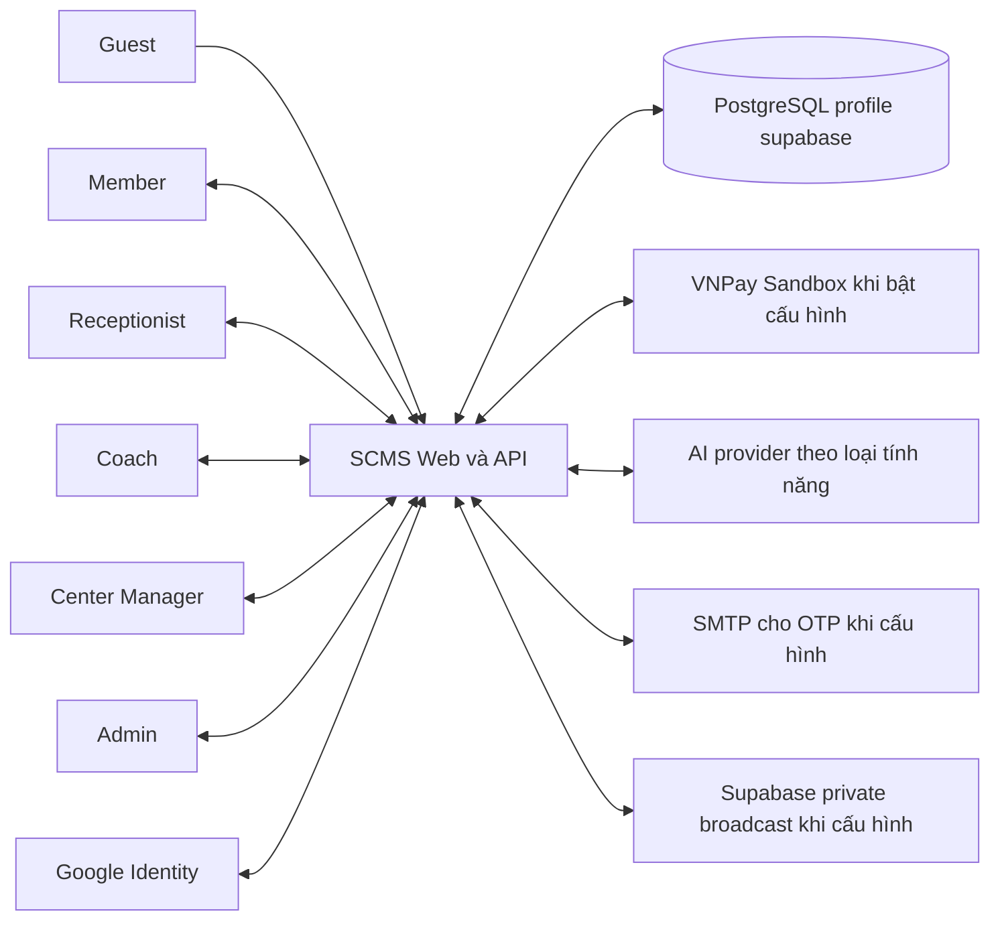

### 2 2 MVP baseline and implementation constraints

MVP được ghi theo phạm vi code hiện hành, kể cả phần mở rộng shop, sân, PT, ví, VNPay sandbox và chat. Không dùng checkbox backlog để xác nhận hoàn thành. Legacy class enrollment vẫn có code; waitlist chưa có entity/service/controller thực thi. Một tính năng có cấu hình ngoài được ghi là phụ thuộc cấu hình, không suy diễn môi trường live đang hoạt động.

Stack hiện hành là React TypeScript ở apps/web, Java 21 Spring Boot 3 ở apps/api và PostgreSQL với profile supabase. Schema là Code-First qua Hibernate; trigger nghiệp vụ PostgreSQL được nạp sau Hibernate. Trường hợp VPS PostgreSQL cục bộ vẫn dùng cùng profile và biến môi trường. Không viết lại schema từ bản ERD cũ.

## 3 System Features

### 3 1 Feature catalogue

| ID | Feature | Owner review | Actors | Modules |
| --- | --- | --- | --- | --- |
| FE-01 | Tài khoản và hồ sơ | Tài | Guest, mọi vai trò | auth; users; security |
| FE-02 | Danh mục và cơ sở vật chất | An | Guest, Center Manager | facilities; catalog |
| FE-03 | Vòng đời hội viên | An | Member, Receptionist, Center Manager | membership |
| FE-04 | Trial và KYC | An | Member, Receptionist | membership; users |
| FE-05 | Lớp học và đặt từng buổi | An | Member, Receptionist, Coach, Center Manager | scheduling |
| FE-06 | Đặt sân và làn | An | Member, Receptionist | courts |
| FE-07 | Check in và điểm danh | An | Member, Receptionist, Coach, Center Manager | attendance |
| FE-08 | PT và huấn luyện | Phong | Member, Coach, Center Manager | coaching; health |
| FE-09 | Trợ lý và gợi ý AI | Phong | Member, Coach, Receptionist, Center Manager theo endpoint | ai |
| FE-10 | Thanh toán và hóa đơn | Phong | Member, Receptionist, Center Manager, VNPay Sandbox | finance |
| FE-11 | Ví hội viên | Phong | Member | wallet; finance |
| FE-12 | Cửa hàng thực phẩm bổ sung | Thịnh | Guest, Member, Receptionist, Center Manager | shop |
| FE-13 | Hỗ trợ và escalation | Tài | Member, Receptionist, Center Manager | support |
| FE-14 | Tin nhắn trực tiếp | Tài | Member, Receptionist, Coach | chat |
| FE-15 | Thông báo | Tài | Mọi vai trò đăng nhập theo API | notifications |
| FE-16 | Yêu cầu nội bộ | Khoa | Receptionist, Coach, Center Manager | operations |
| FE-17 | Quản trị và báo cáo | Khoa | Admin, Center Manager | users; audit; reports; coaching |
| FE-18 | Trang công khai và điều hướng portal | Thịnh | Guest, mọi vai trò | apps/web/src/app; features/landing; shared/portal |

### FE-01 Tài khoản và hồ sơ

| Trường | Đặc tả |
| --- | --- |
| Primary actors | Guest, mọi vai trò |
| Description | Đăng ký, OTP, đăng nhập mật khẩu/Google, hồ sơ và avatar, KYC |
| Trigger | Actor mở màn hình hoặc chọn thao tác của nhóm tính năng. |
| Preconditions | Guest hoặc tài khoản hiện hữu tùy thao tác; API yêu cầu xác thực phải có principal hợp lệ. |
| Normal flow | Nhập dữ liệu → kiểm tra trùng/validation → tạo hoặc tìm user → phát/xác minh OTP khi cần → kích hoạt/đăng nhập → điều hướng theo role. Hồ sơ/KYC/avatar đi qua endpoint riêng. |
| Postconditions | User được tạo/kích hoạt theo flow; OTP challenge được xử lý theo kết quả; token chỉ được cấp ở nhánh login/Google tương ứng. Hồ sơ/avatar/KYC được cập nhật khi validation thành công. |
| Alternative and exception flows | Sai OTP/hết hạn; tài khoản locked/inactive/deleted; upload không hợp lệ |
| User interfaces | /login; /register; /profile |
| Analysis models | FL-IAM-01, ST-IAM-01, ST-OTP-01, SF-PUBLIC |
| Business Rules | BR-IAM-001, BR-IAM-002, BR-IAM-003, BR-IAM-004, BR-IAM-005, BR-IAM-006, BR-IAM-007, BR-IAM-008, BR-IAM-009, BR-IAM-010, BR-IAM-011, BR-IAM-012, BR-IAM-013, BR-IAM-014, BR-IAM-015, BR-IAM-016, BR-IAM-017, SEC-IAM-001, SEC-IAM-002, SEC-IAM-003, SEC-IAM-004, DI-IAM-001, BR-KYC-001, BR-KYC-002 |
| Source and traceability | auth; users; security; Jira tham chiếu: SCRUM-35/38/39/46/48/50/52/55/66 |

### FE-02 Danh mục và cơ sở vật chất

| Trường | Đặc tả |
| --- | --- |
| Primary actors | Guest, Center Manager |
| Description | Bộ môn, gói tập, phòng tier và thiết bị; public catalog chỉ đọc |
| Trigger | Actor mở màn hình hoặc chọn thao tác của nhóm tính năng. |
| Preconditions | Catalog công khai chỉ đọc; quản lý thay đổi dữ liệu theo role và validation. |
| Normal flow | Tải danh mục → chọn tạo/sửa/xóa → validate dữ liệu và tham chiếu → lưu hoặc trả conflict → UI làm mới danh sách. |
| Postconditions | Catalog lưu dữ liệu hợp lệ; thao tác xóa bị chặn khi có tham chiếu theo từng loại; dữ liệu lịch sử vẫn được giữ khi ngừng bán/đóng. |
| Alternative and exception flows | Không xóa dữ liệu đang được tham chiếu; phòng không khả dụng |
| User interfaces | /manager/catalogs; /manager/equipment |
| Analysis models | SW-ADMIN, ERD-02, SF-MANAGER |
| Business Rules | BR-CAT-001, BR-CAT-002, BR-CAT-003, BR-CAT-004, BR-CAT-005, BR-CAT-006, BR-CAT-007, BR-CAT-008 |
| Source and traceability | facilities; catalog; Jira tham chiếu: SCRUM-58/59/60 |

### FE-03 Vòng đời hội viên

| Trường | Đặc tả |
| --- | --- |
| Primary actors | Member, Receptionist, Center Manager |
| Description | Mua, gia hạn, nâng cấp, hủy yêu cầu chờ trả tiền, bảo lưu/resume, hủy qua lễ tân và duyệt hoàn |
| Trigger | Actor mở màn hình hoặc chọn thao tác của nhóm tính năng. |
| Preconditions | MEMBER hợp lệ; mua gói đầu đáp ứng KYC; các thao tác xét status và chuỗi kỳ hiện hữu. |
| Normal flow | Chọn mua/gia hạn/nâng cấp → kiểm tra kỳ, KYC và giá trị còn lại → tạo pending_payment với giá chốt → thanh toán hợp lệ → activate và revoke quyền cũ nếu áp dụng. |
| Postconditions | Kỳ mới chờ thanh toán giữ giá đã chốt; thanh toán hợp lệ kích hoạt kỳ tương ứng. Hold/resume thay đổi trạng thái, ngày hết hạn và quyền lịch theo guard; cancellation chỉ được quyết định qua flow staff/manager. |
| Alternative and exception flows | KYC; gói trùng/pending; hết hạn/frozen; giao dịch VNPay còn khả năng chốt |
| User interfaces | /member/packages; /staff/reception; /manager/reports |
| Analysis models | OPS-SW-01, OPS-SW-02, OPS-ST-01, OPS-ST-03 |
| Business Rules | BR-OPS-001, BR-OPS-002, BR-OPS-003, BR-OPS-004, BR-OPS-005, BR-OPS-006, BR-OPS-007, BR-OPS-008, BR-OPS-009, BR-OPS-010, BR-OPS-011, BR-OPS-012, BR-OPS-013, BR-OPS-014, BR-OPS-015, BR-OPS-016, BR-OPS-017, BR-OPS-018, BR-OPS-019, BR-OPS-020, BR-OPS-021, BR-OPS-022, BR-OPS-023, BR-OPS-024, BR-OPS-025, BR-OPS-031, BR-OPS-032, BR-OPS-033, BR-OPS-034, BR-OPS-035, BR-OPS-094 |
| Source and traceability | membership; Jira tham chiếu: SCRUM-71/86 |

### FE-04 Trial và KYC

| Trường | Đặc tả |
| --- | --- |
| Primary actors | Member, Receptionist |
| Description | Nộp giấy tờ, duyệt/từ chối trial, chống dùng lại danh tính; xác minh trước gói đầu |
| Trigger | Actor mở màn hình hoặc chọn thao tác của nhóm tính năng. |
| Preconditions | MEMBER gửi giấy tờ; trial chỉ cho người chưa từng có subscription; lễ tân xử lý trial. |
| Normal flow | Nhập giấy tờ/ảnh → kiểm tra lịch sử và hash danh tính → PENDING_APPROVAL → lễ tân duyệt/từ chối → APPROVED tạo trial active; REJECTED được gửi lại. |
| Postconditions | Trial APPROVED tạo active subscription miễn phí và cập nhật danh tính; REJECTED giữ lý do và cho gửi lại. Ngày trial thực tế theo code được nêu tại Open Issues. |
| Alternative and exception flows | Giấy tờ không hợp lệ; trial đã dùng; chờ duyệt; có lịch sử subscription |
| User interfaces | /member/packages; /staff/reception |
| Analysis models | OPS-ST-02, OPS-SW-01 |
| Business Rules | BR-OPS-026, BR-OPS-027, BR-OPS-028, BR-OPS-029, BR-OPS-030, BR-KYC-001, BR-KYC-002 |
| Source and traceability | membership; users; Jira tham chiếu: Phần mở rộng sau backlog |

### FE-05 Lớp học và đặt từng buổi

| Trường | Đặc tả |
| --- | --- |
| Primary actors | Member, Receptionist, Coach, Center Manager |
| Description | CRUD lớp/lịch, đăng ký legacy cả lớp và đặt lẻ/bulk từng buổi, hủy/đổi trạng thái lớp |
| Trigger | Actor mở màn hình hoặc chọn thao tác của nhóm tính năng. |
| Preconditions | Lớp active, session scheduled trong tương lai, quyền gói phù hợp, còn chỗ và không xung đột. |
| Normal flow | Chọn lớp/buổi hoặc bulk → kiểm tra entitlement, trùng chỗ, tổng capacity và overlap → ghi booked → trả thành công/skipped theo mode → hủy hợp lệ chuyển cancelled. |
| Postconditions | Đặt thành công lưu class_enrollment hoặc session_booking booked; số chỗ được dùng chung giữa hai mô hình. Hủy buổi không hủy enrollment của những buổi khác. |
| Alternative and exception flows | Hết chỗ; trùng lịch; gói không phủ ngày tập; không có waitlist runtime |
| User interfaces | /member/classes; /staff/classes; /coach/classes |
| Analysis models | OPS-SW-03, OPS-ST-04, OPS-ST-05 |
| Business Rules | BR-OPS-036, BR-OPS-037, BR-OPS-038, BR-OPS-039, BR-OPS-040, BR-OPS-041, BR-OPS-042, BR-OPS-043, BR-OPS-044, BR-OPS-045, BR-OPS-046, BR-OPS-047, BR-OPS-048, BR-OPS-049, BR-OPS-050, BR-OPS-051, BR-OPS-093 |
| Source and traceability | scheduling; Jira tham chiếu: SCRUM-72/73/81/88/113 |

### FE-06 Đặt sân và làn

| Trường | Đặc tả |
| --- | --- |
| Primary actors | Member, Receptionist |
| Description | Chọn slot, lặp lịch, tính quota/giá sân, trả tiền và hủy; hết hạn giữ chỗ |
| Trigger | Actor mở màn hình hoặc chọn thao tác của nhóm tính năng. |
| Preconditions | MEMBER active, sân available, slot hợp lệ trong giờ hoạt động và entitlement phủ ngày thuê. |
| Normal flow | Chọn sân/ngày/slot → kiểm tra conflict → xác định quota hay phí → ghi booking/payment → trả tiền khi phải thu → dùng sân hoặc hủy/expiry theo guard. |
| Postconditions | Court booking lưu booked/cancelled cùng quota hoặc paymentStatus độc lập; yêu cầu phí tạo payment tương ứng. Hủy và hết hạn giải phóng slot theo flow, không tự suy ra hoàn ví. |
| Alternative and exception flows | Sân không khả dụng; xung đột; cutoff 2 giờ khi member hủy; chưa trả tiền |
| User interfaces | /member/courts; /staff/courts |
| Analysis models | OPS-SW-04, OPS-ST-06 |
| Business Rules | BR-OPS-062, BR-OPS-063, BR-OPS-064, BR-OPS-065, BR-OPS-066, BR-OPS-067, BR-OPS-068, BR-OPS-069, BR-OPS-070, BR-OPS-071, BR-OPS-072, BR-OPS-073, BR-OPS-096, BR-OPS-110 |
| Source and traceability | courts; Jira tham chiếu: Phần mở rộng sau backlog |

### FE-07 Check in và điểm danh

| Trường | Đặc tả |
| --- | --- |
| Primary actors | Member, Receptionist, Coach, Center Manager |
| Description | QR thành viên/QR cửa, self scan, vào/ra, anti-passback, streak và batch attendance |
| Trigger | Actor mở màn hình hoặc chọn thao tác của nhóm tính năng. |
| Preconditions | Xác thực/role và QR phù hợp từng endpoint; attendance chỉ cho session đã bắt đầu và member có chỗ. |
| Normal flow | Quét QR → xác minh user/gói/cổng và anti-passback → lưu GRANTED hoặc DENIED → staff checkout hoặc auto-checkout visit stale. Attendance hợp nhất roster, validate và upsert 4 trạng thái. |
| Postconditions | Mỗi lượt quét lưu GRANTED/DENIED và lý do; checkout gán timestamp, không đổi sang status CheckedOut. Attendance lưu/upsert present, late, absent hoặc excused; streak tính từ ngày GRANTED. |
| Alternative and exception flows | QR hết hạn; quyền gói không hợp lệ; đã vào chưa ra; điểm danh trước giờ |
| User interfaces | /member/card; /member/check-in; /member/streak; /staff/check-in; /staff/attendance |
| Analysis models | OPS-SW-06, OPS-ST-08 |
| Business Rules | BR-OPS-052, BR-OPS-053, BR-OPS-054, BR-OPS-055, BR-OPS-056, BR-OPS-057, BR-OPS-058, BR-OPS-059, BR-OPS-060, BR-OPS-061, BR-OPS-097, BR-OPS-098, BR-OPS-124, BR-OPS-125, BR-OPS-126, BR-OPS-127 |
| Source and traceability | attendance; Jira tham chiếu: SCRUM-75/83/87/111/123 |

### FE-08 PT và huấn luyện

| Trường | Đặc tả |
| --- | --- |
| Primary actors | Member, Coach, Center Manager |
| Description | Đặt PT, quota và phí, phân công HLV, giáo án/items/completions, đánh giá buổi tập, metrics, review HLV |
| Trigger | Actor mở màn hình hoặc chọn thao tác của nhóm tính năng. |
| Preconditions | Vai trò và quan hệ coach–member đáp ứng access gate của từng use case; lịch PT và entitlement hợp lệ. |
| Normal flow | Xem member theo scope → đặt PT hoặc soạn plan/items → active plan → hội viên đánh dấu completion hôm nay → coach ghi metric/evaluation; manager quản lý phân công/review theo endpoint. |
| Postconditions | Booking PT, giáo án/items, completion, metric/evaluation hoặc review được ghi theo use case; completion bài tập không tự chuyển plan sang completed khi chưa có writer. |
| Alternative and exception flows | Sai current-coach scope; buổi trùng; quota; không có quyền xem sức khỏe |
| User interfaces | /member/classes; /member/progress; /coach/training-plans; /manager/coach-assignments; /manager/coach-reviews |
| Analysis models | OPS-SW-05, OPS-ST-07, OPS-ST-09, OPS-SW-06 |
| Business Rules | BR-OPS-074, BR-OPS-075, BR-OPS-076, BR-OPS-077, BR-OPS-078, BR-OPS-079, BR-OPS-080, BR-OPS-081, BR-OPS-082, BR-OPS-083, BR-OPS-084, BR-OPS-085, BR-OPS-086, BR-OPS-087, BR-OPS-088, BR-OPS-089, BR-OPS-090, BR-OPS-091, BR-OPS-092, BR-OPS-095, BR-OPS-099, BR-OPS-111, BR-OPS-112, BR-OPS-113, BR-OPS-114, BR-OPS-115, BR-OPS-116, BR-OPS-117, BR-OPS-118, BR-OPS-119, BR-OPS-120, BR-OPS-121, BR-OPS-122, BR-OPS-123 |
| Source and traceability | coaching; health; Jira tham chiếu: SCRUM-116/119/121/122/123/129 |

### FE-09 Trợ lý và gợi ý AI

| Trường | Đặc tả |
| --- | --- |
| Primary actors | Member, Coach, Receptionist, Center Manager theo endpoint |
| Description | Chat sessions/messages và gợi ý giáo án có lưu log; AI recommendation và AI chat có chế độ provider khác nhau |
| Trigger | Actor mở màn hình hoặc chọn thao tác của nhóm tính năng. |
| Preconditions | Vai trò được API cho phép; provider/config phù hợp; recommendation và chat không dùng cùng fallback policy. |
| Normal flow | Chọn chat hoặc workout recommendation → gom dữ liệu theo quyền → gọi provider/adapter tương ứng → lưu session/message hoặc recommendation log → HLV có thể áp dụng vào giáo án. |
| Postconditions | Chat lưu phiên/tin; recommendation lưu context/kết quả và cờ applied khi áp dụng. Provider lỗi trả lỗi theo adapter; chat không tự tạo phản hồi mock. |
| Alternative and exception flows | Provider/key chưa cấu hình; lỗi upstream; recommendation có mock cấu hình; chat không tự mock |
| User interfaces | Widget Tin nhắn; /coach/training-plans |
| Analysis models | FL-AI-01, SF-MEMBER, SF-COACH |
| Business Rules | BR-AI-001, BR-AI-003, BR-AI-004, BR-AI-005, DI-AI-001, DI-AI-002 |
| Source and traceability | ai; Jira tham chiếu: SCRUM-117/118/126 |

### FE-10 Thanh toán và hóa đơn

| Trường | Đặc tả |
| --- | --- |
| Primary actors | Member, Receptionist, Center Manager, VNPay Sandbox |
| Description | Thanh toán dịch vụ, xác nhận tại quầy, VNPay IPN/verify-return, invoice và tải hóa đơn, partial/full refund |
| Trigger | Actor mở màn hình hoặc chọn thao tác của nhóm tính năng. |
| Preconditions | Payment có member/target/số tiền phù hợp; caller có quyền; VNPay cần bật sandbox và credentials. |
| Normal flow | Tạo payment → nhận xác nhận tại quầy hoặc signed VNPay return/IPN → validate target/amount/signature/idempotency → ghi success/failed → phát invoice khi đủ điều kiện; refund là use case riêng. |
| Postconditions | Payment/attempt được cập nhật theo đối soát; invoice được phát khi flow đủ điều kiện. Partial refund có thể giữ success; full refund đổi refunded và thu hồi quyền theo target. |
| Alternative and exception flows | Chữ ký/số tiền sai; callback lặp; timeout; refund quá mức; generic refund khác wallet credit |
| User interfaces | /member/packages/checkout; /member/payments/vnpay/return; /member/invoices; /staff/reception |
| Analysis models | FIN-ST-01, FIN-ST-02, FIN-SW-01, FIN-SW-02 |
| Business Rules | BR-FIN-001, BR-FIN-002, BR-FIN-003, BR-FIN-004, BR-FIN-005, BR-FIN-006, BR-FIN-007, BR-FIN-008, BR-FIN-009, BR-FIN-010, BR-FIN-011, BR-FIN-012, BR-FIN-013, BR-FIN-014, BR-FIN-015, BR-FIN-016, BR-FIN-017, BR-FIN-018, BR-FIN-019, BR-FIN-020, BR-FIN-021, BR-FIN-022, BR-FIN-023, BR-FIN-024, BR-FIN-025 |
| Source and traceability | finance; Jira tham chiếu: SCRUM-76/77/78/125 |

### FE-11 Ví hội viên

| Trường | Đặc tả |
| --- | --- |
| Primary actors | Member |
| Description | Số dư và lịch sử, nạp VNPay, chi trả dịch vụ, credit hoàn theo từng use case |
| Trigger | Actor mở màn hình hoặc chọn thao tác của nhóm tính năng. |
| Preconditions | Principal có ví/member theo endpoint; số tiền hợp lệ, đủ balance khi debit. |
| Normal flow | Tải số dư/ledger → chọn topup hoặc thanh toán → lock/check balance và reference theo method → credit/debit → lưu ledger; tiền hoàn chỉ credit ở những flow thực gọi WalletService. |
| Postconditions | Balance và ledger được ghi trong transaction với lock/guard của method. VNPay thanh toán dịch vụ có cặp credit/debit; generic payment refund không mặc định cộng ví. |
| Alternative and exception flows | Không đủ số dư; callback lặp; không có route /wallet riêng |
| User interfaces | Menu avatar trong PortalShell |
| Analysis models | WAL-SW-01, FIN-SW-01 |
| Business Rules | BR-WAL-001, BR-WAL-002, BR-WAL-003, BR-WAL-004, BR-WAL-005, BR-WAL-006, BR-WAL-007, BR-WAL-008, BR-WAL-009, BR-WAL-010, BR-WAL-011 |
| Source and traceability | wallet; finance; Jira tham chiếu: Phần mở rộng sau backlog |

### FE-12 Cửa hàng thực phẩm bổ sung

| Trường | Đặc tả |
| --- | --- |
| Primary actors | Guest, Member, Receptionist, Center Manager |
| Description | Catalog, variants, giỏ, server quote, địa chỉ, pickup/shipping, order và kho/catalog admin |
| Trigger | Actor mở màn hình hoặc chọn thao tác của nhóm tính năng. |
| Preconditions | Guest xem/giỏ/quote; tạo order cần MEMBER hợp lệ, không cần gói tập active; variant còn tồn. |
| Normal flow | Xem catalog/variant → giỏ → quote server → chọn pickup/shipping và địa chỉ → tạo order giữ tồn → thanh toán hoặc chờ counter → staff xử lý → hoàn thành/hủy và xử lý stock/refund tương ứng. |
| Postconditions | Order giữ snapshot giá và thông tin nhận hàng; tồn được reserve/release theo vòng đời. Chỉ các transition staff cho phép được ghi; order đã trả có flow credit hoàn vào ví khi hủy hợp lệ. |
| Alternative and exception flows | Giá/tồn kho thay đổi; địa chỉ; hết hạn giữ hàng; transition sai; không yêu cầu gói tập active |
| User interfaces | /products; /checkout; /member/orders; /staff/orders; /manager/products |
| Analysis models | SHOP-ST-01, SHOP-SW-01, ERD-06, SF-PUBLIC |
| Business Rules | BR-SHOP-001, BR-SHOP-002, BR-SHOP-003, BR-SHOP-004, BR-SHOP-005, BR-SHOP-006, BR-SHOP-007, BR-SHOP-008, BR-SHOP-009, BR-SHOP-010, BR-SHOP-011, BR-SHOP-012, BR-SHOP-013, BR-SHOP-014, BR-SHOP-015, BR-SHOP-016, BR-SHOP-017, BR-SHOP-018, BR-SHOP-019, BR-SHOP-020, BR-SHOP-021, BR-SHOP-022, BR-SHOP-023, BR-SHOP-024, BR-SHOP-025, BR-SHOP-026, BR-SHOP-027, BR-SHOP-028, BR-SHOP-029 |
| Source and traceability | shop; Jira tham chiếu: Phần mở rộng sau backlog |

### FE-13 Hỗ trợ và escalation

| Trường | Đặc tả |
| --- | --- |
| Primary actors | Member, Receptionist, Center Manager |
| Description | Tạo ticket, hội thoại theo ticket, lễ tân xử lý và chuyển cấp quản lý |
| Trigger | Actor mở màn hình hoặc chọn thao tác của nhóm tính năng. |
| Preconditions | MEMBER tạo ticket; receptionist xử lý; manager chỉ truy cập khi escalated. |
| Normal flow | Member tạo open ticket → lễ tân tiếp nhận/trao đổi → chuyển cấp khi cần → manager chỉ nhận escalated ticket → cập nhật trạng thái/nhắn tin theo guards. |
| Postconditions | Ticket và message được lưu; escalation ghi actor/thời gian/lý do; resolved/closed theo guard service. Chưa có tự đóng 72 giờ trong implementation đã khảo sát. |
| Alternative and exception flows | Quản lý chỉ truy cập ticket đã escalation; resolved/closed theo guard; không giả định tự đóng 72h |
| User interfaces | /member/support; /staff/support; /manager/support |
| Analysis models | ST-SUP-01, FL-SUP-01 |
| Business Rules | BR-SUP-001, BR-SUP-002, BR-SUP-003, BR-SUP-004, BR-SUP-005, BR-SUP-006, BR-SUP-007, BR-SUP-008, BR-SUP-009, BR-SUP-010, BR-SUP-011 |
| Source and traceability | support; Jira tham chiếu: SCRUM-68/128 |

### FE-14 Tin nhắn trực tiếp

| Trường | Đặc tả |
| --- | --- |
| Primary actors | Member, Receptionist, Coach |
| Description | Tạo/mở hội thoại, gửi tin idempotent, đọc/chưa đọc, cảm xúc trái tim cục bộ ở UI, realtime token |
| Trigger | Actor mở màn hình hoặc chọn thao tác của nhóm tính năng. |
| Preconditions | MEMBER hoặc staff/coach có trạng thái phù hợp; caller là participant trong hội thoại. |
| Normal flow | Chọn staff/coach → mở/tìm cặp conversation → gửi message với clientMessageId → lưu và broadcast khi cấu hình → cập nhật last-read và số chưa đọc. Trái tim chỉ là state UI cục bộ. |
| Postconditions | Message được lưu theo participant và retry key; con trỏ read chỉ tiến về phía trước. Trái tim không lưu/đồng bộ qua API. Broadcast tùy cấu hình và không thay thế kiểm tra quyền đọc API. |
| Alternative and exception flows | Sai participant; tài khoản inactive; không suy ra phải có PT booking trước khi chat coach |
| User interfaces | /messages; widget dùng chung |
| Analysis models | FL-CHAT-01 |
| Business Rules | BR-CHAT-001, BR-CHAT-002, BR-CHAT-003, BR-CHAT-004, BR-CHAT-005 |
| Source and traceability | chat; Jira tham chiếu: Phần mở rộng sau backlog |

### FE-15 Thông báo

| Trường | Đặc tả |
| --- | --- |
| Primary actors | Mọi vai trò đăng nhập theo API |
| Description | Danh sách/chưa đọc/đánh dấu đọc và thông báo theo sự kiện; kênh in-app |
| Trigger | Actor mở màn hình hoặc chọn thao tác của nhóm tính năng. |
| Preconditions | Người dùng đã xác thực; chỉ truy cập thông báo thuộc chính mình. |
| Normal flow | Nghiệp vụ phát sinh → tạo in-app notification khi flow có gọi service → người nhận tải danh sách/badge → đánh dấu đã đọc; ngoài in-app phụ thuộc adapter. |
| Postconditions | Notification được lưu cho người nhận; is_read được cập nhật theo hành động. Bản ghi không chứng minh đã giao SMS/push qua dịch vụ ngoài. |
| Alternative and exception flows | Bản ghi read flag không chứng minh đã gửi SMS/push; adapter ngoài có mock |
| User interfaces | /member/notifications; chuông portal |
| Analysis models | FL-SUP-01, FL-CHAT-01, SW-MASTER |
| Business Rules | BR-NOT-001, BR-NOT-002, BR-NOT-003, BR-NOT-004, DI-NOT-001 |
| Source and traceability | notifications; Jira tham chiếu: SCRUM-67/112/127 |

### FE-16 Yêu cầu nội bộ

| Trường | Đặc tả |
| --- | --- |
| Primary actors | Receptionist, Coach, Center Manager |
| Description | Nghỉ/đổi ca/đổi lịch/khác; gửi, hủy và manager duyệt/từ chối |
| Trigger | Actor mở màn hình hoặc chọn thao tác của nhóm tính năng. |
| Preconditions | Receptionist/Coach gửi yêu cầu; Manager review; request đúng trạng thái và người sở hữu. |
| Normal flow | Chọn loại và nhập lý do/ngày/ca → tạo PENDING → người gửi có thể hủy theo guard hoặc manager APPROVED/REJECTED → lưu reviewer và notes. |
| Postconditions | Request lưu PENDING hoặc kết quả APPROVED/REJECTED/CANCELLED cùng actor/thời gian/notes tương ứng. Request type vẫn độc lập với status. |
| Alternative and exception flows | Người gửi và người duyệt theo role; request đã xử lý không duyệt lặp |
| User interfaces | /staff/requests; /manager/requests |
| Analysis models | ST-OPS-01, FL-OPS-01 |
| Business Rules | BR-INT-001, BR-INT-002, BR-INT-003, BR-INT-004, BR-INT-005, BR-INT-006 |
| Source and traceability | operations; Jira tham chiếu: Phần mở rộng sau backlog |

### FE-17 Quản trị và báo cáo

| Trường | Đặc tả |
| --- | --- |
| Primary actors | Admin, Center Manager |
| Description | Admin quản lý toàn hệ thống; manager nhân sự lễ tân/HLV, audit logs, doanh thu, công suất, snapshots và review |
| Trigger | Actor mở màn hình hoặc chọn thao tác của nhóm tính năng. |
| Preconditions | Admin/Center Manager theo từng endpoint; có phạm vi user/cơ sở phù hợp. |
| Normal flow | Chọn module có quyền → nhập bộ lọc/thay đổi → service kiểm tra scope/ràng buộc → query/report hoặc ghi → trả dữ liệu và audit ở flow có instrument. |
| Postconditions | Danh sách/tài khoản/catalog/review hoặc báo cáo được trả trong phạm vi endpoint cho phép. Audit chỉ được tuyên bố ở use case có instrumentation; không suy ra report export chưa tồn tại. |
| Alternative and exception flows | Admin và manager có phạm vi khác; không mặc định admin được mọi endpoint |
| User interfaces | /admin/users; /manager/staff-accounts; /manager/reports; /manager/audit-logs |
| Analysis models | SW-ADMIN, SF-MANAGER, SF-ADMIN |
| Business Rules | BR-IAM-001, BR-IAM-002, BR-IAM-003, BR-IAM-004, BR-IAM-005, BR-IAM-006, BR-IAM-007, BR-IAM-008, BR-IAM-009, BR-IAM-010, BR-IAM-011, BR-IAM-012, BR-IAM-013, BR-IAM-014, BR-IAM-015, BR-IAM-016, BR-IAM-017, BR-RPT-001, BR-RPT-002, BR-RPT-003, BR-RPT-004, BR-RPT-005, BR-RPT-006, BR-RPT-007, SEC-IAM-001, SEC-IAM-002, SEC-IAM-003, SEC-IAM-004, DI-IAM-001 |
| Source and traceability | users; audit; reports; coaching; Jira tham chiếu: SCRUM-50/52/69/79/84/120/124 |

### FE-18 Trang công khai và điều hướng portal

| Trường | Đặc tả |
| --- | --- |
| Primary actors | Guest, mọi vai trò |
| Description | Landing, trang bộ môn/HLV, catalog shop, login redirect, dashboard theo role, modal/widget dùng chung |
| Trigger | Actor mở màn hình hoặc chọn thao tác của nhóm tính năng. |
| Preconditions | Public routes truy cập công khai; portal cần session và role tương ứng. |
| Normal flow | Guest khám phá landing → vào feature/public detail → đăng nhập khi cần hành động bảo vệ → PortalHome chọn màn theo role → page compose feature và hiển thị trạng thái tải/lỗi phù hợp. |
| Postconditions | UI hiển thị đúng page/overlay theo router và RoleGuard; chuyển lại checkout sau login giữ purchase context theo flow. Các lỗi tải/không quyền được hiển thị theo component hiện hành. |
| Alternative and exception flows | Loading/empty/error/forbidden; alias/redirect không tạo feature riêng |
| User interfaces | /; /sports/:sportId; /trainers; /portal |
| Analysis models | SF-PUBLIC, SF-MEMBER, SF-RECEPTION, SF-COACH, SF-MANAGER, SF-ADMIN |
| Business Rules | Quy tắc điều hướng và authorization tham chiếu theo từng feature. |
| Source and traceability | apps/web/src/app; features/landing; shared/portal; Jira tham chiếu: SCRUM-85 và frontend Sprint 1 |

### 3 2 Existing swimlanes and required corrections

Đã đọc XML các tab trong sports_center_all_flows_swimlane.drawio, sports_center_main_flow_swimlane.drawio, sports_center_flow.drawio, state_diagrams.drawio, StateDiagram.drawio và các ERD cũ. Bảng sau chỉ rõ nội dung sửa/thêm/loại; bộ sơ đồ phía sau là bản dựng mới theo code, không ghi đè sơ đồ lịch sử.

| ID | Loại và chủ đề | Xử lý | Thay đổi | Owner |
| --- | --- | --- | --- | --- |
| G01 | Swimlane Master flow | Sửa | Thêm Guest và Admin; 5 role người dùng, VNPay/AI là hệ thống ngoài; phân biệt actor với thành viên nhóm | Khoa |
| G02 | Swimlane Auth và OTP | Tách chi tiết | Register, OTP/resend, login/Google; không vẽ pending registration thành users.status | Tài |
| G03 | Swimlane Mua gia hạn nâng cấp gói | Sửa | KYC, quotedPrice, chuỗi gia hạn, credit nâng cấp và kích hoạt qua thanh toán | An |
| G04 | Swimlane Trial KYC | Thêm | Giấy tờ → lễ tân duyệt/từ chối → tạo trial active | An |
| G05 | Swimlane Hold resume | Thêm | Member yêu cầu, lễ tân quyết định, frozen và resume/tự resume; hủy quyền lịch tương lai | An |
| G06 | Swimlane Hủy gói hoàn vào ví | Thêm | Lễ tân gửi thay member; manager quyết định; credit wallet; member request service không expose | Phong |
| G07 | Swimlane Lớp và từng buổi | Sửa | Hai mô hình đặt lớp; sức chứa dùng chung; bulk partial result; bỏ nhánh hàng chờ runtime | An |
| G08 | Swimlane Sân làn | Thêm | Quota, slot giờ, phí, thanh toán và deadline/hủy | An |
| G09 | Swimlane PT booking | Thêm | HLV, quota, phí, conflict và cutoff PT khác sân | Phong |
| G10 | Swimlane Check in và attendance | Sửa | Self-scan QR cửa, anti-passback, GRANTED/DENIED, checkout, streak; attendance là nghiệp vụ riêng | An |
| G11 | Swimlane Coaching và AI | Sửa | Current-coach access, draft→active, member completion, health; không có AI_Generated như trạng thái | Phong |
| G12 | Swimlane VNPay và ví | Thêm | Tạo payment/URL, signed verify-return và IPN cùng settle, topup/debit, idempotency, timeout | Phong |
| G13 | Swimlane Mua sản phẩm | Thêm | Public cart → login → quote server → pickup/shipping → pay/expiry | Thịnh |
| G14 | Swimlane Kho và fulfillment | Thêm | Catalog/variants, stock movement, staff order transition, refund/cancel | Khoa |
| G15 | Swimlane Support escalation | Sửa | Lễ tân tiếp nhận, manager chỉ xử lý escalation; không tự đóng sau 72h | Tài |
| G16 | Swimlane Yêu cầu nội bộ | Sửa | Tách khỏi support; request type không là state | Tài |
| G17 | Swimlane Direct chat và AI chat | Thêm | Participant guard, send idempotent, seen và reaction cục bộ ở UI, AI provider; popup không là page mới | Tài |
| G18 | Swimlane Quản trị báo cáo | Sửa | Tách Admin/Manager; báo cáo thực có, không tự thêm công nợ/trả góp/Excel export | Khoa |
| G19 | State Membership và hold | Sửa | Bổ sung frozen; holdStatus là máy con độc lập; expiring là nhãn ngày, không DB state | An |
| G20 | State Session booking và legacy | Sửa và thêm | Tách hai thực thể; completed enum không đủ chứng minh có writer | An |
| G21 | State Court booking | Thêm | Booking booked/cancelled tách paymentStatus | An |
| G22 | State PT booking | Thêm | confirmed/cancelled/completed theo writer, payment state độc lập | Phong |
| G23 | State Payment VNPay order | Sửa và thêm | 3 vòng đời riêng; partial refund không đồng nghĩa refunded | Phong |
| G24 | State Trial và cancellation request | Thêm | PENDING_APPROVAL/APPROVED/REJECTED và PENDING/APPROVED/REJECTED | An |
| G25 | State Support và internal request | Sửa và thêm | Transition service thực, escalation là thuộc tính độc lập, bỏ tự đóng 72h | Tài |
| G26 | State Checkin attendance notification AI | Sửa | Phân biệt trạng thái lưu và trạng thái UI/tính từ timestamp/boolean; bỏ gửi SMS/rating không có code | Tài |
| G27 | State Waitlist | Loại khỏi as-built | Không có entity/service/controller thực thi; giữ ở open issue hoặc lịch sử | An |
| G28 | Screen flow Flow theo năm vai trò | Thêm | Public/Member/Receptionist/Coach/Manager/Admin; Guest không là role lưu DB; có modal/widgets và aliases | Khoa |
| G29 | Conceptual Mô hình khái niệm | Vẽ lại | Khái niệm nghiệp vụ, tên quan hệ/cardinality; không bịa SportsCenter entity hay AI Engine table | Thịnh |
| G30 | ERD ERD hiện hành | Vẽ lại | 56 entities + 2 join tables + product_goals collection table, FK/PK/nullability/unique; không dùng T-SQL 33 bảng | Khoa |

### 3 3 Swimlane diagrams

Mỗi làn là actor hoặc thành phần chịu trách nhiệm. Nhánh lỗi, hủy, kiểm tra quyền và cấu hình ngoài được giữ theo code. Một số luồng liên quan được ghép trong cùng sơ đồ để thấy side effects giữa membership, booking và finance.

### SW-MASTER Luồng nghiệp vụ tổng thể hiện hành


Nguồn: Feature catalogue FE-01–FE-18; router và service layer hiện tại

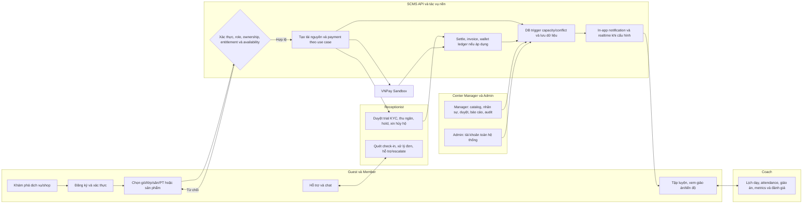

### SW-ADMIN Quản trị catalog và báo cáo


Nguồn: apps/api/src/main/java/com/swp391/scms/reports/ReportController.java:1; apps/api/src/main/java/com/swp391/scms/users/StaffAccountController.java:1

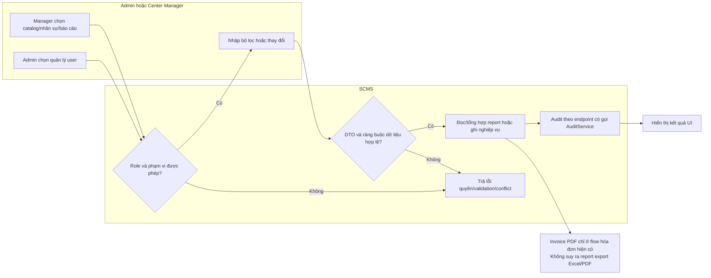

### FL-IAM-01 Đăng ký, OTP và hai nhánh đăng nhập Google


Nguồn: apps/api/src/main/java/com/swp391/scms/auth/AuthController.java:76; apps/api/src/main/java/com/swp391/scms/auth/AuthController.java:126; apps/api/src/main/java/com/swp391/scms/auth/AuthController.java:179; apps/api/src/main/java/com/swp391/scms/auth/AuthService.java:185; apps/api/src/main/java/com/swp391/scms/auth/AuthService.java:408; apps/api/src/main/java/com/swp391/scms/auth/AuthService.java:456

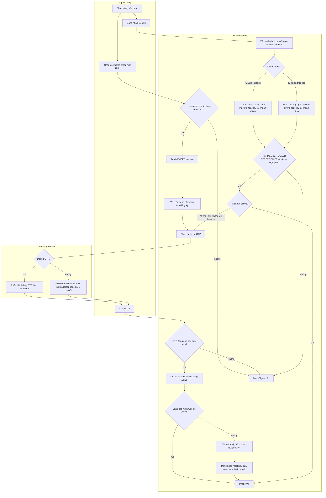

### FL-SUP-01 Tiếp nhận và chuyển cấp khiếu nại


Nguồn: apps/api/src/main/java/com/swp391/scms/support/SupportRequestService.java:105; apps/api/src/main/java/com/swp391/scms/support/SupportRequestService.java:214; apps/api/src/main/java/com/swp391/scms/support/SupportRequestService.java:391; apps/api/src/main/java/com/swp391/scms/support/SupportRequestService.java:416

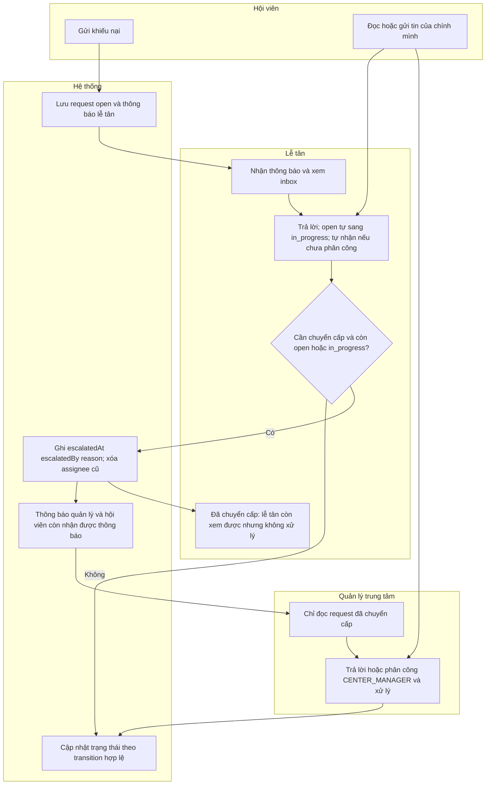

### FL-OPS-01 Gửi và duyệt đơn nghỉ/đổi ca/đổi lịch


Nguồn: apps/api/src/main/java/com/swp391/scms/operations/service/StaffInternalRequestService.java:65; apps/api/src/main/java/com/swp391/scms/operations/service/StaffInternalRequestService.java:145; apps/api/src/main/java/com/swp391/scms/operations/service/StaffInternalRequestService.java:173; apps/api/src/main/java/com/swp391/scms/operations/service/StaffInternalRequestService.java:258

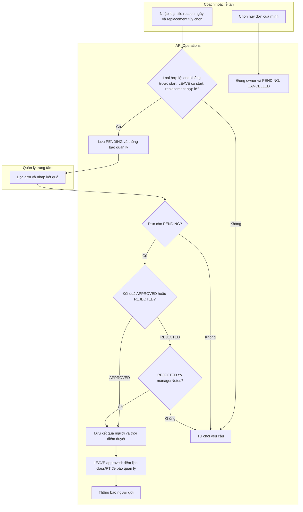

### FL-CHAT-01 Chat trực tiếp và realtime tùy cấu hình


Nguồn: apps/api/src/main/java/com/swp391/scms/chat/service/ChatService.java:70; apps/api/src/main/java/com/swp391/scms/chat/service/ChatService.java:98; apps/api/src/main/java/com/swp391/scms/chat/service/ChatRealtimeService.java:38; apps/web/src/features/chat/chatRealtime.ts:55

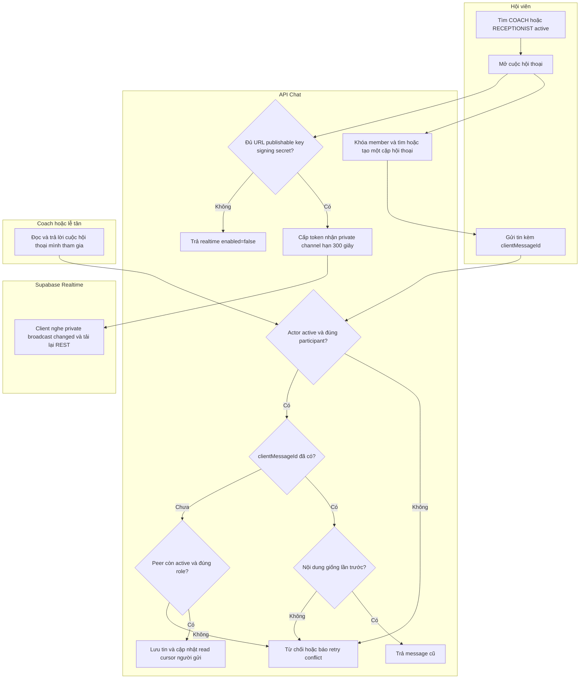

### FL-AI-01 AI giáo án và AI chatbot có adapter khác nhau


Nguồn: apps/api/src/main/java/com/swp391/scms/ai/client/AiClientConfig.java:35; apps/api/src/main/java/com/swp391/scms/ai/client/AiChatProvider.java:104; apps/api/src/main/java/com/swp391/scms/ai/service/AiRecommendationService.java:146; apps/api/src/main/java/com/swp391/scms/ai/service/AiRecommendationService.java:245; apps/api/src/main/java/com/swp391/scms/ai/service/AiChatService.java:197

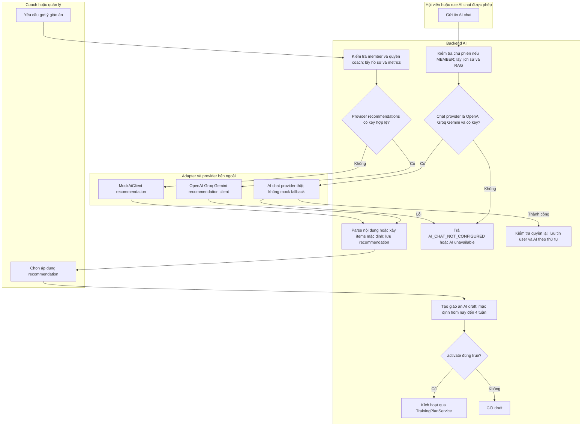

### OPS-SW-01 Trial/KYC → mua/gia hạn/nâng cấp


Nguồn: apps/api/src/main/java/com/swp391/scms/membership/service/MemberTrialService.java:132; apps/api/src/main/java/com/swp391/scms/membership/service/MemberTrialService.java:250; apps/api/src/main/java/com/swp391/scms/membership/service/MembershipSubscriptionService.java:136; apps/api/src/main/java/com/swp391/scms/membership/service/MembershipSubscriptionService.java:239; apps/api/src/main/java/com/swp391/scms/membership/service/MembershipSubscriptionService.java:376; apps/api/src/main/java/com/swp391/scms/finance/service/PaymentService.java:660

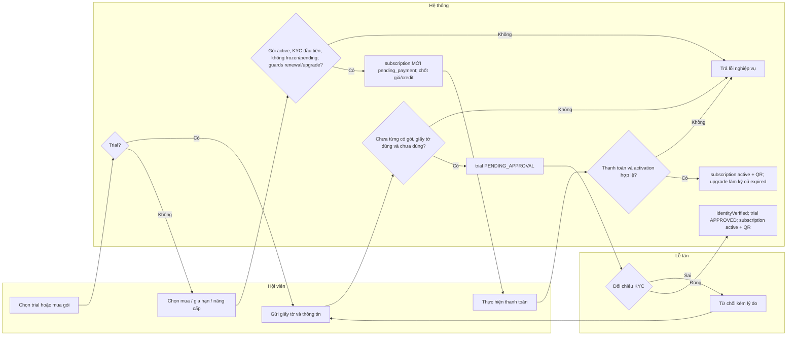

### OPS-SW-02 Hold, resume, hủy gói và giải phóng quyền


Nguồn: apps/api/src/main/java/com/swp391/scms/membership/service/MembershipSubscriptionService.java:554; apps/api/src/main/java/com/swp391/scms/membership/service/MembershipSubscriptionService.java:639; apps/api/src/main/java/com/swp391/scms/membership/service/MembershipSubscriptionService.java:731; apps/api/src/main/java/com/swp391/scms/membership/service/MembershipCancellationService.java:197; apps/api/src/main/java/com/swp391/scms/membership/service/EntitlementRevocationService.java:56; apps/api/src/main/java/com/swp391/scms/membership/MembershipCancellationController.java:37

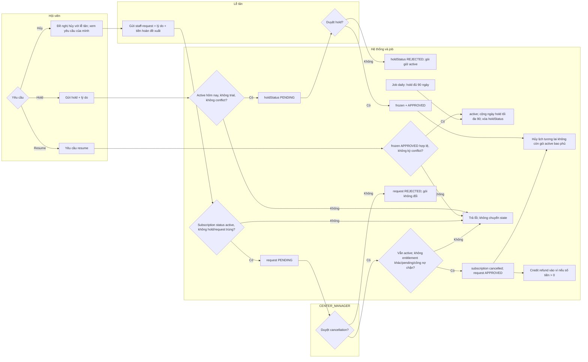

### OPS-SW-03 Đặt/hủy lớp: từng buổi và legacy cả lớp


Nguồn: apps/api/src/main/java/com/swp391/scms/scheduling/service/SessionBookingService.java:128; apps/api/src/main/java/com/swp391/scms/scheduling/service/SessionBookingService.java:165; apps/api/src/main/java/com/swp391/scms/scheduling/service/EnrollmentService.java:90; apps/api/src/main/java/com/swp391/scms/scheduling/service/EnrollmentService.java:248; apps/api/src/main/java/com/swp391/scms/scheduling/service/ClassSessionService.java:69

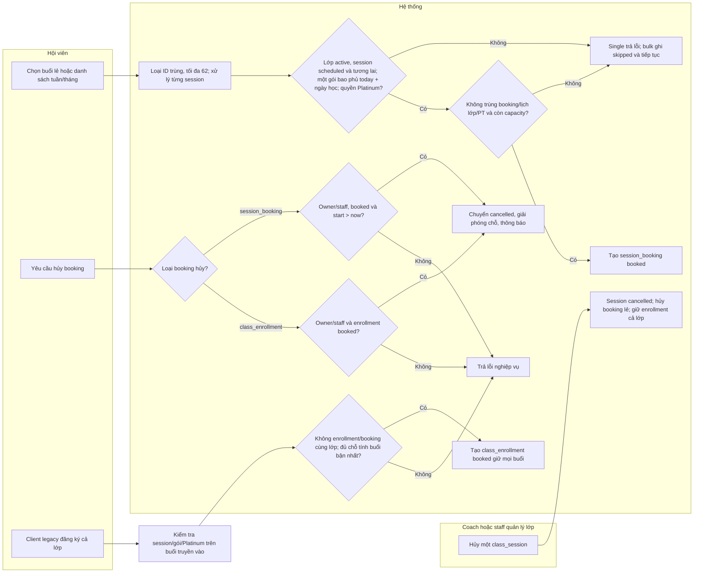

### OPS-SW-04 Sân: quota, tiền, hủy và expiry


Nguồn: apps/api/src/main/java/com/swp391/scms/courts/service/CourtBookingService.java:168; apps/api/src/main/java/com/swp391/scms/courts/service/CourtBookingService.java:254; apps/api/src/main/java/com/swp391/scms/courts/service/CourtBookingService.java:273; apps/api/src/main/java/com/swp391/scms/courts/service/CourtBookingService.java:288; apps/api/src/main/java/com/swp391/scms/courts/service/CourtPricing.java:10

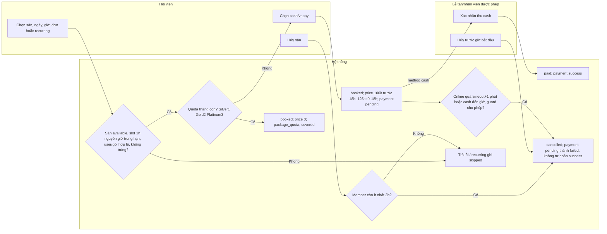

### OPS-SW-05 PT 1:1: quota, unpaid cap và hủy


Nguồn: apps/api/src/main/java/com/swp391/scms/coaching/service/CoachBookingService.java:268; apps/api/src/main/java/com/swp391/scms/coaching/service/CoachBookingService.java:379; apps/api/src/main/java/com/swp391/scms/coaching/service/CoachBookingService.java:521; apps/api/src/main/java/com/swp391/scms/coaching/service/CoachBookingService.java:575

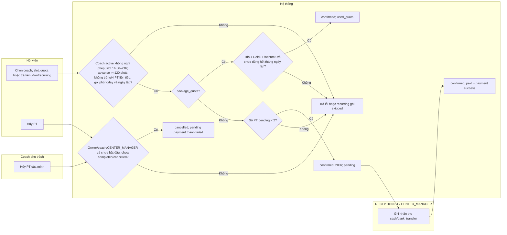

### OPS-SW-06 Cửa, intake health, attendance và tập luyện


Nguồn: apps/api/src/main/java/com/swp391/scms/attendance/service/CenterCheckinService.java:116; apps/api/src/main/java/com/swp391/scms/attendance/service/CenterCheckinService.java:210; apps/api/src/main/java/com/swp391/scms/health/HealthMetricService.java:133; apps/api/src/main/java/com/swp391/scms/attendance/service/SessionAttendanceService.java:223; apps/api/src/main/java/com/swp391/scms/coaching/service/TrainingPlanService.java:63; apps/api/src/main/java/com/swp391/scms/coaching/service/TrainingCompletionService.java:37

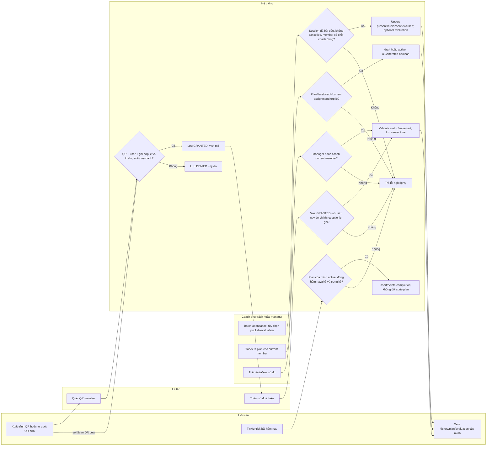

### FIN-SW-01 VNPay: return có chữ ký và IPN cùng settlement


Nguồn: apps/api/src/main/java/com/swp391/scms/finance/controller/VnpayController.java:27; apps/api/src/main/java/com/swp391/scms/finance/service/VnpayPaymentService.java:156; apps/api/src/main/java/com/swp391/scms/finance/service/VnpayPaymentService.java:266

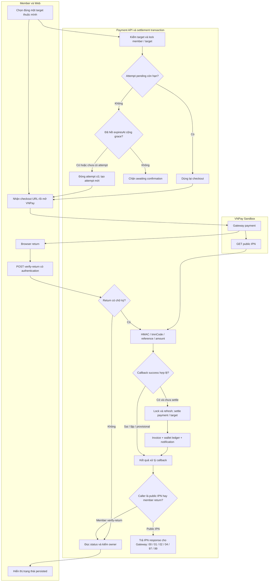

### WAL-SW-01 Ví: nạp, chi và ghi ledger dịch vụ VNPay


Nguồn: apps/api/src/main/java/com/swp391/scms/wallet/WalletService.java:94; apps/api/src/main/java/com/swp391/scms/wallet/WalletService.java:147; apps/api/src/main/java/com/swp391/scms/wallet/WalletService.java:206; apps/api/src/main/java/com/swp391/scms/finance/service/VnpayPaymentService.java:88

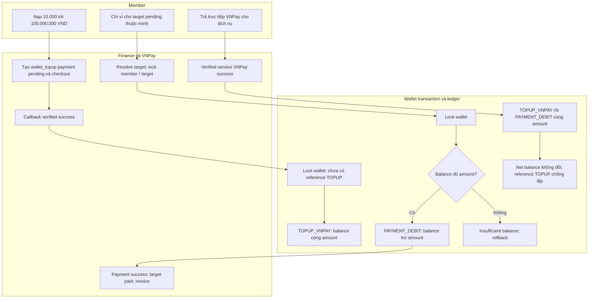

### FIN-SW-02 Ba use case refund phải phân biệt


Nguồn: apps/api/src/main/java/com/swp391/scms/finance/service/PaymentService.java:474; apps/api/src/main/java/com/swp391/scms/membership/service/MembershipCancellationService.java:198; apps/api/src/main/java/com/swp391/scms/shop/service/ProductOrderRefunds.java:34

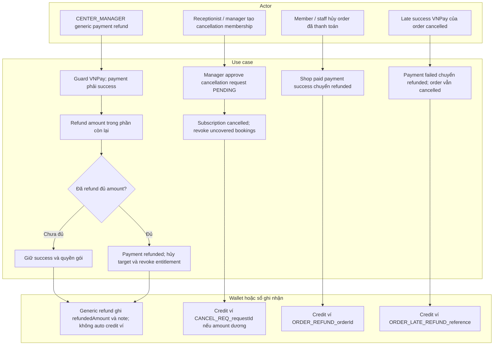

### SHOP-SW-01 Shop: báo giá, giữ tồn và giao nhận


Nguồn: apps/api/src/main/java/com/swp391/scms/shop/service/ProductOrderService.java:163; apps/api/src/main/java/com/swp391/scms/shop/service/QuoteService.java:38; apps/api/src/main/java/com/swp391/scms/shop/service/ProductOrderStaffService.java:137

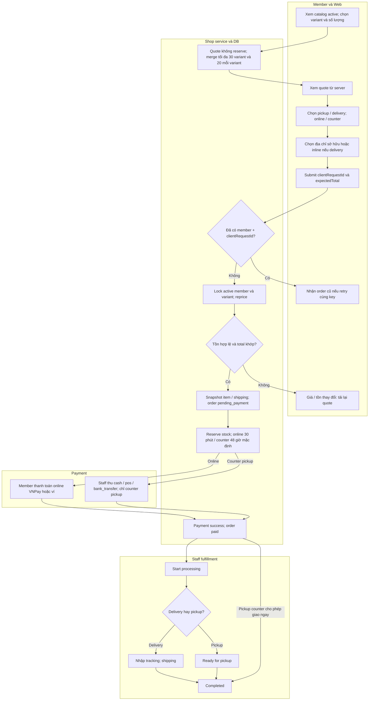

### 3 4 State charts

State Chart chỉ vẽ transition có writer/guard được tìm thấy. Giá trị hợp lệ trong CHECK nhưng chưa thấy use case ghi được đưa vào note. Soft delete, holdStatus, paymentStatus, is_read, thời gian checkout và cờ AI không bị nhập nhầm thành status chính. Expiring là suy ra từ ngày; Waitlisted và AI_Generated không là trạng thái enrollment/plan hiện hành.

### ST-IAM-01 Vòng đời tài khoản theo trạng thái và xóa mềm


Nguồn: apps/api/src/main/java/com/swp391/scms/auth/AuthService.java:266; apps/api/src/main/java/com/swp391/scms/auth/AuthService.java:427; apps/api/src/main/java/com/swp391/scms/users/UserService.java:256; apps/api/src/main/java/com/swp391/scms/users/UserService.java:354

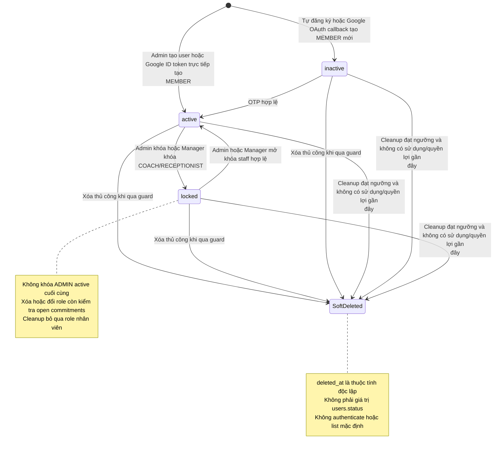

### ST-OTP-01 Challenge OTP: hiệu lực và giới hạn bảo mật


Nguồn: apps/api/src/main/java/com/swp391/scms/auth/OtpService.java:32; apps/api/src/main/java/com/swp391/scms/auth/OtpService.java:50

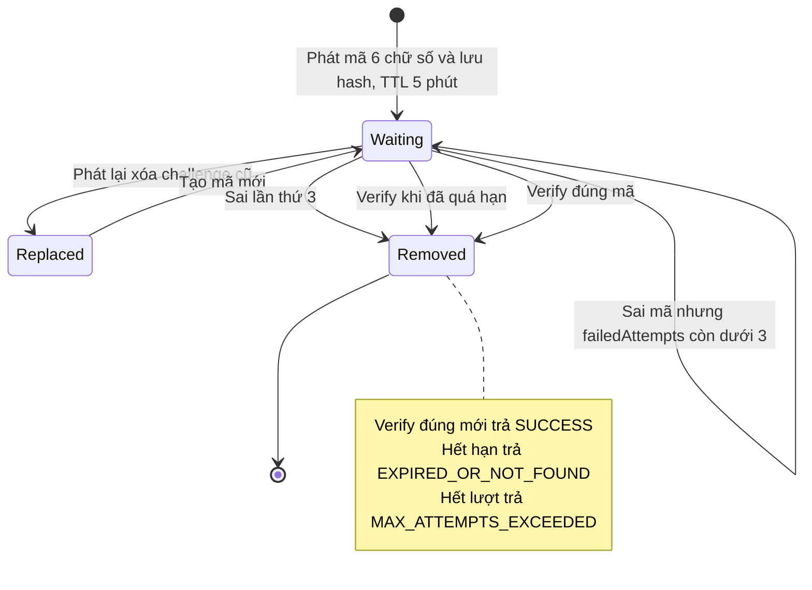

### ST-SUP-01 Trạng thái khiếu nại: không tự đóng sau 72 giờ


Nguồn: apps/api/src/main/java/com/swp391/scms/support/SupportRequestService.java:147; apps/api/src/main/java/com/swp391/scms/support/SupportRequestService.java:243; apps/api/src/main/java/com/swp391/scms/support/SupportRequestService.java:399; apps/api/src/main/java/com/swp391/scms/support/SupportRequestService.java:478

```mermaid
stateDiagram-v2
    [*] --> open: Member gửi yêu cầu
    open --> in_progress: Handler xử lý hoặc trả lời
    open --> resolved: Handler giải quyết
    in_progress --> open: Handler chuyển lại
    in_progress --> resolved: Handler giải quyết
    in_progress --> closed: Handler đóng
    resolved --> in_progress: Handler mở xử lý lại
    resolved --> closed: Handler đóng
    note right of in_progress
      Chưa escalated: RECEPTIONIST là handler
      Đã escalated: CENTER_MANAGER là handler
      Re-assignment theo role handler
    end note
    note right of closed
      Không chỉnh sửa hoặc gửi tin mới
      Không có nhánh member xác nhận hay auto-close 72h
    end note
```

### ST-OPS-01 Vòng đời đơn nội bộ


Nguồn: apps/api/src/main/java/com/swp391/scms/security/SecurityConfig.java:118; apps/api/src/main/java/com/swp391/scms/operations/service/StaffInternalRequestService.java:97; apps/api/src/main/java/com/swp391/scms/operations/service/StaffInternalRequestService.java:145; apps/api/src/main/java/com/swp391/scms/operations/service/StaffInternalRequestService.java:173

```mermaid
stateDiagram-v2
    [*] --> PENDING: COACH hoặc RECEPTIONIST gửi đơn hợp lệ
    PENDING --> CANCELLED: Chính người gửi hủy
    PENDING --> APPROVED: CENTER_MANAGER chấp thuận
    PENDING --> REJECTED: CENTER_MANAGER từ chối và có ghi chú
    note right of APPROVED
      Ghi reviewedBy và reviewedAt
      Thông báo người gửi
      LEAVE: thông báo ảnh hưởng lịch cho quản lý
      Không tự phân công lại replacement
    end note
```

### OPS-ST-01 Subscription và holdStatus riêng


Nguồn: apps/api/src/main/java/com/swp391/scms/membership/service/MembershipSubscriptionService.java:136; apps/api/src/main/java/com/swp391/scms/membership/service/MembershipSubscriptionService.java:554; apps/api/src/main/java/com/swp391/scms/membership/service/MembershipSubscriptionService.java:639; apps/api/src/main/java/com/swp391/scms/finance/service/PaymentService.java:660

```mermaid
stateDiagram-v2
    [*] --> pending_payment: mua / gia hạn / nâng cấp tạo BẢN GHI MỚI
    pending_payment --> active: thanh toán hợp lệ / cấp QR
    pending_payment --> cancelled: chủ hoặc staff rút yêu cầu / payment đã giải quyết
    [*] --> active: reception duyệt trial / miễn phí
    state active {
        [*] --> NoHold
        state "holdStatus = null" as NoHold
        state "holdStatus = PENDING" as HP
        state "holdStatus = REJECTED" as HR
        NoHold --> HP: chủ xin hold [không trial, active hôm nay, không<br/>xung đột]
        HR --> HP: gửi lại hold [cùng guards]
        HP --> HR: reception từ chối
    }
    HP --> frozen: reception duyệt [còn hiệu lực] / holdStatus APPROVED
    frozen --> active: chủ resume [hợp lệ, không kỳ xung đột] / cộng tối đa<br/>90 ngày, xóa holdStatus
    frozen --> active: job khi hold đủ 90 ngày / cộng 90 ngày, xóa<br/>holdStatus
    active --> cancelled: manager duyệt cancellation [không quyền khác / công<br/>nợ chặn]
    active --> expired: thanh toán nâng cấp thành công / hết hiệu lực KỲ CŨ
    note right of active
        Tạo renewal/upgrade là một subscription khác.
        Không vẽ active sang expired tự động khi qua endDate:
        chưa thấy job chuyển status, quyền dùng còn xét ngày.
    end note
```

### OPS-ST-02 Trial/KYC


Nguồn: apps/api/src/main/java/com/swp391/scms/membership/entity/MemberTrialRedemption.java:19; apps/api/src/main/java/com/swp391/scms/membership/service/MemberTrialService.java:132; apps/api/src/main/java/com/swp391/scms/membership/service/MemberTrialService.java:250; apps/api/src/main/java/com/swp391/scms/membership/service/MemberTrialService.java:318

```mermaid
stateDiagram-v2
    [*] --> PENDING_APPROVAL: chưa từng có subscription + giấy tờ hợp lệ/duy nhất
    PENDING_APPROVAL --> APPROVED: reception duyệt / identityVerified, tạo active<br/>subscription
    PENDING_APPROVAL --> REJECTED: reception từ chối / lưu lý do
    REJECTED --> PENDING_APPROVAL: member sửa hồ sơ và gửi lại
    REJECTED --> APPROVED: hiện code vẫn cho duyệt trực tiếp
    REJECTED --> REJECTED: reception từ chối lại
    note right of APPROVED
        Không xin lại, duyệt lại hoặc từ chối sau APPROVED.
        NONE chỉ là DTO khi chưa có record, không state lưu DB.
        Trial endDate hiện today + 3, entitlement inclusive: cần PO xác nhận.
    end note
```

### OPS-ST-03 Yêu cầu hủy membership


Nguồn: apps/api/src/main/java/com/swp391/scms/membership/service/MembershipCancellationService.java:72; apps/api/src/main/java/com/swp391/scms/membership/service/MembershipCancellationService.java:102; apps/api/src/main/java/com/swp391/scms/membership/service/MembershipCancellationService.java:197; apps/api/src/main/java/com/swp391/scms/membership/MembershipCancellationController.java:37

```mermaid
stateDiagram-v2
    [*] --> PENDING: RECEPTIONIST/CENTER_MANAGER tạo staff-request, không<br/>trùng
    PENDING --> APPROVED: CENTER_MANAGER duyệt [kỳ vẫn active hôm nay, không<br/>hold / quyền khác / công nợ chặn]
    PENDING --> REJECTED: CENTER_MANAGER từ chối
    note right of PENDING
        Gửi yêu cầu chưa đổi subscription active.
        Staff request yêu cầu status active,
        duyệt vẫn yêu cầu active bao phủ hôm nay.
        Member chỉ có GET my, chưa expose POST xin hủy.
    end note
    note right of APPROVED
        subscription cancelled, giải phóng lịch không còn quyền.
        refund > 0 được credit vào ví, manager được ghi đè.
        Không quyết định lại request đã APPROVED/REJECTED.
    end note
```

### OPS-ST-04 Class enrollment legacy và session booking


Nguồn: apps/api/src/main/java/com/swp391/scms/scheduling/service/EnrollmentService.java:90; apps/api/src/main/java/com/swp391/scms/scheduling/service/EnrollmentService.java:248; apps/api/src/main/java/com/swp391/scms/scheduling/service/SessionBookingService.java:165; apps/api/src/main/java/com/swp391/scms/scheduling/service/SessionBookingService.java:288; apps/api/src/main/java/com/swp391/scms/scheduling/service/ClassSessionService.java:69

```mermaid
stateDiagram-v2
    state "class_enrollments — cả lớp" as CE {
        [*] --> EBooked: tạo legacy enrollment / giữ chỗ mọi buổi
        state "booked" as EBooked
        state "cancelled" as ECancelled
        EBooked --> ECancelled: chủ/staff hủy, xóa lớp hoặc mất quyền
        note right of EBooked
            API hủy legacy không kiểm tra cutoff giờ.
            Hủy một session không hủy cả enrollment.
        end note
    }
    state "session_bookings — từng buổi" as SB {
        [*] --> BBooked: đặt lẻ/bulk / kiểm tra từng buổi
        state "booked" as BBooked
        state "cancelled" as BCancelled
        BBooked --> BCancelled: chủ/staff hủy [chưa bắt đầu]
        BBooked --> BCancelled: session bị hủy / xóa lớp / mất quyền
    }
    note left of CE
        completed là giá trị DB được phép ở cả hai bảng,
        chưa tìm thấy use-case Java đổi completed.
        Không có Requested, Confirmed, Attended hoặc Waitlisted.
    end note
```

### OPS-ST-05 Buổi lớp — transitions quan sát được


Nguồn: apps/api/src/main/java/com/swp391/scms/scheduling/service/ClassService.java:200; apps/api/src/main/java/com/swp391/scms/scheduling/service/ClassSessionService.java:74; apps/api/src/main/java/com/swp391/scms/scheduling/entity/ClassSession.java:12

```mermaid
stateDiagram-v2
    [*] --> scheduled: manager tạo buổi tương lai, không trùng<br/>room/coach/member
    scheduled --> scheduled: manager sửa ngày/giờ hợp lệ
    scheduled --> cancelled: coach phụ trách hoặc staff hủy
    scheduled --> cancelled: xóa lớp có dữ liệu phụ thuộc
    note right of cancelled
        Hủy session_bookings booked của buổi và gửi thông báo.
        Giữ class_enrollments cho các buổi khác.
        Service hủy chỉ chặn session đã cancelled,
        không có cutoff tương lai cho hủy session.
    end note
    note left of scheduled
        completed được DB cho phép nhưng chưa tìm thấy
        transition Java, không tự vẽ hoàn thành theo đồng hồ.
    end note
```

### OPS-ST-06 Sân — booking và paymentStatus tách biệt


Nguồn: apps/api/src/main/java/com/swp391/scms/courts/service/CourtBookingService.java:168; apps/api/src/main/java/com/swp391/scms/courts/service/CourtBookingService.java:254; apps/api/src/main/java/com/swp391/scms/courts/service/CourtBookingService.java:273; apps/api/src/main/java/com/swp391/scms/courts/service/CourtBookingService.java:288; apps/api/src/main/java/com/swp391/scms/membership/service/EntitlementRevocationService.java:86

```mermaid
stateDiagram-v2
    [*] --> booked: member đặt slot hợp lệ
    booked --> cancelled: member hủy [còn ít nhất 2 giờ]
    booked --> cancelled: staff hủy [chưa bắt đầu]
    booked --> cancelled: chưa thanh toán quá hạn / gateway guard cho phép
    booked --> cancelled: mất entitlement cho ngày đặt và chưa bắt đầu
    cancelled --> cancelled: gọi hủy lại / trả kết quả hiện có
    note right of booked
        Còn quota: paymentStatus covered, price 0.
        Ngoài quota: pending, cash hoặc vnpay.
        Staff xác nhận cash: pending sang paid,
        booking vẫn booked và payment thành success.
        Availability free/booked/class/past là DTO tính toán.
    end note
    note right of cancelled
        Hủy thủ công đóng payment pending thành failed.
        Service không tự hoàn khoản success.
    end note
```

### OPS-ST-07 PT 1:1 — booking và paymentStatus


Nguồn: apps/api/src/main/java/com/swp391/scms/coaching/service/CoachBookingService.java:268; apps/api/src/main/java/com/swp391/scms/coaching/service/CoachBookingService.java:450; apps/api/src/main/java/com/swp391/scms/coaching/service/CoachBookingService.java:521; apps/api/src/main/java/com/swp391/scms/coaching/service/CoachBookingService.java:575

```mermaid
stateDiagram-v2
    [*] --> confirmed: đặt hợp lệ / đủ quota hoặc cho phép chưa trả
    confirmed --> cancelled: chủ / coach phụ trách / CENTER_MANAGER hủy [start ><br/>now]
    confirmed --> cancelled: mất entitlement [chưa bắt đầu]
    note right of confirmed
        package_quota: paymentStatus used_quota.
        cash/bank_transfer: paymentStatus pending.
        Reception/CENTER_MANAGER thu tiền: pending sang paid,
        ghi payment success, booking vẫn confirmed.
        completed có trong DB nhưng chưa thấy writer Java.
        Không có Requested/PendingApproval của PT booking.
    end note
```

### OPS-ST-08 Check-in trung tâm và session attendance độc lập


Nguồn: apps/api/src/main/java/com/swp391/scms/attendance/service/CenterCheckinService.java:210; apps/api/src/main/java/com/swp391/scms/attendance/service/CenterCheckinService.java:267; apps/api/src/main/java/com/swp391/scms/attendance/service/CenterCheckinService.java:323; apps/api/src/main/java/com/swp391/scms/attendance/service/SessionAttendanceService.java:233; apps/api/src/main/java/com/swp391/scms/attendance/service/SessionAttendanceService.java:281

```mermaid
stateDiagram-v2
    state "center_checkins — MỖI LƯỢT QUÉT là record mới" as Gate {
        [*] --> GRANTED: QR + user + gói hợp lệ, không anti-passback
        [*] --> DENIED: QR sai/hết hạn, user/gói không hợp lệ, visit đang mở
        GRANTED --> GRANTED: staff checkout / gán checkOutTime
        GRANTED --> GRANTED: tự checkout stale > 12 giờ / note<br/>SYSTEM_AUTO_CHECKOUT
        note right of GRANTED
            Đã ra cửa không đổi status sang CheckedOut.
            Self-checkout hiện xung đột filter/method RBAC nên không reachable.
            Service còn caveat truy vấn không lọc GRANTED.
        end note
    }
    state "session_attendance — coach/staff upsert" as Attend {
        [*] --> present
        [*] --> late
        [*] --> absent
        [*] --> excused
        present --> late: sửa điểm danh
        present --> absent: sửa điểm danh
        present --> excused: sửa điểm danh
        late --> present: sửa điểm danh
        late --> absent: sửa điểm danh
        late --> excused: sửa điểm danh
        absent --> present: sửa điểm danh
        absent --> late: sửa điểm danh
        absent --> excused: sửa điểm danh
        excused --> present: sửa điểm danh
        excused --> late: sửa điểm danh
        excused --> absent: sửa điểm danh
        note right of present
            Ghi khi buổi đã bắt đầu, không cancelled, member có chỗ.
            present/late có checkedInAt, absent/excused xóa giờ.
            Chưa điểm danh là null/không record.
        end note
    }
```

### OPS-ST-09 Training plan


Nguồn: apps/api/src/main/java/com/swp391/scms/coaching/service/TrainingPlanService.java:63; apps/api/src/main/java/com/swp391/scms/coaching/service/TrainingPlanService.java:153; apps/api/src/main/java/com/swp391/scms/coaching/service/TrainingPlanService.java:211; apps/api/src/main/java/com/swp391/scms/coaching/service/TrainingCompletionService.java:37

```mermaid
stateDiagram-v2
    [*] --> draft: coach/manager tạo mặc định
    [*] --> active: tạo activate=true/status active hoặc manager phân<br/>công
    draft --> active: activate
    active --> active: activate lại / sửa plan hợp lệ
    draft --> draft: sửa plan/bài hợp lệ
    active --> cancelled: xóa/withdraw plan active / giữ bài và completion<br/>history
    draft --> [*]: xóa vật lý draft
    cancelled --> cancelled: xóa lại / idempotent
    note right of active
        aiGenerated là boolean, không có AI_Generated, Assigned, In_Progress.
        Member tick bài tạo completion theo member/item/date,
        không đổi state plan.
        completed có DB constraint, chưa thấy transition Java.
    end note
```

### FIN-ST-01 Payment: chuyển trạng thái và hoàn tiền


Nguồn: apps/api/src/main/java/com/swp391/scms/finance/service/PaymentService.java:244; apps/api/src/main/java/com/swp391/scms/finance/service/PaymentService.java:474; apps/api/src/main/java/com/swp391/scms/finance/service/VnpayPaymentService.java:327

```mermaid
stateDiagram-v2
    [*] --> pending: Tạo giao dịch
    pending --> success: Cashier xác nhận hoặc ví / VNPay verified
    pending --> failed: Xác nhận thất bại hoặc hủy đơn chưa trả
    failed --> pending: Retry cho phép, subscription còn pending_payment
    success --> success: Refund một phần, refundedAmount tăng
    success --> refunded: Generic refund đủ tổng amount
    success --> refunded: Shop hủy đơn đã thanh toán, hoàn ví
    failed --> refunded: VNPay late success của shop đã cancelled, hoàn ví
    note right of success
      Generic refund không tự credit ví.
      VNPay success bị chặn generic refund.
      Shop và membership cancellation có use case hoàn ví riêng.
    end note
    note right of pending
      Same-status update là no-op.
      Attempt VNPay là state machine riêng.
    end note
```

### FIN-ST-02 VNPay attempt: pending, expiry, callback trễ


Nguồn: apps/api/src/main/java/com/swp391/scms/finance/service/VnpayPaymentService.java:156; apps/api/src/main/java/com/swp391/scms/finance/service/VnpayPaymentService.java:266; apps/api/src/main/java/com/swp391/scms/finance/service/VnpayPaymentGuard.java:70

```mermaid
stateDiagram-v2
    [*] --> pending: Tạo attempt có expiresAt
    pending --> success: Chữ ký + amount hợp lệ, response/status 00,<br/>transactionNo hợp lệ
    pending --> failed: Callback không success với status 02/04/07
    pending --> failed: now lớn hơn expiresAt cộng grace 15 phút
    pending --> pending: Provisional callback trả 99, tiếp tục chặn
    failed --> success: Late verified success và payment vẫn pending
    failed --> success: Shop cancelled, payment failed, credit wallet và<br/>payment refunded
    note right of failed
      Job mặc định mỗi 5 phút.
      Hết vnp_ExpireDate chưa đủ để retry:
      phải hết grace 15 phút.
    end note
    note right of success
      Callback lặp trả 02.
      Không ghi ledger hoặc settle lần hai.
    end note
```

### SHOP-ST-01 ProductOrder: toàn bộ chuyển trạng thái cho phép


Nguồn: apps/api/src/main/java/com/swp391/scms/shop/entity/OrderStatus.java:3; apps/api/src/main/java/com/swp391/scms/shop/service/ProductOrderStaffService.java:137; apps/api/src/main/java/com/swp391/scms/shop/service/ProductOrderService.java:263

```mermaid
stateDiagram-v2
    [*] --> pending_payment: Tạo order và reserve stock
    pending_payment --> paid: Online / ví success hoặc staff thu quầy pickup
    paid --> processing: Staff bắt đầu xử lý
    processing --> shipping: Delivery, staff nhập tracking
    processing --> ready_for_pickup: Pickup, staff báo sẵn sàng
    shipping --> completed: Staff xác nhận hoàn tất delivery
    ready_for_pickup --> completed: Staff bàn giao pickup
    paid --> completed: Chỉ pickup counter
    pending_payment --> cancelled: Member / staff, không còn pending VNPay
    pending_payment --> cancelled: Scheduler dueAt đã qua và guard không chặn
    paid --> cancelled: Member hoặc staff, hoàn ví
    processing --> cancelled: Chỉ staff, hoàn ví
    shipping --> cancelled: Chỉ staff, hoàn ví
    ready_for_pickup --> cancelled: Chỉ staff, hoàn ví
    completed --> [*]
    cancelled --> [*]
    note right of cancelled
      Member và scheduler trả stock.
      Staff chọn restock, mặc định true.
      Late VNPay success giữ order cancelled,
      chỉ credit ví và payment refunded.
    end note
```

## 4 Data Requirements

### 4 1 Conceptual Model

Mô hình khái niệm mô tả thực thể nghiệp vụ và quan hệ, không trộn cột kỹ thuật, kiểu T-SQL hay khóa ngoại vào lớp khái niệm. User có hồ sơ theo vai trò; đặt cả lớp và đặt từng buổi là hai quan hệ khác nhau. Không tạo thực thể SportsCenter hoặc bảng AI Engine khi không có mapping tương ứng.

### CM-01 Mô hình khái niệm dịch vụ thể thao


Nguồn: JPA users, facilities, membership, scheduling, attendance, coaching, courts, health; entity-source-map.json

```mermaid
classDiagram
 direction LR
 class User
 class Role
 class Permission
 class Member
 class Coach
 class Receptionist
 class CenterManager
 class MembershipPackage
 class Subscription
 class Discipline
 class Room
 class Class
 class Session
 class ClassEnrollment
 class SessionBooking
 class CourtBooking
 class PTBooking
 class TrainingPlan
 class ProgressLog
 class Checkin
 class Attendance
 Role "1" --> "0..*" User : phân vai
 Role "0..*" --> "0..*" Permission : có quyền
 User "1" --> "0..1" Member : hồ sơ hội viên
 User "1" --> "0..1" Coach : hồ sơ HLV
 User "1" --> "0..1" Receptionist : hồ sơ lễ tân
 User "1" --> "0..1" CenterManager : hồ sơ quản lý
 Member "1" --> "0..*" Subscription : sở hữu
 MembershipPackage "1" --> "0..*" Subscription : xác định quyền lợi
 Discipline "1" --> "0..*" Class : phân loại
 Coach "1" --> "0..*" Class : dạy
 Room "1" --> "0..*" Class : tổ chức
 Class "1" --> "0..*" Session : có buổi
 Member "1" --> "0..*" ClassEnrollment : đăng ký cả lớp
 Class "1" --> "0..*" ClassEnrollment : nhận đăng ký
 Member "1" --> "0..*" SessionBooking : đặt từng buổi
 Session "1" --> "0..*" SessionBooking : nhận đặt chỗ
 Member "1" --> "0..*" CourtBooking : thuê sân
 Room "1" --> "0..*" CourtBooking : được thuê
 Member "1" --> "0..*" PTBooking : thuê HLV
 Coach "1" --> "0..*" PTBooking : phụ trách
 Coach "1" --> "0..*" TrainingPlan : soạn
 Member "1" --> "0..*" TrainingPlan : nhận giáo án
 Member "1" --> "0..*" ProgressLog : có chỉ số
 Member "0..1" --> "0..*" Checkin : được ghi nhận
 Session "1" --> "0..*" Attendance : ghi điểm danh
 Member "1" --> "0..*" Attendance : được điểm danh
```

### CM-02 Mô hình khái niệm thương mại và hỗ trợ


Nguồn: JPA shop, finance, wallet, support, chat, notifications, operations; entity-source-map.json

```mermaid
classDiagram
 direction LR
 class Member
 class User
 class ProductCategory
 class Product
 class Variant
 class StockMovement
 class Order
 class OrderItem
 class Address
 class Payment
 class VnpayAttempt
 class Invoice
 class InvoiceItem
 class Wallet
 class WalletEntry
 class SupportTicket
 class SupportMessage
 class Conversation
 class ChatMessage
 class Notification
 class InternalRequest
 ProductCategory "1" --> "0..*" Product : nhóm hàng
 Product "1" --> "0..*" Variant : biến thể
 Variant "1" --> "0..*" StockMovement : biến động kho
 Member "1" --> "0..*" Order : đặt mua
 Order "1" --> "0..*" OrderItem : chứa dòng hàng
 Variant "1" --> "0..*" OrderItem : sản phẩm được mua
 Member "1" --> "0..*" Address : lưu địa chỉ
 Member "1" --> "0..*" Payment : thanh toán
 Order "0..1" --> "0..*" Payment : nhận thanh toán
 Payment "1" --> "0..*" VnpayAttempt : thử thanh toán
 Payment "1" --> "0..1" Invoice : phát hành hóa đơn
 Invoice "1" --> "0..*" InvoiceItem : chứa
 User "1" --> "0..1" Wallet : có ví
 Wallet "1" --> "0..*" WalletEntry : ghi sổ
 Member "1" --> "0..*" SupportTicket : yêu cầu hỗ trợ
 SupportTicket "1" --> "0..*" SupportMessage : có trao đổi
 User "1" --> "0..*" Notification : nhận
 Member "1" --> "0..*" Conversation : tham gia
 User "1" --> "0..*" Conversation : đối tác hội thoại
 Conversation "1" --> "0..*" ChatMessage : chứa
 User "1" --> "0..*" InternalRequest : gửi yêu cầu
```

### 4 2 Logical ERD

ERD được chia 7 miền để đọc rõ. Tổng mapping là 56 @Entity, 2 @JoinTable (role_permissions và member_favorite_disciplines) và 1 @CollectionTable (product_goals), tương ứng 59 bảng đích ORM. Đây là schema theo code, chưa xác minh danh sách bảng vật lý trên DB đang chạy. Inverse properties không tạo cột; scalar ID và association cùng một cột được gộp. Các ID generic không tự biến thành FK.

Ký pháp Crow’s Foot biểu diễn bắt buộc/không bắt buộc theo owning-side annotation. Ô ngoài miền chỉ hiển thị PK để nối quan hệ. 103 liên kết sở hữu được trích xuất gồm các khóa của join/collection table. Kiểu dữ liệu là kiểu logic PostgreSQL suy từ Java/JPA; definition/precision/length và unique composite xem trong Dictionary, không dùng các sơ đồ này làm migration DDL.

### ERD-01 Tài khoản và quyền


Nguồn: entity-source-map.json; data-dictionary.json; owning-side JPA annotations; db chưa introspect

```mermaid
erDiagram
  direction LR
  center_managers {
    bigint user_id PK,FK,UK
    date hire_date
  }
  coaches {
    bigint user_id PK,FK,UK
    varchar_150 specialization
    text bio
    varchar_255 certification
    date hire_date
    varchar_20 employment_status
  }
  disciplines {
    bigint id PK
  }
  member_favorite_disciplines {
    bigint member_id FK
    bigint discipline_id FK
  }
  members {
    bigint user_id PK,FK,UK
    varchar_30 membership_code UK
    date join_date
    varchar_255 health_notes
    varchar_255 fitness_goal
    varchar_20 fitness_level
    varchar_150 emergency_contact_name
    varchar_20 emergency_contact_phone
    varchar_20 document_type
    varchar_30 citizen_id
    varchar_100 nationality
    text front_image_url
    text back_image_url
    boolean identity_verified
    timestamp identity_verified_at
    uuid payment_realtime_topic
  }
  otp_challenges {
    bigint id PK
    varchar_255 target UK
    varchar_100 code_hash
    timestamp expires_at
    integer failed_attempts
    timestamp created_at
  }
  permissions {
    bigint id PK
    varchar_100 code UK
    varchar_150 name
    varchar_50 module
    timestamp created_at
  }
  receptionists {
    bigint user_id PK,FK,UK
    date hire_date
    varchar_50 shift
    varchar_20 employment_status
  }
  role_permissions {
    bigint role_id FK
    bigint permission_id FK
  }
  roles {
    bigint id PK
    varchar_50 code UK
    varchar_100 name
    varchar_255 description
    timestamp created_at
  }
  users {
    bigint id PK
    bigint role_id FK
    varchar_150 full_name
    varchar_150 email UK
    varchar_50 username
    varchar_20 phone
    varchar_255 password_hash
    date dob
    varchar_10 gender
    text avatar_url
    varchar_255 address
    varchar_20 status
    timestamp last_login_at
    timestamp created_at
    timestamp updated_at
    timestamp deleted_at
    varchar_100 google_sub UK
  }
  users ||--o| center_managers : "user_id"
  users ||--o| coaches : "user_id"
  users ||--o| members : "user_id"
  users ||--o| receptionists : "user_id"
  roles ||--o{ users : "role_id"
  roles ||--o{ role_permissions : "role_id"
  permissions ||--o{ role_permissions : "permission_id"
  members ||--o{ member_favorite_disciplines : "member_id"
  disciplines ||--o{ member_favorite_disciplines : "discipline_id"
```

### ERD-02 Membership và facilities


Nguồn: entity-source-map.json; data-dictionary.json; owning-side JPA annotations; db chưa introspect

```mermaid
erDiagram
  direction LR
  disciplines {
    bigint id PK
    varchar_100 name UK
    text description
    timestamp created_at
  }
  equipment {
    bigint id PK
    varchar_150 name
    varchar_60 code UK
    varchar_80 category
    bigint room_id FK
    integer quantity
    varchar_30 status
    date purchase_date
    date maintenance_date
    varchar_500 note
    timestamp created_at
    timestamp updated_at
  }
  member_trial_redemptions {
    bigint id PK
    bigint member_id FK,UK
    varchar_64 cccd_hash UK
    varchar_4 cccd_last4
    varchar_150 full_name
    varchar_20 document_type
    varchar_100 nationality
    text front_image_url
    text back_image_url
    varchar_30 status
    bigint reviewed_by
    timestamp reviewed_at
    varchar_500 rejection_reason
    bigint subscription_id FK,UK
    timestamp redeemed_at
  }
  members {
    bigint user_id PK,FK,UK
  }
  membership_cancellation_requests {
    bigint id PK
    bigint member_id FK
    bigint subscription_id FK
    varchar_500 reason
    numeric_15_2 refund_amount
    bigint requested_by FK
    varchar_20 status
    timestamp requested_at
    bigint resolved_by FK
    timestamp resolved_at
    varchar_500 resolution_note
  }
  membership_packages {
    bigint id PK
    varchar_150 name
    text description
    numeric_12_2 price
    integer duration_days
    integer class_credit_limit
    varchar_20 status
    varchar_30 tier
    bigint created_by FK
    timestamp created_at
    timestamp updated_at
  }
  membership_subscriptions {
    bigint id PK
    bigint member_id FK
    bigint package_id FK
    bigint previous_subscription_id FK
    date start_date
    date end_date
    varchar_20 status
    varchar_255 qr_code UK
    numeric_14_2 upgrade_charge
    numeric_14_2 credit_applied
    numeric_14_2 quoted_price
    date replaced_end_date
    varchar_20 hold_status
    varchar_500 hold_reason
    timestamp hold_requested_at
    timestamp hold_resolved_at
    bigint hold_resolved_by FK
    bigint created_by FK
    timestamp created_at
    timestamp updated_at
  }
  rooms {
    bigint id PK
    varchar_100 name
    varchar_150 location
    integer capacity
    varchar_20 status
    bigint discipline_id FK
    time open_time
    time close_time
    varchar_30 tier
  }
  users {
    bigint id PK
  }
  rooms |o--o{ equipment : "room_id"
  users |o--o{ membership_packages : "created_by"
  disciplines |o--o{ rooms : "discipline_id"
  members ||--o| member_trial_redemptions : "member_id"
  membership_subscriptions |o--o| member_trial_redemptions : "subscription_id"
  members ||--o{ membership_cancellation_requests : "member_id"
  membership_subscriptions ||--o{ membership_cancellation_requests : "subscription_id"
  users |o--o{ membership_cancellation_requests : "requested_by"
  users |o--o{ membership_cancellation_requests : "resolved_by"
  members ||--o{ membership_subscriptions : "member_id"
  membership_packages ||--o{ membership_subscriptions : "package_id"
  membership_subscriptions |o--o{ membership_subscriptions : "previous_subscription_id"
  users |o--o{ membership_subscriptions : "hold_resolved_by"
  users |o--o{ membership_subscriptions : "created_by"
```

### ERD-03 Lịch học điểm danh và sân


Nguồn: entity-source-map.json; data-dictionary.json; owning-side JPA annotations; db chưa introspect

```mermaid
erDiagram
  direction LR
  center_checkins {
    bigint id PK
    bigint member_id FK
    timestamp check_in_time
    timestamp check_out_time
    varchar_10 method
    bigint recorded_by FK
    varchar_50 gate
    varchar_20 status
    varchar_255 denial_reason
    varchar_255 notes
  }
  class_enrollments {
    bigint id PK
    bigint class_id FK
    bigint member_id FK
    varchar_20 status
    timestamp enrolled_at
    timestamp cancelled_at
    bigint cancelled_by FK
    varchar_255 cancel_reason
  }
  class_sessions {
    bigint id PK
    bigint class_id FK
    date session_date
    time start_time
    time end_time
    varchar_20 status
    varchar_255 cancel_reason
    timestamp created_at
    timestamp updated_at
  }
  classes {
    bigint id PK
    varchar_150 name
    bigint discipline_id FK
    bigint coach_id FK
    bigint room_id FK
    integer capacity
    varchar_20 level
    text description
    varchar_20 status
    bigint created_by FK
    timestamp created_at
    timestamp updated_at
  }
  coaches {
    bigint user_id PK,FK,UK
  }
  court_bookings {
    bigint id PK
    bigint room_id FK
    bigint member_id FK
    date booking_date
    time start_time
    time end_time
    varchar_20 status
    timestamp created_at
    timestamp cancelled_at
    varchar_255 cancel_reason
    numeric_12_2 price
    varchar_20 payment_method
    varchar_20 payment_status
  }
  disciplines {
    bigint id PK
  }
  members {
    bigint user_id PK,FK,UK
  }
  rooms {
    bigint id PK
  }
  session_attendance {
    bigint id PK
    bigint session_id FK
    bigint member_id FK
    varchar_20 status
    timestamp checked_in_at
    bigint recorded_by FK
    varchar_255 notes
  }
  session_bookings {
    bigint id PK
    bigint session_id FK
    bigint member_id FK
    varchar_20 status
    timestamp booked_at
    varchar_36 batch_id
    timestamp cancelled_at
    bigint cancelled_by FK
    varchar_255 cancel_reason
  }
  users {
    bigint id PK
  }
  members |o--o{ center_checkins : "member_id"
  users |o--o{ center_checkins : "recorded_by"
  class_sessions ||--o{ session_attendance : "session_id"
  members ||--o{ session_attendance : "member_id"
  coaches ||--o{ session_attendance : "recorded_by"
  rooms ||--o{ court_bookings : "room_id"
  users ||--o{ court_bookings : "member_id"
  classes ||--o{ class_enrollments : "class_id"
  members ||--o{ class_enrollments : "member_id"
  users |o--o{ class_enrollments : "cancelled_by"
  classes ||--o{ class_sessions : "class_id"
  disciplines ||--o{ classes : "discipline_id"
  coaches ||--o{ classes : "coach_id"
  rooms ||--o{ classes : "room_id"
  users |o--o{ classes : "created_by"
  class_sessions ||--o{ session_bookings : "session_id"
  members ||--o{ session_bookings : "member_id"
  users |o--o{ session_bookings : "cancelled_by"
```

### ERD-04 Coaching sức khỏe và AI


Nguồn: entity-source-map.json; data-dictionary.json; owning-side JPA annotations; db chưa introspect

```mermaid
erDiagram
  direction LR
  ai_chat_messages {
    bigint id PK
    bigint session_id FK
    varchar_10 sender
    text message
    timestamp created_at
  }
  ai_chat_sessions {
    bigint id PK
    bigint member_id FK
    varchar_150 topic
    timestamp started_at
    timestamp ended_at
  }
  ai_recommendation_logs {
    bigint id PK
    bigint coach_id FK
    bigint member_id FK
    jsonb input_context
    jsonb recommended_content
    varchar_100 model_name
    boolean is_applied
    timestamp created_at
  }
  class_sessions {
    bigint id PK
  }
  classes {
    bigint id PK
  }
  coach_bookings {
    bigint id PK
    bigint member_id FK
    bigint coach_id FK
    bigint discipline_id FK
    date booking_date
    time start_time
    time end_time
    numeric_12_2 hourly_rate
    varchar_30 payment_method
    varchar_20 payment_status
    varchar_20 status
    varchar_500 notes
    timestamp created_at
    timestamp cancelled_at
    varchar_255 cancel_reason
  }
  coach_monthly_reviews {
    bigint id PK
    bigint coach_id FK
    bigint manager_id FK
    integer review_year
    integer review_month
    numeric_3_2 average_rating
    integer total_reviews
    integer total_sessions
    integer rank_position
    varchar_100 badge
    numeric_12_2 bonus_amount
    text manager_feedback
    varchar_20 status
    timestamp created_at
    timestamp updated_at
  }
  coach_reviews {
    bigint id PK
    bigint coach_id FK
    bigint member_id FK
    bigint booking_id
    bigint class_session_id
    integer rating
    text comment
    boolean is_anonymous
    varchar_20 status
    text manager_notes
    timestamp created_at
  }
  coaches {
    bigint user_id PK,FK,UK
  }
  disciplines {
    bigint id PK
  }
  member_progress_logs {
    bigint id PK
    bigint member_id FK
    varchar_100 metric_name
    numeric_10_2 metric_value
    varchar_20 unit
    bigint recorded_by FK
    timestamp recorded_at
  }
  members {
    bigint user_id PK,FK,UK
  }
  session_evaluations {
    bigint id PK
    bigint session_id FK
    bigint member_id FK
    bigint coach_id FK
    text performance_notes
    numeric_4_1 progress_score
    text feedback
    timestamp evaluated_at
    timestamp created_at
  }
  training_item_completions {
    bigint id PK
    bigint member_id FK
    bigint training_plan_item_id FK
    date exercise_date
    timestamp completed_at
  }
  training_plan_items {
    bigint id PK
    bigint training_plan_id FK
    integer day_of_week
    varchar_150 exercise_name
    text description
    integer rest_seconds
    integer sets
    integer reps
    integer duration_minutes
    integer order_index
  }
  training_plans {
    bigint id PK
    bigint member_id FK
    bigint coach_id FK
    bigint class_id FK
    varchar_255 goal
    date start_date
    date end_date
    varchar_20 status
    boolean is_ai_generated
    bigint ai_recommendation_id FK
    timestamp created_at
    timestamp updated_at
  }
  users {
    bigint id PK
  }
  ai_chat_sessions ||--o{ ai_chat_messages : "session_id"
  members ||--o{ ai_chat_sessions : "member_id"
  coaches |o--o{ ai_recommendation_logs : "coach_id"
  members ||--o{ ai_recommendation_logs : "member_id"
  members ||--o{ coach_bookings : "member_id"
  coaches ||--o{ coach_bookings : "coach_id"
  disciplines |o--o{ coach_bookings : "discipline_id"
  coaches ||--o{ coach_monthly_reviews : "coach_id"
  users |o--o{ coach_monthly_reviews : "manager_id"
  coaches ||--o{ coach_reviews : "coach_id"
  members ||--o{ coach_reviews : "member_id"
  class_sessions |o--o{ session_evaluations : "session_id"
  members ||--o{ session_evaluations : "member_id"
  coaches ||--o{ session_evaluations : "coach_id"
  members ||--o{ training_item_completions : "member_id"
  training_plan_items ||--o{ training_item_completions : "training_plan_item_id"
  members ||--o{ training_plans : "member_id"
  coaches ||--o{ training_plans : "coach_id"
  classes |o--o{ training_plans : "class_id"
  ai_recommendation_logs |o--o{ training_plans : "ai_recommendation_id"
  training_plans ||--o{ training_plan_items : "training_plan_id"
  members ||--o{ member_progress_logs : "member_id"
  users ||--o{ member_progress_logs : "recorded_by"
```

### ERD-05 Finance wallet và báo cáo


Nguồn: entity-source-map.json; data-dictionary.json; owning-side JPA annotations; db chưa introspect

```mermaid
erDiagram
  direction LR
  class_enrollments {
    bigint id PK
  }
  coach_bookings {
    bigint id PK
  }
  court_bookings {
    bigint id PK
  }
  invoice_items {
    bigint id PK
    bigint invoice_id FK
    varchar_255 description
    integer quantity
    numeric_12_2 unit_price
    numeric_12_2 amount
  }
  invoices {
    bigint id PK
    bigint payment_id FK,UK
    varchar_50 invoice_number UK
    timestamp issued_at
    numeric_12_2 subtotal_amount
    numeric_12_2 tax_amount
    numeric_12_2 total_amount
    varchar_255 pdf_url
    timestamp created_at
  }
  members {
    bigint user_id PK,FK,UK
  }
  membership_subscriptions {
    bigint id PK
  }
  payments {
    bigint id PK
    bigint member_id FK
    bigint subscription_id FK
    bigint coach_booking_id FK
    bigint court_booking_id FK
    bigint product_order_id FK
    bigint class_enrollment_id FK
    numeric_12_2 amount
    numeric_12_2 refunded_amount
    varchar_20 method
    varchar_20 status
    timestamp paid_at
    bigint received_by FK
    varchar_255 note
    text receipt_image
    timestamp created_at
  }
  product_orders {
    bigint id PK
  }
  report_snapshots {
    bigint id PK
    varchar_30 report_type
    date period_start
    date period_end
    jsonb data
    bigint generated_by FK
    timestamp generated_at
  }
  users {
    bigint id PK
  }
  vnpay_transactions {
    varchar_32 reference PK
    bigint payment_id FK
    numeric_12_2 amount
    timestamp created_at
    timestamp expires_at
    varchar_45 ip_address
    varchar_20 status
    varchar_20 gateway_transaction_no UK
  }
  wallet_transactions {
    bigint id PK
    bigint wallet_id FK
    varchar_30 type
    numeric_15_2 amount
    numeric_15_2 balance_after
    varchar_50 reference_type
    varchar_100 reference_id
    varchar_500 description
    timestamp created_at
  }
  wallets {
    bigint id PK
    bigint user_id FK,UK
    numeric_15_2 balance
    timestamp updated_at
  }
  payments ||--o| invoices : "payment_id"
  invoices ||--o{ invoice_items : "invoice_id"
  members ||--o{ payments : "member_id"
  membership_subscriptions |o--o{ payments : "subscription_id"
  coach_bookings |o--o{ payments : "coach_booking_id"
  court_bookings |o--o{ payments : "court_booking_id"
  product_orders |o--o{ payments : "product_order_id"
  class_enrollments |o--o{ payments : "class_enrollment_id"
  users |o--o{ payments : "received_by"
  payments ||--o{ vnpay_transactions : "payment_id"
  users |o--o{ report_snapshots : "generated_by"
  users ||--o| wallets : "user_id"
  wallets ||--o{ wallet_transactions : "wallet_id"
```

### ERD-06 Cửa hàng


Nguồn: entity-source-map.json; data-dictionary.json; owning-side JPA annotations; db chưa introspect

```mermaid
erDiagram
  direction LR
  member_addresses {
    bigint id PK
    bigint member_id FK
    varchar_80 recipient_name
    varchar_15 phone
    varchar_10 province_code
    varchar_80 province_name
    varchar_10 ward_code
    varchar_80 ward_name
    varchar_200 street_line
    varchar_200 note
    boolean is_default
    timestamp created_at
    timestamp updated_at
  }
  members {
    bigint user_id PK,FK,UK
  }
  product_categories {
    bigint id PK
    varchar_80 name UK
    varchar_80 slug UK
    integer sort_order
    boolean active
    timestamp created_at
  }
  product_goals {
    bigint product_id FK
    varchar_30 goal
  }
  product_images {
    bigint id PK
    bigint product_id FK
    text data_url
    varchar_20 content_type
    varchar_160 alt_text
    integer sort_order
    timestamp created_at
  }
  product_nutrients {
    bigint id PK
    bigint product_id FK
    varchar_80 name
    numeric_10_2 amount
    varchar_12 unit
    integer daily_value_percent
    boolean sub_row
    boolean highlight
    integer sort_order
  }
  product_order_items {
    bigint id PK
    bigint order_id FK
    bigint variant_id FK
    varchar_160 product_name
    varchar_80 variant_label
    varchar_40 sku
    numeric_12_2 unit_price
    integer quantity
    numeric_12_2 line_total
  }
  product_orders {
    bigint id PK
    varchar_20 code UK
    bigint member_id FK
    varchar_36 client_request_id
    varchar_20 status
    varchar_10 fulfillment
    varchar_10 payment_method
    numeric_12_2 subtotal
    numeric_12_2 shipping_fee
    numeric_12_2 total
    varchar_80 ship_recipient_name
    varchar_15 ship_phone
    varchar_80 ship_province_name
    varchar_80 ship_ward_name
    varchar_200 ship_street_line
    varchar_200 ship_note
    timestamp payment_due_at
    timestamp paid_at
    timestamp processing_at
    timestamp shipped_at
    timestamp ready_at
    timestamp completed_at
    timestamp cancelled_at
    varchar_255 cancel_reason
    bigint cancelled_by_id FK
    varchar_60 tracking_carrier
    varchar_60 tracking_number
    timestamp created_at
    timestamp updated_at
  }
  product_stock_movements {
    bigint id PK
    bigint variant_id FK
    integer delta
    varchar_20 reason
    bigint order_id
    varchar_200 note
    bigint actor_id FK
    timestamp created_at
  }
  product_variants {
    bigint id PK
    bigint product_id FK
    varchar_40 sku UK
    varchar_80 label
    numeric_12_2 price
    integer servings_per_container
    integer stock
    boolean active
    integer sort_order
  }
  products {
    bigint id PK
    bigint category_id FK
    varchar_160 name
    varchar_180 slug UK
    varchar_80 brand
    varchar_20 form
    varchar_300 short_description
    text description
    varchar_60 serving_size
    text usage_instructions
    text warnings
    varchar_60 registration_number
    boolean active
    boolean featured
    timestamp created_at
    timestamp updated_at
  }
  users {
    bigint id PK
  }
  members ||--o{ member_addresses : "member_id"
  product_categories ||--o{ products : "category_id"
  products ||--o{ product_images : "product_id"
  products ||--o{ product_nutrients : "product_id"
  members ||--o{ product_orders : "member_id"
  users |o--o{ product_orders : "cancelled_by_id"
  product_orders ||--o{ product_order_items : "order_id"
  product_variants ||--o{ product_order_items : "variant_id"
  products ||--o{ product_variants : "product_id"
  product_variants ||--o{ product_stock_movements : "variant_id"
  users |o--o{ product_stock_movements : "actor_id"
  products ||--o{ product_goals : "product_id"
```

### ERD-07 Support chat và vận hành


Nguồn: entity-source-map.json; data-dictionary.json; owning-side JPA annotations; db chưa introspect

```mermaid
erDiagram
  direction LR
  audit_logs {
    bigint id PK
    bigint user_id FK
    varchar_100 action
    varchar_100 entity_type
    bigint entity_id
    jsonb old_value
    jsonb new_value
    varchar_45 ip_address
    timestamp created_at
  }
  chat_conversations {
    bigint id PK
    bigint member_user_id FK
    bigint staff_user_id FK
    timestamptz created_at
    timestamptz last_activity_at
    bigint member_last_read_message_id
    bigint staff_last_read_message_id
  }
  chat_messages {
    bigint id PK
    bigint conversation_id FK
    bigint sender_user_id FK
    uuid client_message_id
    varchar_2000 message
    timestamptz created_at
  }
  members {
    bigint user_id PK,FK,UK
  }
  notifications {
    bigint id PK
    bigint user_id FK
    varchar_150 title
    text content
    varchar_30 type
    varchar_50 related_entity_type
    bigint related_entity_id
    boolean is_read
    timestamp created_at
    varchar_500 action_path
  }
  staff_internal_requests {
    bigint id PK
    bigint user_id FK
    varchar_50 request_type
    varchar_200 title
    text reason
    date start_date
    date end_date
    varchar_100 target_shift
    bigint replacement_user_id FK
    varchar_30 status
    text manager_notes
    bigint reviewed_by_user_id FK
    timestamp reviewed_at
    timestamp created_at
    timestamp updated_at
  }
  support_request_messages {
    bigint id PK
    bigint support_request_id FK
    bigint sender_user_id FK
    text message
    timestamp created_at
    uuid client_message_id
  }
  support_requests {
    bigint id PK
    bigint member_id FK
    bigint assigned_to FK
    varchar_150 subject
    text description
    varchar_20 status
    timestamp created_at
    timestamp resolved_at
    timestamp escalated_at
    bigint escalated_by FK
    varchar_500 escalation_reason
  }
  users {
    bigint id PK
  }
  users |o--o{ audit_logs : "user_id"
  users ||--o{ chat_conversations : "member_user_id"
  users ||--o{ chat_conversations : "staff_user_id"
  chat_conversations ||--o{ chat_messages : "conversation_id"
  users ||--o{ chat_messages : "sender_user_id"
  users ||--o{ notifications : "user_id"
  users ||--o{ staff_internal_requests : "user_id"
  users |o--o{ staff_internal_requests : "replacement_user_id"
  users |o--o{ staff_internal_requests : "reviewed_by_user_id"
  members ||--o{ support_requests : "member_id"
  users |o--o{ support_requests : "assigned_to"
  users |o--o{ support_requests : "escalated_by"
  support_requests ||--o{ support_request_messages : "support_request_id"
  users ||--o{ support_request_messages : "sender_user_id"
```

### 4 3 Entity catalogue and data dictionary

| Table | Mapping | Module hoặc loại | Source |
| --- | --- | --- | --- |
| ai_chat_messages | AiChatMessage | ai | AiChatMessage.java:10 |
| ai_chat_sessions | AiChatSession | ai | AiChatSession.java:8 |
| ai_recommendation_logs | AiRecommendationLog | ai | AiRecommendationLog.java:11 |
| center_checkins | CenterCheckin | attendance | CenterCheckin.java:9 |
| session_attendance | SessionAttendance | attendance | SessionAttendance.java:10 |
| audit_logs | AuditLog | audit | AuditLog.java:9 |
| otp_challenges | OtpChallenge | auth | OtpChallenge.java:12 |
| chat_conversations | ChatConversation | chat | ChatConversation.java:7 |
| chat_messages | ChatMessage | chat | ChatMessage.java:8 |
| coach_bookings | CoachBooking | coaching | CoachBooking.java:16 |
| coach_monthly_reviews | CoachMonthlyReview | coaching | CoachMonthlyReview.java:14 |
| coach_reviews | CoachReview | coaching | CoachReview.java:13 |
| session_evaluations | SessionEvaluation | coaching | SessionEvaluation.java:12 |
| training_item_completions | TrainingItemCompletion | coaching | TrainingItemCompletion.java:10 |
| training_plans | TrainingPlan | coaching | TrainingPlan.java:12 |
| training_plan_items | TrainingPlanItem | coaching | TrainingPlanItem.java:9 |
| court_bookings | CourtBooking | courts | CourtBooking.java:9 |
| disciplines | Discipline | facilities | Discipline.java:8 |
| equipment | Equipment | facilities | Equipment.java:10 |
| membership_packages | MembershipPackage | facilities | MembershipPackage.java:10 |
| rooms | Room | facilities | Room.java:7 |
| invoices | Invoice | finance | Invoice.java:14 |
| invoice_items | InvoiceItem | finance | InvoiceItem.java:11 |
| payments | Payment | finance | Payment.java:14 |
| vnpay_transactions | VnpayTransaction | finance | VnpayTransaction.java:7 |
| member_progress_logs | MemberProgressLog | health | MemberProgressLog.java:9 |
| member_trial_redemptions | MemberTrialRedemption | membership | MemberTrialRedemption.java:12 |
| membership_cancellation_requests | MembershipCancellationRequest | membership | MembershipCancellationRequest.java:9 |
| membership_subscriptions | MembershipSubscription | membership | MembershipSubscription.java:12 |
| notifications | Notification | notifications | Notification.java:7 |
| staff_internal_requests | StaffInternalRequest | operations | StaffInternalRequest.java:8 |
| report_snapshots | ReportSnapshot | reports | ReportSnapshot.java:11 |
| class_enrollments | ClassEnrollment | scheduling | ClassEnrollment.java:9 |
| class_sessions | ClassSession | scheduling | ClassSession.java:11 |
| classes | GymClass | scheduling | GymClass.java:12 |
| session_bookings | SessionBooking | scheduling | SessionBooking.java:15 |
| member_addresses | MemberAddress | shop | MemberAddress.java:7 |
| products | Product | shop | Product.java:10 |
| product_categories | ProductCategory | shop | ProductCategory.java:6 |
| product_images | ProductImage | shop | ProductImage.java:6 |
| product_nutrients | ProductNutrient | shop | ProductNutrient.java:6 |
| product_orders | ProductOrder | shop | ProductOrder.java:14 |
| product_order_items | ProductOrderItem | shop | ProductOrderItem.java:9 |
| product_variants | ProductVariant | shop | ProductVariant.java:8 |
| product_stock_movements | StockMovement | shop | StockMovement.java:7 |
| support_requests | SupportRequest | support | SupportRequest.java:10 |
| support_request_messages | SupportRequestMessage | support | SupportRequestMessage.java:11 |
| center_managers | CenterManager | users | CenterManager.java:7 |
| coaches | Coach | users | Coach.java:6 |
| members | Member | users | Member.java:6 |
| permissions | Permission | users | Permission.java:7 |
| receptionists | Receptionist | users | Receptionist.java:6 |
| roles | Role | users | Role.java:7 |
| users | User | users | User.java:7 |
| wallets | Wallet | wallet | Wallet.java:8 |
| wallet_transactions | WalletTransaction | wallet | WalletTransaction.java:7 |
| role_permissions | Role.permissions | JoinTable | Role.java:28 |
| member_favorite_disciplines | Member.favoriteDisciplines | JoinTable | Member.java:119 |
| product_goals | Product.goals | CollectionTable | Product.java:68 |

File SCMS_Task_Sheet_5_nguoi.xlsx, tab Dictionary chứa 548 cột mapping đã chuẩn hóa kèm kiểu logic, kiểu Java, NULL, PK/FK/UK, target, unique composite, annotation và file/dòng. Tab Data model chứa CHECK và unique của từng entity. member_favorite_disciplines còn mapping dù UI favorites đã được gỡ; không suy ra một tính năng công khai từ sự tồn tại của bảng.

## 5 User Interfaces

### 5 1 Screen Flow and MVP navigation

Screen Flow gồm Guest/public và năm role đăng nhập. Đây là các luồng của web hiện có, không là mobile native. Modal, tab và widget được ghi rõ; route alias và redirect không đếm thành UI độc lập. Ví trong PortalShell và SÖL AI trong Tin nhắn không có route trang riêng.

### SF-PUBLIC Screen flow công khai


Nguồn: apps/web/src/app/router.tsx:9; apps/web/src/features/shop/CheckoutPage.tsx:1

```mermaid
flowchart LR
 H["/ Landing"] --> S["/swimming /tennis /boxing /badminton /yoga
/sports/:sportId"]
 H --> T["/trainers và /trainers/:trainerId"]
 H --> P["/products"] --> PD["/products/:slug"]
 PD --> CART["Giỏ hàng overlay dùng chung"]
 CART --> CO["/checkout"]
 CO --> AUTH{"Đã là MEMBER?"}
 AUTH -- Chưa đăng nhập --> L["/login?returnTo=%2Fcheckout"]
 L --> CO
 L --> REG["/register → OTP trong luồng auth"]
 AUTH -- Có --> PAY["Địa chỉ/nhận tại quầy → quote → tạo order"]
 PAY --> V["VNPay hoặc Wallet hoặc counter theo fulfillment"]
 V --> O["/member/orders/:orderId"]
```

### SF-MEMBER Screen flow hội viên


Nguồn: apps/web/src/app/router.tsx:57; apps/web/src/features/portal/PortalShell.tsx:1

```mermaid
flowchart LR
 D["/member/dashboard"] --> PK["/member/packages"]
 PK --> CK["/member/packages/checkout"] --> V["VNPay Sandbox"] --> RET["/member/payments/vnpay/return"]
 D --> CL["/member/classes
Đặt từng buổi và PT trong màn hình"]
 D --> CR["/member/courts"]
 D --> CA["/member/card"]
 D --> CI["/member/check-in
Self check-in; self-checkout API có gate conflict"]
 D --> ST["/member/streak"]
 D --> PR["/member/progress"]
 D --> INV["/member/invoices"]
 D --> OR["/member/orders
Tabs đơn hàng và địa chỉ"] --> OD["/member/orders/:orderId"]
 D --> SH["/member/products
Dùng lại MemberOrdersPage tab shop"]
 D --> SU["/member/support"]
 D --> N["/member/notifications"]
 D --> AV["Menu avatar"] --> PROF["/profile hoặc /member/profile"]
 AV --> W["Ví overlay trong PortalShell"]
 D --> MSG["Widget Tin nhắn hoặc /messages"]
 MSG --> AI["SÖL AI thread trong widget"]
```

### SF-RECEPTION Screen flow lễ tân


Nguồn: apps/web/src/app/router.tsx:188; apps/web/src/shared/ui/PortalHome.tsx:1

```mermaid
flowchart LR
 P["/portal → Receptionist home"] --> R["/staff/reception
Lookup, thu ngân, trial/KYC, hold, hủy gói hộ"]
 P --> C["/staff/check-in
Quét member QR, QR cửa, lịch sử, checkout"]
 P --> CL["/staff/classes
Lớp và lịch"]
 P --> CT["/staff/courts"]
 P --> S["/staff/support
Tiếp nhận và escalation"]
 P --> O["/staff/orders
Fulfillment sản phẩm"]
 P --> I["/staff/requests
Gửi yêu cầu nội bộ"]
 P --> M["/messages và widget chat/AI"]
 P --> N["/member/notifications dùng chung"]
 P --> A["Avatar → /profile và Logout"]
```

### SF-COACH Screen flow huấn luyện viên


Nguồn: apps/web/src/app/router.tsx:211; apps/web/src/features/coaching/CoachTrainingPlanPage.tsx:1

```mermaid
flowchart LR
 P["/portal → Coach home"] --> C["/coach/classes
Alias /staff/coach-classes"]
 C --> ATT["/staff/attendance
Route này dành cho COACH"]
 P --> TR["/coach/training-plans
Member, health, giáo án, AI suggestion"]
 P --> REQ["/staff/requests"]
 P --> CHAT["/messages và widget chat/AI"]
 P --> N["/member/notifications dùng chung"]
 P --> AV["Avatar → /profile và Logout"]
```

### SF-MANAGER Screen flow quản lý cơ sở


Nguồn: apps/web/src/app/router.tsx:280; apps/api/src/main/java/com/swp391/scms/support/SupportRequestService.java:147

```mermaid
flowchart LR
 P["/portal → Center Manager home"] --> CAT["/manager/catalogs"]
 P --> EQ["/manager/equipment"]
 P --> CA["/manager/coach-assignments"]
 P --> AC["/manager/staff-accounts
Alias redirect /manager/users"]
 P --> REP["/manager/reports
Có duyệt cancellation
Alias redirect /manager/cancellations"]
 P --> AU["/manager/audit-logs"]
 P --> REV["/manager/coach-reviews"]
 P --> SUP["/manager/support
Chỉ ticket được escalation"]
 P --> REQ["/manager/requests"]
 P --> CL["/staff/classes dùng chung"]
 P --> O["/staff/orders dùng chung"]
 P --> PROD["/manager/products"] --> ED["/manager/products/new
/manager/products/:productId"]
 P --> N["/member/notifications dùng chung"]
 P --> AV["Avatar → /profile và Logout"]
```

### SF-ADMIN Screen flow quản trị viên


Nguồn: apps/web/src/app/router.tsx:272; apps/api/src/main/java/com/swp391/scms/security/SecurityConfig.java:57

```mermaid
flowchart LR
 L["/login"] --> P["/portal → Admin home"]
 P --> U["/admin/users
Quản lý toàn bộ tài khoản theo guard API"]
 P --> N["/member/notifications dùng chung"]
 P --> AV["Menu avatar"] --> PR["/profile hoặc /member/profile"]
 AV --> LOG["Xác nhận Logout → Landing"]
 P --> FORB["Đường dẫn ngoài role → Forbidden
ADMIN không tự có quyền mọi endpoint"]
```

### 5 2 Route catalogue

| UI ID | Route | Role theo router | Phân loại | Source |
| --- | --- | --- | --- | --- |
| UI-001 | / | Công khai | Màn hình | router.tsx:8 |
| UI-002 | /swimming | Công khai | Màn hình | router.tsx:9 |
| UI-003 | /tennis | Công khai | Màn hình | router.tsx:10 |
| UI-004 | /boxing | Công khai | Màn hình | router.tsx:11 |
| UI-005 | /badminton | Công khai | Màn hình | router.tsx:12 |
| UI-006 | /yoga | Công khai | Màn hình | router.tsx:13 |
| UI-007 | /sports/:sportId | Công khai | Màn hình | router.tsx:14 |
| UI-008 | /trainers | Công khai | Màn hình | router.tsx:15 |
| UI-009 | /trainers/:trainerId | Công khai | Màn hình | router.tsx:16 |
| UI-010 | /products | Công khai | Màn hình | router.tsx:17 |
| UI-011 | /products/:slug | Công khai | Màn hình | router.tsx:18 |
| UI-012 | /checkout | Công khai | Route công khai; checkout yêu cầu đăng nhập MEMBER | router.tsx:19 |
| UI-013 | /login | Công khai | Màn hình | router.tsx:20 |
| UI-014 | /register | Công khai | Màn hình | router.tsx:21 |
| UI-015 | /portal | Đã đăng nhập | Màn hình | router.tsx:28 |
| UI-016 | /messages | MEMBER, RECEPTIONIST, COACH | Màn hình | router.tsx:31 |
| UI-017 | /member/notifications | Mọi vai trò đăng nhập theo RoleGuard | Màn hình | router.tsx:39 |
| UI-018 | /member/courts | MEMBER | Màn hình | router.tsx:49 |
| UI-019 | /member/dashboard | MEMBER | Màn hình | router.tsx:51 |
| UI-020 | /member/packages | MEMBER | Màn hình | router.tsx:55 |
| UI-021 | /member/packages/checkout | MEMBER | Màn hình | router.tsx:59 |
| UI-022 | /member/payments/vnpay/return | MEMBER | Callback UI có xác thực và đối soát chữ ký qua API | router.tsx:63 |
| UI-023 | /member/card | MEMBER | Màn hình | router.tsx:65 |
| UI-024 | /member/check-in | MEMBER | Màn hình | router.tsx:69 |
| UI-025 | /member/invoices | MEMBER | Màn hình | router.tsx:73 |
| UI-026 | /member/orders | MEMBER | Màn hình | router.tsx:77 |
| UI-027 | /member/products | MEMBER | Alias hoặc dùng lại component; không đếm UI mới | router.tsx:81 |
| UI-028 | /member/orders/:orderId | MEMBER | Màn hình | router.tsx:88 |
| UI-029 | /member/progress | MEMBER | Màn hình | router.tsx:92 |
| UI-030 | /member/support | MEMBER | Màn hình | router.tsx:96 |
| UI-031 | /member/classes | MEMBER | Màn hình | router.tsx:111 |
| UI-032 | /member/streak | MEMBER | Màn hình | router.tsx:115 |
| UI-033 | /member/profile | Mọi vai trò đăng nhập theo RoleGuard | Màn hình | router.tsx:138 |
| UI-034 | /profile | Đã đăng nhập | Alias hoặc dùng lại component; không đếm UI mới | router.tsx:142 |
| UI-035 | /staff/reception | RECEPTIONIST | Màn hình | router.tsx:153 |
| UI-036 | /staff/check-in | RECEPTIONIST | Màn hình | router.tsx:157 |
| UI-037 | /staff/support | RECEPTIONIST | Màn hình | router.tsx:160 |
| UI-038 | /staff/courts | RECEPTIONIST | Màn hình | router.tsx:161 |
| UI-039 | /staff/attendance | COACH | Màn hình | router.tsx:170 |
| UI-040 | /coach/classes | COACH | Màn hình | router.tsx:174 |
| UI-041 | /coach/training-plans | COACH | Màn hình | router.tsx:178 |
| UI-042 | /staff/coach-classes | COACH | Alias hoặc dùng lại component; không đếm UI mới | router.tsx:182 |
| UI-043 | /staff/requests | RECEPTIONIST, COACH | Màn hình | router.tsx:193 |
| UI-044 | /staff/classes | RECEPTIONIST, CENTER_MANAGER | Màn hình | router.tsx:204 |
| UI-045 | /staff/orders | RECEPTIONIST, CENTER_MANAGER | Màn hình | router.tsx:208 |
| UI-046 | /admin/users | ADMIN | Màn hình | router.tsx:218 |
| UI-047 | /manager/catalogs | CENTER_MANAGER | Màn hình | router.tsx:228 |
| UI-048 | /manager/products | CENTER_MANAGER | Màn hình | router.tsx:232 |
| UI-049 | /manager/products/new | CENTER_MANAGER | Màn hình | router.tsx:236 |
| UI-050 | /manager/products/:productId | CENTER_MANAGER | Màn hình | router.tsx:240 |
| UI-051 | /manager/equipment | CENTER_MANAGER | Màn hình | router.tsx:244 |
| UI-052 | /manager/coach-assignments | CENTER_MANAGER | Màn hình | router.tsx:248 |
| UI-053 | /manager/staff-accounts | CENTER_MANAGER | Màn hình | router.tsx:252 |
| UI-054 | /manager/users | CENTER_MANAGER | Redirect, không đếm là màn hình riêng | router.tsx:256 |
| UI-055 | /manager/reports | CENTER_MANAGER | Màn hình | router.tsx:260 |
| UI-056 | /manager/cancellations | CENTER_MANAGER | Redirect, không đếm là màn hình riêng | router.tsx:264 |
| UI-057 | /manager/audit-logs | CENTER_MANAGER | Màn hình | router.tsx:268 |
| UI-058 | /manager/coach-reviews | CENTER_MANAGER | Màn hình | router.tsx:272 |
| UI-059 | /manager/support | CENTER_MANAGER | Màn hình | router.tsx:276 |
| UI-060 | /manager/requests | CENTER_MANAGER | Màn hình | router.tsx:280 |
| UI-061 | * | Công khai | Redirect, không đếm là màn hình riêng | router.tsx:291 |

Router thể hiện gate UI; hiệu lực authorization cuối cùng còn phụ thuộc SecurityConfig, @PreAuthorize và service. Ví dụ POST self-checkout hiện bị xung đột role giữa filter và controller, được ghi trong Open Issues. Profile/notifications dùng route tên member nhưng được dùng chung theo RoleGuard.

## 6 Business Rules

Danh mục dưới đây giữ ID để trace về source và task-sheet. BR là chính sách nghiệp vụ; DI là dữ liệu/validation; SEC là bảo mật/quyền truy cập. Các phát hiện OPEN được tách sang phụ lục, không dùng làm policy đã được nhóm phê duyệt. Những quy tắc gần nhau nhưng khác endpoint được giữ riêng khi guard thực tế khác nhau.

### AI

| Rule ID | Loại | Quy tắc hiện hành | Source |
| --- | --- | --- | --- |
| BR-AI-001 | BR | Coach tạo gợi ý giáo án cho hội viên mình huấn luyện khi có coach profile và CoachMemberAccess được inject. | AiRecommendationService.java:156 |
| BR-AI-003 | BR | Áp dụng gợi ý tạo giáo án cho member của recommendation, mặc định bắt đầu hôm nay và kết thúc sau 4 tuần. | AiRecommendationService.java:264 |
| BR-AI-004 | BR | Giáo án áp dụng từ gợi ý chỉ tự activate khi request.activate đúng true. | AiRecommendationService.java:298 |
| BR-AI-005 | BR | MEMBER chỉ được tạo/đọc/gửi trong phiên AI chat của chính mình. | AiChatService.java:274 |
| DI-AI-001 | DI | AiClient cho recommendations chọn OpenAI/Groq/Gemini khi có key; còn lại fallback MockAiClient. | AiClientConfig.java:35 |
| DI-AI-002 | DI | AI chat dùng provider riêng OpenAI/Groq/Gemini, không fallback mock; thiếu cấu hình báo AI_CHAT_NOT_CONFIGURED. | AiChatProvider.java:104 |

### Attendance

| Rule ID | Loại | Quy tắc hiện hành | Source |
| --- | --- | --- | --- |
| BR-OPS-052 | BR | HTTP scan và staff checkout thực tế chỉ RECEPTIONIST/CENTER_MANAGER: SecurityConfig chặn ADMIN dù controller/service liệt kê ADMIN; member có selfScan riêng dùng QR cửa. | SecurityConfig.java:78; CenterCheckinController.java:65 |
| BR-OPS-053 | BR | QR động xác minh chữ ký, thời hạn và cặp user/subscription; QR tĩnh tra subscription theo qrCode; QR sai cũng lưu DENIED. | CenterCheckinService.java:183 |
| BR-OPS-054 | BR | Chỉ GRANTED khi user active, chưa xóa mềm và subscription active có startDate <= hôm nay <= endDate; các trường hợp từ chối đều ghi denial_reason. | CenterCheckinService.java:210 |
| BR-OPS-055 | BR | Anti-passback: còn visit GRANTED chưa checkout thì lần vào tiếp theo ghi DENIED. | CenterCheckinService.java:242 |
| BR-OPS-056 | BR | Visit chưa đóng quá 12 giờ được tự checkout; giờ checkout gán min(checkIn + 4 giờ, now), note SYSTEM_AUTO_CHECKOUT; job mặc định 03:00. | CenterCheckinService.java:267 |
| BR-OPS-057 | BR | Checkout staff chỉ RECEPTIONIST/CENTER_MANAGER qua HTTP; từ chối record DENIED hoặc đã có checkOutTime, hợp lệ thì ghi giờ server; endpoint selfCheckout có xung đột RBAC được ghi riêng OPEN. | CenterCheckinService.java:323; SecurityConfig.java:79 |
| BR-OPS-058 | BR | QR cửa chỉ hỗ trợ A1/A2/B1, HMAC-SHA256 và TTL 60 giây; issued ở tương lai hoặc age >= 60 giây bị từ chối. | GateQrService.java:19 |
| BR-OPS-059 | BR | Roster là hợp class_enrollments booked và session_bookings booked của buổi, loại trùng theo member. | SessionAttendanceService.java:103 |
| BR-OPS-060 | BR | Chỉ ghi batch attendance khi session không cancelled và đã bắt đầu; member phải có class enrollment booked/completed hoặc booking booked của buổi. | SessionAttendanceService.java:233 |
| BR-OPS-061 | BR | Attendance upsert theo session/member; present/late có checkedInAt, absent/excused xóa checkedInAt; publishEvaluations + progressScore tạo/cập nhật evaluation. | SessionAttendanceService.java:281 |
| BR-OPS-097 | DI | Checkin result chỉ GRANTED/DENIED; inside/outside được suy ra checkOutTime, không lưu state CheckedOut. | CenterCheckin.java:11 |
| BR-OPS-098 | DI | Attendance status chỉ present,absent,late,excused; chưa điểm danh là chưa có record/null, không phải state persisted. | SessionAttendance.java:11 |
| BR-OPS-124 | BR | Batch attendance records không rỗng, status chỉ present/absent/late/excused không phân biệt hoa thường, notes tối đa 255 ký tự, progressScore tùy chọn 1–100. | BatchAttendanceRequest.java:17 |
| BR-OPS-125 | BR | Lịch sử check-in mặc định hôm nay; khoảng ngày inclusive tối đa 31 ngày; member chỉ xem bản ghi chính mình. | CenterCheckinService.java:360 |
| BR-OPS-126 | SEC | POST /api/v1/check-in/self/checkout bị xung đột: SecurityConfig pattern /check-in/*/checkout chỉ RECEPTIONIST/CENTER_MANAGER, trong khi @PreAuthorize selfCheckout chỉ MEMBER; không coi member tự checkout là HTTP reachable hiện tại. | SecurityConfig.java:79; CenterCheckinController.java:101 |
| BR-OPS-127 | BR | Streak chỉ dùng các ngày có visit GRANTED hợp lệ đã xảy ra, loại trùng ngày; current streak đếm lùi từ hôm nay nếu đã tập, nếu chưa thì từ hôm qua; longest là chuỗi ngày liên tục dài nhất; recent window từ thứ Hai đầu tuần lùi 12 tuần đến hôm nay. | CenterCheckinService.java:396 |

### CHAT

| Rule ID | Loại | Quy tắc hiện hành | Source |
| --- | --- | --- | --- |
| BR-CHAT-001 | BR | Chỉ MEMBER được tìm liên hệ và mở cuộc hội thoại trực tiếp. | ChatService.java:70 |
| BR-CHAT-002 | BR | Member được mở chat với COACH hoặc RECEPTIONIST active chưa xóa; code không đòi đã đặt lịch với coach. | ChatService.java:76 |
| BR-CHAT-003 | BR | Một cặp MEMBER–nhân viên tái sử dụng cùng cuộc hội thoại. | ChatService.java:79 |
| BR-CHAT-004 | BR | Chỉ hai người tham gia đúng vai trò được đọc hoặc gửi tin trong cuộc hội thoại. | ChatService.java:130 |
| BR-CHAT-005 | BR | Không gửi tin mới khi đối phương đã ngừng active, bị xóa hoặc đã đổi sang vai trò không hợp lệ. | ChatService.java:111 |

### Cancellation

| Rule ID | Loại | Quy tắc hiện hành | Source |
| --- | --- | --- | --- |
| BR-OPS-031 | BR | HTTP chỉ cho RECEPTIONIST/CENTER_MANAGER tạo cancellation qua staff-request: lý do bắt buộc, chọn subscriptionId hoặc memberId; kỳ phải status active (chưa buộc active hôm nay khi gửi), không hold PENDING hoặc cancellation PENDING trùng; staff được đề xuất refund >= 0. | MembershipCancellationController.java:37; MembershipCancellationService.java:102 |
| BR-OPS-032 | BR | Chỉ CENTER_MANAGER quyết định cancellation; request phải PENDING; duyệt yêu cầu subscription vẫn active hôm nay và không có hold PENDING. | MembershipCancellationService.java:197 |
| BR-OPS-033 | BR | Không duyệt hủy nếu còn payment enrollment tương lai chưa giải quyết, kỳ active/frozen khác còn hạn hoặc kỳ pending_payment khác. | MembershipCancellationService.java:346 |
| BR-OPS-034 | BR | Duyệt hủy chuyển subscription cancelled, giải phóng lịch không còn quyền; request APPROVED; từ chối chỉ request REJECTED. | MembershipCancellationService.java:213 |
| BR-OPS-035 | BR | Tiền hoàn đề xuất là phần paidValue chưa sử dụng; manager được ghi đè; khoản > 0 được credit vào ví với khóa CANCEL_REQ_<id>. | MembershipCancellationService.java:236 |

### Catalog

| Rule ID | Loại | Quy tắc hiện hành | Source |
| --- | --- | --- | --- |
| BR-CAT-001 | BR | Không xóa bộ môn đang được lớp, phòng hoặc PT booking tham chiếu; khi xóa được thì gỡ member favorites trước. | DisciplineService.java:73 |
| BR-CAT-002 | BR | Không xóa gói đã từng có subscription; dùng trạng thái inactive để ngừng bán mà giữ lịch sử. | PackageService.java:72 |
| BR-CAT-003 | BR | Không xóa phòng đã từng được lớp hoặc court booking sử dụng; endpoint trả ROOM_IN_USE. | RoomService.java:85 |
| BR-CAT-004 | BR | Phòng gắn discipline phải là discipline sân được hỗ trợ và có giờ mở/đóng hợp lệ; phòng không gắn discipline sẽ xóa giờ mở/đóng. | RoomService.java:52 |
| BR-CAT-005 | DI | Room capacity tối thiểu 1; status available/maintenance/closed; tier STANDARD hoặc PLATINUM, không phân biệt hoa thường ở DTO. | CatalogRequests.java:17 |
| BR-CAT-006 | DI | Gói có price không âm, durationDays tối thiểu 1, classCreditLimit không âm nếu có; trạng thái active/inactive. | CatalogRequests.java:33 |
| BR-CAT-007 | BR | Mã thiết bị không rỗng phải duy nhất theo kiểm tra repository; khi cập nhật loại trừ ID thiết bị hiện tại. | EquipmentService.java:104 |
| BR-CAT-008 | DI | Thiết bị có quantity tối thiểu 1 và trạng thái active/maintenance/broken/retired; tên tối đa 150, mã tối đa 60, ghi chú tối đa 500 ký tự. | EquipmentRequest.java:7 |

### Coaching

| Rule ID | Loại | Quy tắc hiện hành | Source |
| --- | --- | --- | --- |
| BR-OPS-083 | BR | Current coach scope gồm plan active/draft chưa qua endDate, PT confirmed ngày >= hôm nay hoặc enrollment/booking booked có lớp active và scheduled session ngày >= hôm nay; user member phải active chưa xóa. | CurrentCoachMemberRepository.java:10 |
| BR-OPS-084 | BR | Plan mới có startDate <= endDate; HLV chỉ tạo cho mình và member đang có current assignment; tạo draft mặc định hoặc active nếu yêu cầu activate/status active. | TrainingPlanService.java:63 |
| BR-OPS-085 | BR | Plan chỉ sửa nội dung khi draft/active; activate chấp nhận draft hoặc active; xóa active chuyển cancelled, xóa draft xóa vật lý, cancelled idempotent, completed không được xóa. | TrainingPlanService.java:153 |
| BR-OPS-086 | BR | Member chỉ tick/untick bài thuộc plan mình vào đúng hôm nay, plan active trong khoảng ngày và thứ bài trùng hôm nay; ghi hoàn thành unique member/item/date. | TrainingCompletionService.java:37 |
| BR-OPS-087 | BR | Review coach 1–5 sao, phải chọn đúng một PT booking hoặc class_session; nguồn phải thuộc member và coach, đã kết thúc strictly trước hiện tại, không cancelled và chưa review trùng. | CoachReviewService.java:162 |
| BR-OPS-088 | BR | Review lớp cần attendance present/late; review mới được approved ngay; anonymous ẩn memberId và ID nguồn trong public view. | CoachReviewService.java:196 |
| BR-OPS-095 | DI | DB plan states là draft,active,completed,cancelled; aiGenerated là boolean, không phải state AI_Generated. | TrainingPlan.java:13 |
| BR-OPS-099 | SEC | HealthMetricService dùng CurrentCoachMembers, nhưng nhiều luồng đọc plan/evaluation vẫn dùng CoachMemberAccess với quan hệ lịch sử; không khẳng định cả hệ thống đã thống nhất current scope. | HealthMetricService.java:142 |
| BR-OPS-121 | BR | Bài trong plan yêu cầu exerciseName không trống tối đa 150 ký tự; sets/reps/duration nếu cung cấp phải >=1, restSeconds >=0, dayOfWeek nếu có nằm 1–7. | TrainingPlanItemCreateDto.java:11 |
| BR-OPS-122 | BR | Xem progress theo ngày chỉ coach/CENTER_MANAGER, ngày không tương lai; ngày ngoài kỳ trả danh sách rỗng; trong kỳ chỉ hiện bài đúng thứ cùng completion của member. | TrainingPlanProgressService.java:21 |
| BR-OPS-123 | BR | Tạo evaluation yêu cầu progressScore 1–100; coach không được ghi thay coach khác; không có sessionId vẫn được ghi evaluation. | SessionEvaluationService.java:70 |

### Coaching/Assignment

| Rule ID | Loại | Quy tắc hiện hành | Source |
| --- | --- | --- | --- |
| BR-OPS-112 | BR | API phân công chỉ tạo loại TRAINING_PLAN, yêu cầu coach employment active và user active chưa xóa; member user active chưa xóa và có membership active hôm nay. | CoachAssignmentService.java:152 |
| BR-OPS-113 | BR | Plan phân công mới có startDate <= endDate và endDate >= hôm nay; tạo active; goal ưu tiên request, rồi fitnessGoal, rồi mặc định. | CoachAssignmentService.java:156 |
| BR-OPS-114 | BR | Reassign chỉ TRAINING_PLAN hoặc PT_1_1, fromCoach khác toCoach, reference phải đúng member và coach nguồn; CLASS chỉ đọc tại màn phân công. | CoachAssignmentService.java:173 |
| BR-OPS-115 | BR | Reassign plan chỉ khi active chưa hết endDate; reassign PT chỉ khi confirmed, chưa bắt đầu, gói phủ hôm nay/ngày tập và coach mới không nghỉ phép hoặc trùng lịch lớp/PT. | CoachAssignmentService.java:184 |
| BR-OPS-116 | BR | Reassign ghi audit hai coach và đúng reference, gửi thông báo cho coach cũ/mới và member; remove assignment chuyển active plan chưa hết hạn sang cancelled, giữ lịch sử. | CoachAssignmentService.java:208 |

### Coaching/Leaderboard

| Rule ID | Loại | Quy tắc hiện hành | Source |
| --- | --- | --- | --- |
| BR-OPS-117 | BR | Tổng kết tháng tính averageRating từ review approved, tổng review và số PT/lớp trong tháng không cancelled; số buổi không buộc status completed. | CoachLeaderboardService.java:107 |
| BR-OPS-118 | BR | Xếp hạng generate ưu tiên coach có review, tiếp theo averageRating giảm dần, totalSessions giảm dần, totalReviews giảm dần; rank liên tiếp i+1. | CoachLeaderboardService.java:143 |
| BR-OPS-119 | BR | Generate gán published; badge mặc định top1 thưởng 2.000.000đ, top2 1.000.000đ, top3 500.000đ, còn lại 0; badge tùy chỉnh đã có được giữ lại. | CoachLeaderboardService.java:131 |
| BR-OPS-120 | BR | Manager được sửa rank, badge, bonus, feedback, status tổng kết tháng; cập nhật published gửi notification coach; leaderboard và coach my-review chỉ lấy published. | CoachLeaderboardService.java:200 |

### Coaching/PT

| Rule ID | Loại | Quy tắc hiện hành | Source |
| --- | --- | --- | --- |
| BR-OPS-074 | BR | PT chỉ đặt với coach employment active, không nghỉ phép đã duyệt vào ngày đặt; slot đúng 1 giờ nguyên giờ trong 06:00–21:00. | CoachBookingService.java:273 |
| BR-OPS-075 | BR | PT cần đặt trước ít nhất 120 phút; đúng now + 120 phút được phép. | CoachBookingService.java:303 |
| BR-OPS-076 | BR | PT không được giao lớp/PT của coach hoặc lớp/PT của member; không tạo chuỗi 4 slot PT liên tiếp cho coach, kể cả đặt không theo thứ tự. | CoachBookingService.java:315 |
| BR-OPS-077 | BR | PT trả tiền hay quota đều yêu cầu một membership active bao phủ cả hôm nay và ngày đặt. | CoachBookingService.java:363 |
| BR-OPS-078 | BR | Quota PT theo tháng ngày booking: trial 1, Gold 3, Platinum 6, gói khác 0; hết quota phải chọn thanh toán theo giờ. | CoachBookingService.java:385 |
| BR-OPS-079 | BR | PT theo giờ 200.000đ, method cash/bank_transfer, payment pending; chặn khi member có từ 2 booking chưa trả trở lên; quota dùng method package_quota và used_quota. | CoachBookingService.java:429 |
| BR-OPS-080 | BR | PT tạo ngay status confirmed; chủ member, CENTER_MANAGER hoặc coach của booking được hủy trước giờ bắt đầu; completed/cancelled không được hủy. | CoachBookingService.java:521 |
| BR-OPS-081 | BR | RECEPTIONIST/CENTER_MANAGER thu PT pending ngoài package_quota và chưa cancelled, đổi paid và ghi payment success theo cash/bank_transfer. | CoachBookingService.java:575 |
| BR-OPS-082 | BR | Recurring PT/sân chỉ period week hoặc month, thứ ISO 1–7; week từ start đến start + 6, month đến start + 1 tháng - 1; từng ngày được kiểm tra và trả skipped độc lập. | RecurrenceDates.java:26 |
| BR-OPS-111 | DI | Quota PT đếm mọi booking khác cancelled dùng package_quota trong tháng bookingDate; giới hạn chưa trả đếm pending + confirmed/completed, kể cả PT trong quá khứ. | CoachBookingRepository.java:64 |

### Courts

| Rule ID | Loại | Quy tắc hiện hành | Source |
| --- | --- | --- | --- |
| BR-OPS-062 | BR | Chỉ MEMBER được đặt sân; room phải available, đúng discipline sân và có giờ mở/đóng nguyên giờ hợp lệ. | CourtBookingService.java:168 |
| BR-OPS-063 | BR | Đặt sân đơn cho ngày từ hôm nay đến hôm nay + 365 ngày inclusive; recurring tối đa hôm nay + 31 ngày inclusive. | CourtBookingService.java:87 |
| BR-OPS-064 | BR | Slot sân dài đúng 1 giờ, bắt đầu nguyên giờ, strictly trong tương lai và nằm trọn giờ mở cửa. | CourtBookingService.java:171 |
| BR-OPS-065 | BR | Đặt sân yêu cầu user active chưa xóa và một membership active bao phủ cả hôm nay lẫn ngày đặt. | CourtBookingService.java:177 |
| BR-OPS-066 | BR | Không đặt sân giao nhau với booking cùng sân, buổi lớp dùng sân hoặc booking sân của chính member. | CourtBookingService.java:182 |
| BR-OPS-067 | BR | Giá slot bắt đầu trước 18:00 là 100.000đ; từ 18:00 là 125.000đ đã bao gồm chiếu sáng. | CourtPricing.java:10 |
| BR-OPS-068 | BR | Quota sân theo tháng lịch cộng chung Tennis/Badminton/Swimming: Silver 1, Gold 2, Platinum 3; gói khác 0. | CourtPricing.java:22 |
| BR-OPS-069 | BR | Còn quota thì booking giá 0, method package_quota và paymentStatus covered; hết quota bắt buộc chọn cash hoặc vnpay và paymentStatus pending. | CourtBookingService.java:185 |
| BR-OPS-070 | BR | Member hủy sân khi start >= now + 2 giờ; staff hủy khi start > now; đã cancelled trả lại kết quả cũ. | CourtBookingService.java:317 |
| BR-OPS-071 | BR | Hủy sân đóng payment pending thành failed và đổi booking cancelled; không có thao tác tự hoàn payment đã success trong service hủy sân. | CourtBookingService.java:254 |
| BR-OPS-072 | BR | Staff xác nhận thanh toán sân chỉ khi booked + payment pending + method cash; chuyển paid và payment success. | CourtBookingService.java:273 |
| BR-OPS-073 | BR | Sân cash chưa trả bị hủy khi slot bắt đầu; sân VNPay chưa trả quá timeout + 1 phút (mặc định 16 phút) bị hủy nếu gateway guard cho phép. | CourtBookingService.java:288 |
| BR-OPS-096 | DI | DB court booking chỉ booked,cancelled; trạng thái free/class/past từ availability là giá trị hiển thị tính toán, không lưu state booking. | CourtBooking.java:13 |
| BR-OPS-110 | DI | Quota sân chỉ đếm booking status booked và method package_quota trong tháng bookingDate; hủy sẽ hoàn quota dùng vì record không còn booked. | CourtBookingRepository.java:50 |

### FIN

| Rule ID | Loại | Quy tắc hiện hành | Source |
| --- | --- | --- | --- |
| BR-FIN-001 | SEC | Member tạo payment chỉ cho chính mình, chỉ pending, không tự đặt paidAt/receivedBy; cash yêu cầu ảnh biên lai. | PaymentService.java:112 |
| BR-FIN-002 | BR | Subscription payment phải thuộc member, trạng thái pending_payment và amount bằng payableAmount; không tạo thêm payment nếu subscription đã có payment. | PaymentService.java:173 |
| BR-FIN-003 | BR | Payment status flow tổng quát: pending → success hoặc failed; failed → pending; lặp nguyên trạng là no-op; success → refunded phải đi refund use case. | PaymentService.java:244 |
| BR-FIN-004 | BR | Generic refund chỉ nhận payment success; refundable=amount−refundedAmount; nếu không truyền refundAmount thì hoàn hết phần còn lại, 0<refundAmount≤refundable. | PaymentService.java:474 |
| BR-FIN-005 | BR | Hoàn một phần giữ payment success và quyền gói; khi tổng refund=amount mới chuyển refunded và hủy target subscription/enrollment. | PaymentService.java:493 |
| BR-FIN-006 | BR | Hoàn toàn bộ upgrade có thể phục hồi gói trước đã expired với endDate gốc nếu chưa qua hạn; quyền booking tương lai được thu hồi theo entitlement còn lại. | PaymentService.java:545 |
| BR-FIN-007 | SEC | Endpoint generic refund chỉ CENTER_MANAGER; refund được audit PAYMENT_REFUND và bắt buộc đi use case riêng. | PaymentController.java:95 |
| BR-FIN-008 | BR | Generic refund chặn pending VNPay và chặn payment có VNPay success (VNPAY_REFUND_UNSUPPORTED). | VnpayPaymentGuard.java:44 |
| BR-FIN-009 | DI | VNPay chỉ enabled khi flag bật, hashSecret không rỗng, tmnCode 8 ký tự chữ/số, timeout 1..60 phút, payment URL HTTPS host sandbox.vnpayment.vn; return HTTPS hoặc HTTP localhost/127.0.0.1 và không query/fragment/userInfo. | VnpayGateway.java:27 |
| BR-FIN-010 | BR | VNPay amount phải số nguyên VND dương; gửi vnp_Amount=amount×100, tối đa 12 chữ số (amount nguyên tối đa 9.999.999.999 VND). | VnpayGateway.java:45 |
| BR-FIN-011 | SEC | Chữ ký VNPay HMAC-SHA512 trên key sắp xếp + URL encode, bỏ SecureHash/SecureHashType và giá trị rỗng; kiểm tmnCode, 128 hex và so sánh constant time. | VnpayGateway.java:60 |
| BR-FIN-012 | BR | Checkout phải chọn đúng một ID dương trong subscriptionId/coachBookingId/courtBookingId/paymentId/productOrderId và target thuộc member. | VnpayPaymentService.java:180 |
| BR-FIN-013 | BR | Checkout chỉ xử lý payment pending: subscription pending_payment, PT confirmed/completed với payment pending, court booked với payment pending, shop pending_payment không phải counter. | VnpayPaymentService.java:185 |
| BR-FIN-014 | BR | Checkout dùng lại VNPay attempt pending chưa hết hạn; đã hết hạn phải chờ thêm grace 15 phút rồi mới đóng failed và tạo attempt mới. | VnpayPaymentService.java:156 |
| BR-FIN-015 | BR | Attempt VNPay pending quá expiresAt+15 phút mới stale (so sánh strict before); scheduler mặc định 300.000 ms, đồng thời guard kiểm tra khi đổi payment/cancel. | VnpayPaymentGuard.java:70 |
| BR-FIN-016 | BR | IPN yêu cầu chữ ký hợp lệ, TxnRef chữ/số 1..32, amount số 1..12 chữ số và bằng storedAmount×100; mã trả tương ứng 97/01/04 khi sai. | VnpayPaymentService.java:266 |
| BR-FIN-017 | BR | IPN success cần ResponseCode=00, TransactionStatus=00 và TransactionNo 1..15 chữ số khác toàn 0; settlement success, target paid, invoice và wallet ledger nằm cùng transaction. | VnpayPaymentService.java:282 |
| BR-FIN-018 | BR | IPN duplicate/target đã settle trả 02, không credit hoặc settle lần hai; lỗi runtime rollback trả 99 để gateway retry; query param trùng trả 97. | VnpayIpnHandler.java:24 |
| BR-FIN-019 | BR | IPN không success chỉ chốt attempt failed với TransactionStatus 02/04/07; trạng thái provisional/khác trả 99 và tiếp tục chặn để đối soát. | VnpayPaymentService.java:314 |
| BR-FIN-020 | BR | Late success sau local expiry vẫn được settle nếu payment còn pending; nếu shop đã cancelled và payment failed thì chuyển payment refunded và credit wallet thay vì mở lại đơn. | VnpayPaymentService.java:275 |
| BR-FIN-021 | DI | Signed verify-return gọi ipn.process cùng settlement trước khi đọc trạng thái; thiếu chữ ký chỉ đọc status. Không thể mô tả browser return luôn chỉ đọc hoặc hoàn toàn không settle. | VnpayController.java:38 |
| BR-FIN-022 | BR | Auto-issue invoice chỉ payment success, dùng lại invoice hiện có; subtotal=payment.amount, tax=0, shop tách từng item snapshot và dòng shipping nếu fee>0. | InvoiceService.java:128 |
| BR-FIN-023 | DI | Invoice total_amount được DB generated=subtotal_amount+tax_amount; InvoiceItem amount generated=quantity×unit_price. | Invoice.java:44 |
| BR-FIN-024 | SEC | Member chỉ xem/tải invoice payment của chính mình đang success; trả stored total, không expose pdfUrl nội bộ. | InvoiceService.java:112 |
| BR-FIN-025 | BR | Có GET /api/v1/invoices/my/by-payment/{id}/download trả PDF attachment no-store; thiếu dữ liệu stored total/metadata báo unavailable; PDF là bản thông tin, không phải hóa đơn thuế ký số. | MemberInvoiceController.java:56 |

### Health

| Rule ID | Loại | Quy tắc hiện hành | Source |
| --- | --- | --- | --- |
| BR-OPS-089 | BR | Member chỉ xem số đo của mình; manager xem mọi member; coach chỉ xem trong current assignment. | HealthMetricService.java:48 |
| BR-OPS-090 | BR | Coach/manager được thêm/sửa/xóa số đo; receptionist chỉ append khi có visit GRANTED mở hôm nay do chính receptionist ghi, user member active chưa xóa. | HealthMetricService.java:133 |
| BR-OPS-091 | BR | Tên metric chỉ weight/height/bmi/body_fat/muscle_mass/waist; unit lần lượt kg/cm/không đơn vị/%/kg/cm. | HealthMetricService.java:171 |
| BR-OPS-092 | BR | Giá trị số đo 0,01–99.999.999,99, tối đa 2 chữ số thập phân; body_fat <= 100; recordedAt do server Asia/Ho_Chi_Minh gán. | HealthMetricService.java:171 |

### IAM

| Rule ID | Loại | Quy tắc hiện hành | Source |
| --- | --- | --- | --- |
| BR-IAM-001 | BR | Năm vai trò lõi được seed: ADMIN, CENTER_MANAGER, RECEPTIONIST, COACH, MEMBER. | IdentitySeeder.java:42 |
| BR-IAM-002 | BR | API quản trị toàn bộ users và roles chỉ dành cho ADMIN. | SecurityConfig.java:191 |
| BR-IAM-003 | BR | CENTER_MANAGER hoặc ADMIN chỉ tạo tài khoản nhân viên qua staff-accounts với vai trò COACH hoặc RECEPTIONIST. | UserService.java:34 |
| BR-IAM-004 | BR | Đăng ký tự phục vụ không được dùng username đã tồn tại, so sánh không phân biệt hoa thường. | AuthService.java:103 |
| BR-IAM-005 | BR | Đăng ký tự phục vụ không được dùng email đã tồn tại, kể cả tài khoản đã xóa mềm. | AuthService.java:108 |
| BR-IAM-006 | BR | Số điện thoại không rỗng khi đăng ký phải chưa tồn tại. | AuthService.java:111 |
| BR-IAM-007 | BR | Tài khoản tự đăng ký là MEMBER ở trạng thái inactive. | AuthService.java:266 |
| BR-IAM-008 | BR | Xác minh OTP đăng ký thành công kích hoạt tài khoản inactive thành active. | AuthService.java:125 |
| BR-IAM-009 | BR | Đăng nhập mật khẩu chấp nhận username hoặc email của tài khoản chưa xóa. | UserRepository.java:24 |
| BR-IAM-010 | BR | Chỉ tài khoản active được đăng nhập mật khẩu. | AuthService.java:93 |
| BR-IAM-011 | BR | Google chỉ chấp nhận tài khoản thuộc MEMBER, COACH hoặc RECEPTIONIST. | AuthService.java:456 |
| BR-IAM-012 | BR | Tài khoản Google mới luôn được tạo với vai trò MEMBER. | AuthService.java:279 |
| BR-IAM-013 | BR | Google OAuth callback tạo MEMBER mới ở inactive và gửi OTP; endpoint login ID-token trực tiếp có thể tạo MEMBER active. | AuthService.java:208 |
| BR-IAM-014 | BR | Chỉ MEMBER được phép đi qua Google khi đang inactive; COACH và RECEPTIONIST phải active. | AuthService.java:461 |
| BR-IAM-015 | BR | Không được khóa, xóa hoặc đổi vai trò làm mất ADMIN active cuối cùng. | UserService.java:316 |
| BR-IAM-016 | BR | Không được xóa hoặc đổi vai trò MEMBER còn gói active/frozen/pending_payment chưa hết hạn hoặc lịch đặt sắp tới. | UserService.java:285 |
| BR-IAM-017 | BR | Không được xóa hoặc đổi vai trò COACH còn lớp scheduled hoặc lịch PT sắp tới. | UserService.java:301 |
| SEC-IAM-001 | SEC | OTP là 6 chữ số, hiệu lực 5 phút, chỉ lưu hash; phát lại thay challenge cũ. | OtpService.java:32 |
| SEC-IAM-002 | SEC | OTP tối đa 3 lần sai, xóa challenge khi hết lượt hoặc xác minh thành công. | OtpService.java:50 |
| SEC-IAM-003 | SEC | Rate limit trong bộ nhớ theo IP/phút: auth chung 60, scan 60, dynamic QR 30; /auth/me được miễn. | RateLimitingFilter.java:30 |
| SEC-IAM-004 | SEC | JWT request đọc lại role/status từ DB và chỉ authenticate tài khoản active chưa xóa. | JwtAuthenticationFilter.java:43 |
| DI-IAM-001 | DI | OTP có SMTP adapter thật theo app.auth.otp.delivery=smtp; số đích không phải email bị từ chối vì SMS chưa hỗ trợ. | SmtpOtpDeliveryAdapter.java:38 |

### KYC

| Rule ID | Loại | Quy tắc hiện hành | Source |
| --- | --- | --- | --- |
| BR-KYC-001 | BR | Member KYC yêu cầu họ tên không rỗng, ảnh mặt trước; CCCD yêu cầu ảnh mặt sau và số 9/12 chữ số; passport 6–15 chữ/số chỉ cho người không có quốc tịch Việt Nam. | ProfileService.java:223 |
| BR-KYC-002 | BR | submitMemberKyc hiện trực tiếp đặt identityVerified=true và identityVerifiedAt sau validation, lưu giấy tờ và đồng bộ fullName; không có bước duyệt riêng trong method này. | ProfileService.java:273 |

### Membership

| Rule ID | Loại | Quy tắc hiện hành | Source |
| --- | --- | --- | --- |
| BR-OPS-001 | BR | Chỉ mua gói có status active và durationDays > 0. | MembershipSubscriptionService.java:906 |
| BR-OPS-002 | BR | Mua mới bị chặn nếu member có bất kỳ subscription frozen. | MembershipSubscriptionService.java:141 |
| BR-OPS-003 | BR | Mua mới bị chặn nếu có subscription active với endDate >= hôm nay hoặc có subscription pending_payment. | MembershipSubscriptionService.java:146 |
| BR-OPS-004 | BR | Mua gói đầu tiên yêu cầu identityVerified=true hoặc trial APPROVED; áp dụng khi chưa từng có subscription. | MembershipSubscriptionService.java:162 |
| BR-OPS-005 | BR | Mua mới tạo pending_payment, bắt đầu hôm nay, kết thúc hôm nay + durationDays - 1 và chốt quotedPrice theo giá lúc yêu cầu. | MembershipSubscriptionService.java:176 |
| BR-OPS-006 | BR | Gia hạn chỉ từ kỳ active hoặc expired; kỳ frozen không được coi là kỳ đã trả tiền để gia hạn. | MembershipSubscriptionService.java:239 |
| BR-OPS-007 | BR | Gia hạn bị chặn khi có hold PENDING trên kỳ active, pending_payment, frozen hoặc chuỗi kỳ trả tiền bị nhánh, vòng lặp, sai khoảng ngày hay chồng nhau ngoài chuyển tiếp nâng cấp. | MembershipSubscriptionService.java:249 |
| BR-OPS-008 | BR | Gia hạn nối vào đuôi chuỗi cùng package: startDate = hôm nay nếu đuôi đã hết hạn, ngược lại endDate đuôi + 1; tạo kỳ pending_payment mới. | MembershipSubscriptionService.java:287 |
| BR-OPS-009 | BR | Nâng cấp chỉ được từ kỳ active đang bao phủ hôm nay và không có hold PENDING. | MembershipSubscriptionService.java:385 |
| BR-OPS-010 | BR | Nâng cấp bị chặn nếu có pending_payment, successor pending/active hoặc kỳ gia hạn đã trả tiền trong tương lai. | MembershipSubscriptionService.java:402 |
| BR-OPS-011 | BR | Gói cao hơn được xác định bằng giá cao hơn; nếu giá bằng nhau thì durationDays phải lớn hơn; không được chọn lại cùng package. | MembershipSubscriptionService.java:531 |
| BR-OPS-012 | BR | Phí nâng cấp = giá gói đích lúc yêu cầu - giá trị còn lại kỳ hiện tại; phải > 0 và được chốt cùng creditApplied. | MembershipSubscriptionService.java:425 |
| BR-OPS-013 | BR | Giá trị còn lại tính cả ngày hôm nay; kỳ chưa bắt đầu còn nguyên giá trị; kỳ hết hạn còn 0. | SubscriptionValueCalculator.java:99 |
| BR-OPS-014 | BR | Quy đổi một phần = paidValue × remainingDays / totalDays, làm tròn xuống đến 1.000 đồng; còn đủ kỳ thì giữ nguyên paidValue. | SubscriptionValueCalculator.java:123 |
| BR-OPS-015 | BR | paidValue ưu tiên tổng payment success/refunded trừ refundedAmount cộng creditApplied; fallback upgradeCharge + credit, sau đó giá catalog. | SubscriptionValueCalculator.java:43 |
| BR-OPS-016 | BR | Chủ gói hoặc staff được hủy pending_payment; đã cancelled trả kết quả hiện có; trạng thái khác bị từ chối. | MembershipSubscriptionService.java:460 |
| BR-OPS-017 | BR | Không hủy yêu cầu gói nếu có payment success hoặc VNPay còn có thể quyết toán; member không được tự hủy payment pending ngoài online_wallet; pending được đóng failed khi hủy hợp lệ. | MembershipSubscriptionService.java:499 |
| BR-OPS-018 | BR | Yêu cầu hold chỉ cho chủ kỳ active bao phủ hôm nay; gói trial không hỗ trợ hold. | MembershipSubscriptionService.java:554 |
| BR-OPS-019 | BR | Lý do hold sau trim phải có 1–500 ký tự; không gửi thêm khi holdStatus=PENDING. | MembershipSubscriptionService.java:581 |
| BR-OPS-020 | BR | Hold bị chặn khi có pending_payment, gia hạn tương lai đã trả tiền hoặc cancellation request PENDING cùng subscription. | MembershipSubscriptionService.java:618 |
| BR-OPS-021 | BR | Duyệt hold chỉ khi hold PENDING và subscription vẫn active hôm nay; chuyển subscription thành frozen và holdStatus thành APPROVED. | MembershipSubscriptionService.java:739 |
| BR-OPS-022 | BR | Từ chối hold chỉ khi PENDING, chuyển holdStatus=REJECTED và giữ trạng thái subscription. | MembershipSubscriptionService.java:806 |
| BR-OPS-023 | BR | Resume chỉ từ frozen + APPROVED với ngày duyệt hợp lệ trong kỳ; bị chặn nếu có active còn hạn, pending_payment hoặc gia hạn tương lai đã trả. | MembershipSubscriptionService.java:647 |
| BR-OPS-024 | BR | Resume giữ nguyên kỳ và cộng endDate số ngày đã hold, tối đa 90; trả active và xóa holdStatus; scheduler tự resume khi đủ 90 ngày. | MembershipSubscriptionService.java:661 |
| BR-OPS-025 | BR | Hold, hủy gói và quét lifecycle giải phóng booking tương lai không còn active subscription bao phủ ngày tập; booking PT/sân đã bắt đầu được giữ lịch sử. | EntitlementRevocationService.java:56 |
| BR-OPS-094 | DI | DB subscription states là pending_payment,active,frozen,expired,cancelled; holdStatus là thuộc tính riêng PENDING/APPROVED/REJECTED/null, không phải state subscription. | MembershipSubscription.java:13 |

### NOT

| Rule ID | Loại | Quy tắc hiện hành | Source |
| --- | --- | --- | --- |
| BR-NOT-001 | BR | Mỗi người dùng chỉ đánh dấu đã đọc thông báo thuộc hộp thư của mình. | NotificationService.java:69 |
| BR-NOT-002 | BR | Nhắc gói hết hạn nhắm gói active có ngày kết thúc đúng 7 ngày sau ngày quét. | NotificationScheduler.java:95 |
| BR-NOT-003 | BR | Không nhắc hết hạn nếu đã có kỳ tiếp nối active/expired hoặc thông báo của subscription này đã được tạo. | NotificationScheduler.java:121 |
| BR-NOT-004 | BR | Nhắc lớp trong cửa sổ từ lúc quét tới 2 giờ tới cho hợp người có class enrollment booked và session booking booked; chỉ một thông báo mỗi user/session. | NotificationScheduler.java:188 |
| DI-NOT-001 | DI | In-app lưu Notification thật; email/push/webhook notification hiện là mock adapter, không chứng minh đã gửi ngoài. | MockPushNotificationChannelAdapter.java:24 |

### OPS

| Rule ID | Loại | Quy tắc hiện hành | Source |
| --- | --- | --- | --- |
| BR-INT-001 | BR | Đơn nội bộ chỉ chấp nhận loại LEAVE, SHIFT_EXCHANGE, SCHEDULE_CHANGE hoặc OTHER. | StaffInternalRequestService.java:26 |
| BR-INT-002 | BR | Ngày kết thúc đơn không được trước ngày bắt đầu. | StaffInternalRequestService.java:74 |
| BR-INT-003 | BR | Đơn LEAVE phải có ngày bắt đầu. | StaffInternalRequestService.java:80 |
| BR-INT-004 | BR | Người thay thế được đề xuất phải là COACH/RECEPTIONIST active chưa xóa và khác người gửi. | StaffInternalRequestService.java:85 |
| BR-INT-005 | BR | Người gửi chỉ được hủy đơn của mình khi còn PENDING. | StaffInternalRequestService.java:145 |
| BR-INT-006 | BR | Quản lý chỉ duyệt đơn PENDING sang APPROVED hoặc REJECTED; từ chối phải có managerNotes. | StaffInternalRequestService.java:173 |

### RPT

| Rule ID | Loại | Quy tắc hiện hành | Source |
| --- | --- | --- | --- |
| BR-RPT-001 | BR | Khoảng ngày revenue/renewal/recent mặc định từ hôm nay trừ 30 ngày tới hôm nay; ngày bắt đầu không được sau ngày kết thúc. | RevenueReportService.java:91 |
| BR-RPT-002 | BR | Doanh thu ngày chỉ lấy Payment success theo paidAt, cộng netAmount và trả cả ngày không phát sinh với số tiền 0. | RevenueReportService.java:126 |
| BR-RPT-003 | BR | netAmount bằng amount trừ refundedAmount; refundedAmount null được coi là 0. | Payment.java:219 |
| BR-RPT-004 | BR | Doanh thu theo gói chỉ phân bổ Payment success có subscription ánh xạ tới gói; tỷ trọng = doanh thu gói/tổng doanh thu các gói được phân bổ ×100, làm tròn 1 số lẻ. | RevenueReportService.java:160 |
| BR-RPT-005 | BR | Renewal rate = số kỳ đã hết hạn có kỳ tiếp nối đã trả tiền / số kỳ đã hết hạn đã trả tiền ×100; chỉ tính ngày kết thúc tới hôm qua; mẫu số 0 trả null. | RevenueReportService.java:102 |
| BR-RPT-006 | BR | Utilization dùng E=max(enrolledCount,presentCount); tỷ lệ = min(E,capacity)/capacity×100; capacity 0 trả 0; làm tròn 1 số lẻ. | RevenueReportService.java:228 |
| BR-RPT-007 | BR | Attendance rate = min(presentCount,E)/E×100 với E=max(enrolledCount,presentCount); E 0 trả 0; làm tròn 1 số lẻ. | RevenueReportService.java:244 |

### SHOP

| Rule ID | Loại | Quy tắc hiện hành | Source |
| --- | --- | --- | --- |
| BR-SHOP-001 | BR | Catalog public chỉ product active + category active; inStock filter yêu cầu có active variant stock>0. | ProductRepository.java:23 |
| BR-SHOP-002 | BR | Chi tiết public chỉ đưa active variants; public stock clamp 0..99, available=active và stock>0. | ProductMapper.java:100 |
| BR-SHOP-003 | BR | Price-per-serving=price/servingsPerContainer làm tròn nguyên HALF_UP; trả null nếu servings thiếu/<1 hoặc price thiếu. | ProductVariant.java:45 |
| BR-SHOP-004 | BR | Mỗi product có 1..12 variant, giá 1.000..100.000.000 VND, servings nếu có 1..1.000, initialStock 0..9.999. | ProductAdminService.java:576 |
| BR-SHOP-005 | BR | SKU không trùng trong request hay toàn catalog (so không phân biệt hoa/thường); product slug sinh từ tên và phải độc nhất. | ProductAdminService.java:148 |
| BR-SHOP-006 | BR | Không xóa product/variant đã xuất hiện trong order; quản trị có thể tắt active để ngừng bán. | ProductAdminService.java:304 |
| BR-SHOP-007 | BR | Stock adjustment delta khác 0 trong −9.999..9.999, reason restock/adjustment, kết quả không âm; tạo StockMovement và actor. | ProductAdminService.java:395 |
| BR-SHOP-008 | BR | Cart/quote không rỗng; merge variant trùng, tổng quantity mỗi variant 1..20 và tối đa 30 variant. | QuoteService.java:38 |
| BR-SHOP-009 | BR | Quote không giữ stock: trả NOT_FOUND/INACTIVE/OUT_OF_STOCK/INSUFFICIENT_STOCK; quantity thực tế=min(requested,stock), valid=false khi có problem. | QuoteService.java:85 |
| BR-SHOP-010 | BR | Line total=roundHalfUp(unitPrice,0)×actualQty; subtotal=sum(lineTotal); total=subtotal+shippingFee, cả subtotal và total≤100.000.000 VND. | QuoteService.java:115 |
| BR-SHOP-011 | BR | Pickup fee=0; delivery miễn phí nếu subtotal≥ngưỡng mặc định 500.000 VND, thấp hơn thu mặc định 30.000 VND; đều lấy ShopProperties/env. | ShopPricing.java:18 |
| BR-SHOP-012 | BR | Member có tối đa 5 saved addresses; lưu địa chỉ trong checkout khi đầy thì bỏ qua lưu, không chặn đặt hàng. | AddressService.java:56 |
| BR-SHOP-013 | BR | Địa chỉ đầu tiên mặc định; đặt mặc định mới bỏ mặc định cũ; xóa mặc định chuyển sang địa chỉ mới nhất còn lại. | AddressService.java:128 |
| BR-SHOP-014 | BR | Địa chỉ yêu cầu recipient 2..80, street 5..200, note≤200; phone ^(0\|\+84)(3\|5\|7\|8\|9)\d{8}$ và chuẩn hóa +84→0; ward phải thuộc province từ resource hai cấp đóng gói. | AddressService.java:217 |
| BR-SHOP-015 | BR | Đặt hàng yêu cầu MEMBER đang active/chưa xóa; không kiểm subscription active để mua shop. | ProductOrderService.java:163 |
| BR-SHOP-016 | BR | clientRequestId bắt buộc 8..36 ký tự; cùng member+requestId trả order cũ (200), tạo mới 201; unique collision được đọc lại order thay vì trừ stock lần nữa. | ShopOrderController.java:45 |
| BR-SHOP-017 | BR | Tạo order phải quote lại dưới lock variant; lỗi stock trả PRODUCT_OUT_OF_STOCK; expectedTotal làm tròn nguyên phải bằng giá server, nếu khác ORDER_PRICE_CHANGED. | ProductOrderService.java:181 |
| BR-SHOP-018 | BR | Fulfillment chỉ pickup/delivery; paymentMethod chỉ online/counter; counter chỉ đi với pickup. | ProductOrderService.java:374 |
| BR-SHOP-019 | BR | Delivery cần đúng một addressId hoặc shippingAddress; pickup cấm cả hai; khi tạo order lưu shipping snapshot và item snapshot. | ProductOrderService.java:193 |
| BR-SHOP-020 | BR | Order bắt đầu pending_payment; paymentDueAt=now+30 phút online hoặc now+48 giờ counter theo default cấu hình. | ProductOrderService.java:202 |
| BR-SHOP-021 | BR | Ngay khi tạo order reserve stock bằng stock−quantity và StockMovement order_reserve; hủy có restock thì stock+quantity, movement order_release. | StockService.java:51 |
| BR-SHOP-022 | BR | Thanh toán online/ví chỉ cho order pending_payment không phải counter; success đổi paid và ghi paidAt. | ProductOrderPayments.java:47 |
| BR-SHOP-023 | BR | Staff thu quầy chỉ pending_payment+counter+pickup bằng cash/pos/bank_transfer; tạo payment success đúng order.total và invoice. | ProductOrderStaffService.java:232 |
| BR-SHOP-024 | BR | Luồng delivery: paid→processing→shipping→completed; chuyển shipping cần trackingNumber 3..60 và carrier≤60, không gọi carrier API. | ProductOrderStaffService.java:137 |
| BR-SHOP-025 | BR | Luồng pickup: paid→processing→ready_for_pickup→completed; riêng pickup counter được paid→completed trực tiếp. | ProductOrderStaffService.java:184 |
| BR-SHOP-026 | BR | Member chỉ hủy pending_payment hoặc paid; pending có VNPay chưa rõ kết quả bị chặn, hủy trả stock và nếu đã paid hoàn về wallet. | ProductOrderService.java:263 |
| BR-SHOP-027 | BR | Staff hủy bất kỳ trạng thái chưa terminal, reason 5..255; restock tùy chọn mặc định true; completed/cancelled không hủy lại. | ProductOrderStaffService.java:277 |
| BR-SHOP-028 | BR | Job mỗi 60.000 ms lấy pending_payment có dueAt<now, khóa lại, bỏ qua nếu VNPay pending, hủy+release stock và chuyển payment pending thành failed. | ProductOrderService.java:334 |
| BR-SHOP-029 | DI | OrderStatus đúng 7 giá trị: pending_payment, paid, processing, shipping, ready_for_pickup, completed, cancelled; terminal=completed/cancelled. | OrderStatus.java:3 |

### SUP

| Rule ID | Loại | Quy tắc hiện hành | Source |
| --- | --- | --- | --- |
| BR-SUP-001 | BR | Support request mới bắt đầu ở trạng thái open. | SupportRequest.java:55 |
| BR-SUP-002 | BR | Khiếu nại mới thông báo cho RECEPTIONIST trước. | SupportRequestService.java:111 |
| BR-SUP-003 | BR | CENTER_MANAGER chỉ được xem khiếu nại đã escalated. | SupportRequestService.java:391 |
| BR-SUP-004 | BR | RECEPTIONIST được xem toàn bộ khiếu nại nhưng chỉ xử lý khiếu nại chưa escalated. | SupportRequestService.java:399 |
| BR-SUP-005 | BR | Chỉ RECEPTIONIST được chuyển cấp khiếu nại đang open hoặc in_progress. | SupportRequestService.java:416 |
| BR-SUP-006 | BR | Chuyển cấp xóa người được phân công cũ và ghi người, thời điểm, lý do chuyển cấp. | SupportRequestService.java:432 |
| BR-SUP-007 | BR | Người được phân công phải là RECEPTIONIST trước chuyển cấp, CENTER_MANAGER sau chuyển cấp. | SupportRequestService.java:179 |
| BR-SUP-008 | BR | Member chỉ đọc và gửi tin trong khiếu nại của chính mình. | SupportRequestService.java:218 |
| BR-SUP-009 | BR | Nhân viên trả lời khiếu nại open tự chuyển sang in_progress và tự nhận nếu chưa có người được phân công. | SupportRequestService.java:252 |
| BR-SUP-010 | BR | Khiếu nại closed không được đổi trạng thái, phân công lại hoặc gửi tin mới. | SupportRequestService.java:147 |
| BR-SUP-011 | BR | Chuyển trạng thái hợp lệ: open→in_progress/resolved; in_progress→open/resolved/closed; resolved→in_progress/closed; giữ nguyên trạng thái được phép nếu chưa closed. | SupportRequestService.java:478 |

### Scheduling

| Rule ID | Loại | Quy tắc hiện hành | Source |
| --- | --- | --- | --- |
| BR-OPS-036 | BR | Đặt buổi yêu cầu class active, session scheduled và thời điểm bắt đầu strictly sau hiện tại theo Asia/Ho_Chi_Minh. | SessionBookingService.java:170 |
| BR-OPS-037 | BR | Một kỳ membership active hiện tại phải đồng thời bao phủ hôm nay và ngày buổi tập; không cộng gộp kỳ gia hạn tương lai để đáp ứng. | SessionEligibility.java:39 |
| BR-OPS-038 | BR | Phòng tier PLATINUM yêu cầu gói active có tên chứa PLATINUM và bao phủ ngày học. | SessionEligibility.java:53 |
| BR-OPS-039 | BR | Member không được đặt cùng session booked hai lần hoặc đặt lẻ buổi khi đã có class_enrollment booked cùng lớp. | SessionBookingService.java:179 |
| BR-OPS-040 | BR | Số chỗ dùng của từng buổi = class_enrollments booked của lớp + session_bookings booked của buổi; chỉ đặt khi tổng < capacity. | SessionBookingService.java:189 |
| BR-OPS-041 | BR | Member không giữ hai buổi lớp hoặc PT giao nhau: startA < endB và endA > startB; hai slot tiếp giáp được phép. | SessionBookingService.java:205 |
| BR-OPS-042 | BR | class_enrollment legacy giữ một chỗ cho mọi buổi của lớp; không được tạo nếu đã có session_bookings booked trong lớp đó. | EnrollmentService.java:90 |
| BR-OPS-043 | BR | Capacity khi tạo class_enrollment legacy tính enrollments booked + số session_bookings cao nhất trên bất kỳ buổi trong lớp. | EnrollmentService.java:134 |
| BR-OPS-044 | BR | Bulk đặt/hủy không được rỗng; ID hợp lệ được loại trùng; tối đa 62; kết quả trả danh sách thành công và skipped với nguyên nhân từng mục. | SessionBookingService.java:354 |
| BR-OPS-045 | BR | Chủ booking hoặc staff được hủy session_booking chỉ khi booked và thời điểm bắt đầu strictly sau hiện tại; giải phóng chỗ bằng cancelled. | SessionBookingService.java:288 |
| BR-OPS-046 | BR | Chủ hoặc staff được hủy class_enrollment legacy booked; service không áp dụng cutoff 2 giờ hoặc kiểm tra buổi đã bắt đầu cho thao tác này. | EnrollmentService.java:248 |
| BR-OPS-047 | BR | Hủy một class_session chuyển session cancelled và các session_bookings booked của buổi thành cancelled; class_enrollments giữ hiệu lực cho buổi khác. | ClassSessionService.java:69 |
| BR-OPS-048 | BR | HLV chỉ được hủy session thuộc lớp mình phụ trách; CENTER_MANAGER/MANAGER/STAFF/RECEPTIONIST được hủy. | ClassSessionService.java:158 |
| BR-OPS-049 | BR | Tạo lớp yêu cầu discipline/coach/room tồn tại, coach employment active và room available; có đủ ngày giờ thì tạo buổi đầu trong cùng transaction. | ClassService.java:145 |
| BR-OPS-050 | BR | Không giảm capacity thấp hơn số class_enrollments booked + số session_bookings cao nhất của một buổi; đổi coach/room kiểm tra lại các scheduled session. | ClassService.java:247 |
| BR-OPS-051 | BR | Xóa lớp có bản ghi phụ thuộc chuyển inactive, hủy các scheduled sessions và booked enrollments/bookings, giữ lịch sử; không có phụ thuộc thì xóa vật lý. | ClassService.java:313 |
| BR-OPS-093 | DI | DB check cho phép session_bookings/class_enrollments: booked,cancelled,completed; completed là giá trị được phép, chưa tìm thấy writer chuyển completed trong Java hiện tại. | SessionBooking.java:16 |

### Trial/KYC

| Rule ID | Loại | Quy tắc hiện hành | Source |
| --- | --- | --- | --- |
| BR-OPS-026 | BR | Chỉ member chưa từng có bất kỳ subscription nào được gửi trial; hash giấy tờ đã dùng bởi tài khoản khác bị chặn. | MemberTrialService.java:150 |
| BR-OPS-027 | BR | CCCD phải 9 hoặc 12 chữ số; passport phải 6–15 ký tự chữ/số và chỉ dành cho quốc tịch không Việt Nam đã cung cấp. | MemberTrialService.java:102 |
| BR-OPS-028 | BR | Trial APPROVED không được xin lại; PENDING_APPROVAL không được gửi trùng; REJECTED được cập nhật hồ sơ và gửi lại PENDING_APPROVAL. | MemberTrialService.java:162 |
| BR-OPS-029 | BR | Duyệt trial xác minh identity, đồng bộ họ tên/giấy tờ, tạo subscription active miễn phí có QR và liên kết trial APPROVED. | MemberTrialService.java:264 |
| BR-OPS-030 | BR | Ngày kết thúc trial hiện được code gán today.plusDays(3), trong khi entitlement kiểm tra ngày kết thúc inclusive. | MemberTrialService.java:286 |

### WAL

| Rule ID | Loại | Quy tắc hiện hành | Source |
| --- | --- | --- | --- |
| BR-WAL-001 | BR | Ví khởi tạo balance=0 cho user chưa bị xóa; GET /wallet/my được dùng bởi user authenticated. | WalletService.java:48 |
| BR-WAL-002 | BR | Lịch sử ví trả 50 dòng mới nhất theo createdAt desc rồi id desc. | WalletService.java:76 |
| BR-WAL-003 | DI | Các thay đổi ví lấy pessimistic write lock theo user để tính balance mới trong transaction. | WalletRepository.java:17 |
| BR-WAL-004 | BR | Member nạp VNPay tối thiểu 10.000 và tối đa 100.000.000 VND; chỉ credit sau verified success, không credit khi mới tạo checkout. | VnpayPaymentService.java:88 |
| BR-WAL-005 | BR | Topup cộng amount vào số dư; idempotency theo wallet+reference:TOPUP; ghi TOPUP_VNPAY/VNPAY_TOPUP và balanceAfter. | WalletService.java:94 |
| BR-WAL-006 | BR | Thanh toán ví yêu cầu amount>0 và balance≥amount; balance mới=balance−amount, ghi PAYMENT_DEBIT/WALLET_PAYMENT với WALLET_PAY_{paymentId}. | WalletService.java:147 |
| BR-WAL-007 | BR | Ví thanh toán target pending thành công thì payment success, target paid và invoice; không yêu cầu bật VNPay để chi số dư có sẵn. | VnpayPaymentService.java:110 |
| BR-WAL-008 | BR | Thanh toán trực tiếp qua VNPay cho dịch vụ ghi TOPUP rồi DEBIT cùng amount nên net balance không đổi; chặn lặp bằng reference:TOPUP. | WalletService.java:206 |
| BR-WAL-009 | BR | Refund ví cộng amount vào balance, ghi REFUND_CREDIT; không lặp khi cùng referenceId trong ví, description cắt tối đa 500 ký tự. | WalletService.java:288 |
| BR-WAL-010 | BR | Shop refund dùng reference ORDER_REFUND_{orderId}; late payment refund dùng ORDER_LATE_REFUND_{reference}, hoàn toàn bộ paid.amount về ví. | ProductOrderRefunds.java:34 |
| BR-WAL-011 | BR | Duyệt cancellation membership credit ví bằng CANCEL_REQ_{requestId} khi refundAmount>0; đây là use case khác generic PaymentService.refundPayment. | MembershipCancellationService.java:236 |

## 7 Review and Submission Plan

Bản nháp hiện tại đã dựng các nội dung yêu cầu. 45 task trong workbook là việc kiểm tra nguồn, đối chiếu hành vi thực tế, review chéo, chỉnh bản thảo và đóng gói nộp; không mặc định coi nội dung tự sinh đã được các thành viên phê duyệt. Tổng 147 giờ dự kiến được trải D1–D5, chưa gán ngày nộp vì nhóm chưa cung cấp deadline.

| Thành viên | Vai trò hồ sơ | Số task | Giờ dự kiến | Reviewer phối hợp |
| --- | --- | --- | --- | --- |
| Tài | Identity/support/chat/notification, quyền và hợp nhất BR | 9 | 28 | Khoa, Phong, Thịnh |
| An | Membership/booking/sân/check-in/trigger, BR vận hành | 9 | 31 | Phong, Khoa, Thịnh |
| Phong | Finance/wallet/shop backend/coaching/AI, review ERD | 9 | 29 | An, Tài, Khoa |
| Khoa | Screen flow staff/admin, ERD và dictionary, hợp nhất bản nộp | 9 | 30 | Tài, Phong, Thịnh |
| Thịnh | Public/member flow, conceptual model, MVP và UI demo | 9 | 29 | An, Tài, Khoa |

| Mốc | Đầu ra cần có |
| --- | --- |
| D1 | Chốt baseline, actors, feature/route inventory, quan hệ dữ liệu và danh mục rule |
| D2 | Rà swimlane/state; chốt các flow membership/payment/booking/support |
| D3 | Screen Flow, Conceptual Model, ERD, Dictionary và rules hoàn tất bản review |
| D4 | Review chéo, xử lý trùng/thiếu và cập nhật Open Issues theo code |
| D5 | Demo hoặc ghi chưa chạy, kiểm tra tài liệu/sơ đồ, xác nhận reviewer và đóng gói bản nộp |

Điều kiện Done của task-sheet là trạng thái Done, reviewer Approved và có link bằng chứng. Nếu một điều kiện còn thiếu thì cột Đủ điều kiện vẫn bằng 0. Các task cần runtime chỉ hoàn thành khi có target/commit và kết quả thực thi; chưa chạy phải ghi rõ trong evidence và phần giới hạn của bản nộp.

## Appendix A Open Issues

Đây là các hiện trạng phát hiện trong code cần được nhóm đọc và ký nhận. Tài liệu giữ đúng hành vi đang có; việc thay đổi nghiệp vụ hoặc sửa code là quyết định riêng ngoài phạm vi lần lập tài liệu này.

| Issue | Rule reference | Hiện trạng | Owner | Source |
| --- | --- | --- | --- | --- |
| OI-001 | OPEN-SUP-001 | Sơ đồ cũ nói member xác nhận/tự đóng 72 giờ; chưa thấy endpoint member-close hoặc scheduler 72h trong support; SRS cần đánh dấu chưa triển khai. | Tài | SupportRequestService.java:478 |
| OI-002 | OPEN-NOT-001 | Sơ đồ cũ ghi Push/SMS đã gửi tới thiết bị; enum kênh hiện không có SMS và các outbound notification adapters chỉ mock. | Tài | NotificationChannel.java:6 |
| OI-003 | OPEN-AI-001 | Chưa thấy endpoint hoặc trường rating/feedback của AI chat/recommendation; không mô tả AI rating là chức năng đã triển khai. | Phong | AiRecommendationLog.java:19 |
| OI-004 | BR-OPS-100 | Trial endDate=today+3 và kiểm tra inclusive cho phép 4 ngày lịch; phải xác nhận với PO trước khi ghi SRS là đúng 3 ngày. | An | MemberTrialService.java:291 |
| OI-005 | BR-OPS-101 | approveTrialInternal chỉ chặn APPROVED; không yêu cầu PENDING_APPROVAL nên code còn cho duyệt trực tiếp REJECTED; reject cũng chỉ chặn APPROVED. | An | MemberTrialService.java:254 |
| OI-006 | BR-OPS-102 | Không tìm thấy job Java đổi active sang expired khi hết ngày; lifecycle hiện resume hold và revoke booking. expired có writer khi nâng cấp trả tiền. Không vẽ tự động expiry status nếu chưa được PO xác nhận. | An | MembershipLifecycleScheduler.java:35 |
| OI-007 | BR-OPS-103 | Không tìm thấy entity/service/endpoint waitlist hiện tại; không đưa Waitlisted/Requested/Attended vào state enrollment như chức năng đã triển khai. | An | ClassEnrollment.java:10 |
| OI-008 | BR-OPS-104 | PT completed và plan completed có trong DB constraint nhưng chưa tìm thấy use-case Java chuyển sang completed; diagram nên dùng chú thích giá trị hợp lệ chưa có transition triển khai. | Phong | CoachBooking.java:17 |
| OI-009 | BR-OPS-105 | Hủy sân đã trả và entitlement revoke không tự credit refund trong service này; không suy luận chính sách hoàn sân 100% từ membership cancellation. | An | CourtBookingService.java:254 |
| OI-010 | BR-OPS-106 | Legacy enrollment service kiểm tra membership/overlap trên session được truyền vào, trong khi seat giữ cả lớp; DB triggers kiểm tra thêm PT và member overlap. Không đồng nhất với per-session validation. | An | EnrollmentService.java:109 |
| OI-011 | BR-OPS-107 | selfCheckout truy vấn visit mở không lọc GRANTED; DENIED cũng có checkOutTime null. Ý định comment là đóng GRANTED nhưng cần xác nhận hành vi thực tế và sửa trước khi mô tả như đảm bảo. | An | CenterCheckinService.java:153 |
| OI-012 | BR-OPS-108 | CreateEvaluation chỉ kiểm tra score và coach identity, chưa thấy kiểm tra current member assignment, attendance hoặc session đã bắt đầu trong method; batch attendance có guard riêng. | Phong | SessionEvaluationService.java:70 |
| OI-013 | BR-OPS-109 | Service request(principal, subscriptionId, body) cho member xin hủy vẫn tồn tại nhưng controller không expose endpoint gọi method này; không mô tả member tự submit cancellation là chức năng HTTP đã triển khai. | An | MembershipCancellationController.java:31 |
| OI-014 | BR-FIN-026 | Chỉ xác minh code/config mặc định; chưa truy cập deployment/secrets/VNPay merchant console, chưa chứng minh live enabled hoặc registered IPN/public return URL hoạt động. | Phong | .env.example:55 |
| OI-015 | BR-FIN-027 | Không mô tả VNPay production: adapter hard-code allowlist sandbox host và application.yml dùng sandbox URL; đổi env flag chưa đủ để thành gateway thật. | Phong | VnpayGateway.java:35 |
| OI-016 | BR-FIN-028 | Manual createInvoice chỉ chặn failed/refunded nên pending vẫn tạo được invoice; auto-issue/member view yêu cầu success. Cần chốt SRS phân biệt invoice draft/manual. | Phong | InvoiceService.java:58 |
| OI-017 | BR-FIN-029 | Generic refund không chuyển tiền qua VNPay/bank và không credit WalletService; SRS không được gộp với shop refund hoặc membership cancellation refund. | Phong | PaymentService.java:474 |
| OI-018 | BR-FIN-030 | Member cancellation service.request vẫn có nhưng không được expose qua controller; chỉ staff-request hiện hữu. Mock frontend cũ không chứng minh member flow khả dụng. | Phong | MembershipCancellationController.java:31 |
| OI-019 | BR-WAL-012 | WalletTransaction reference_id chỉ có index, không unique; credit có existence guard sau row lock nhưng debitForPayment không tự kiểm reference duplicate. Không ghi là mọi thao tác ví có DB exactly-once. | Phong | WalletTransaction.java:8 |
| OI-020 | BR-SHOP-030 | Không tìm thấy coupon/discountCode trong shop DTO/service/frontend được scan; total hiện subtotal+shippingFee. Coupon discount không phải BR đã triển khai. | Thịnh | OrderDtos.java:18 |
| OI-021 | BR-SHOP-031 | requirePayable không so now với paymentDueAt; expiry chỉ có scheduler. Có khoảng dueAt đã qua nhưng job chưa hủy vẫn có thể thanh toán; cần chốt desired SRS. OrderMapper.canPay có xét dueAt nên UI và service gate chưa đồng nhất. | Thịnh | ProductOrderPayments.java:47 |
| OI-022 | BR-SHOP-032 | Staff service cho role MANAGER nhưng controller chỉ RECEPTIONIST/STAFF/CENTER_MANAGER; không coi MANAGER là role HTTP hợp lệ đã chứng minh. | Thịnh | StaffProductOrderController.java:25 |
| OI-023 | BR-SHOP-033 | Catalog sort giá/price_per_serving chỉ nạp tối đa 500 product rồi sort in-memory; không khẳng định sort toàn catalog khi catalog lớn. | Thịnh | ProductCatalogService.java:118 |

## Appendix B Submission checklist

☐ Features, Screen Flow, State Chart và các lane không mô tả feature lịch sử thiếu runtime code.

☐ Conceptual model và ERD tách đúng cấp độ; 59 bảng đích ORM được đối chiếu đủ, kể cả product_goals.

☐ Mọi rule có ID, loại và source file/dòng; không đưa OPEN vào nhóm policy đã phê duyệt.

☐ Không dùng test report cũ để tuyên bố kết quả test của đợt này; runtime/config-dependent ghi đúng mức xác minh.

☐ Nhóm review xong DOCX, bản HTML đọc/zoom sơ đồ và nguồn Mermaid; task-sheet có reviewer/evidence trước khi tính Done.
